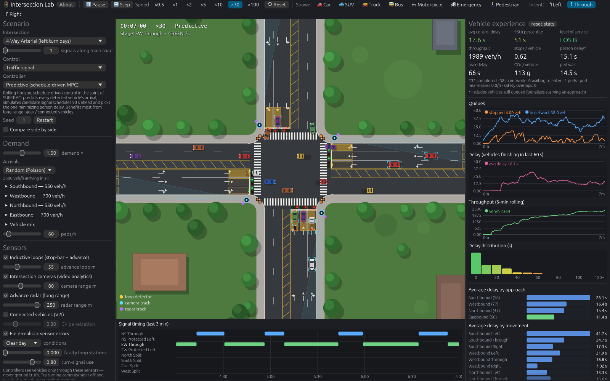
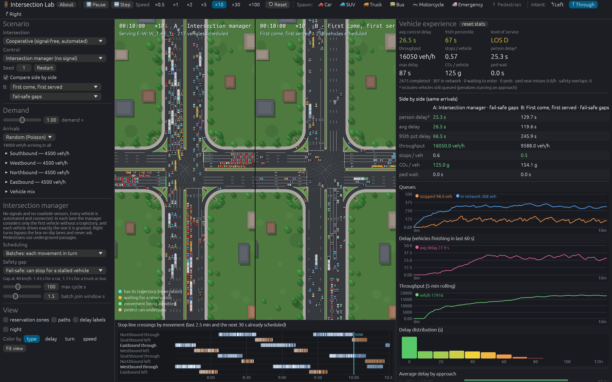
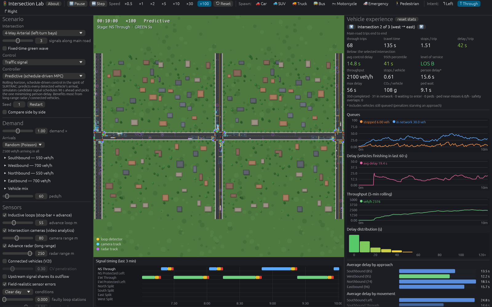
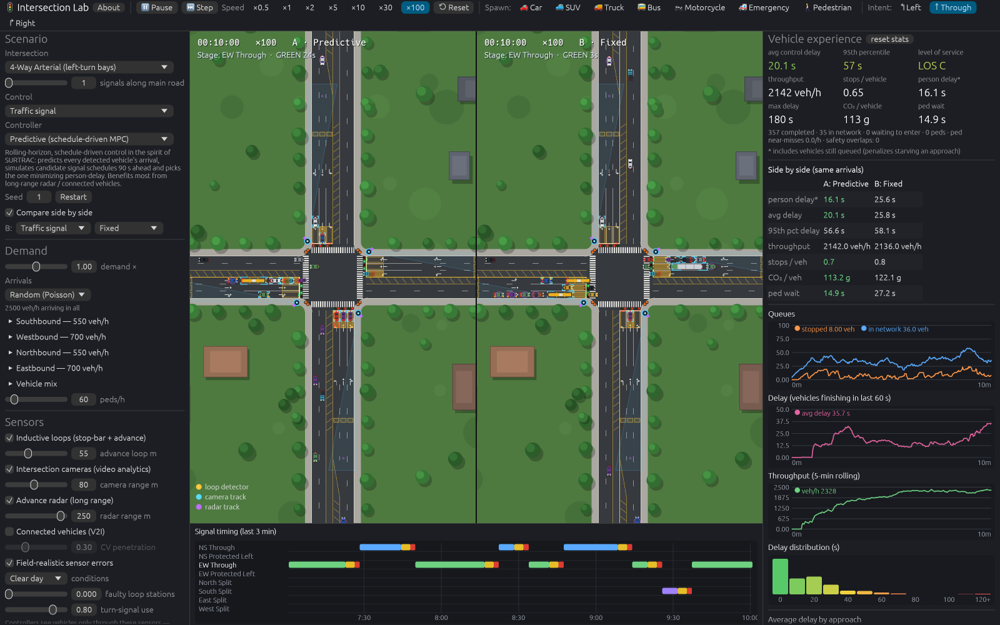

# Intersection Lab

[](https://www.bestpractices.dev/projects/16447)
[](https://scorecard.dev/viewer/?uri=github.com/schreck61/intersection-lab)

A graphically rich, microscopic traffic-intersection simulator in Rust for exploring how
signal control, sensing, pedestrian treatments and AI affect what drivers, transit riders
and pedestrians actually experience, at one intersection or along a corridor. It also
looks ahead to a [signal-free crossing](#the-signal-free-cooperative-crossing) for fully
automated, connected vehicles, to measure how much such a crossing could carry and why
its vehicles should still take turns in batches rather than weave through one another.

**[Try it in your browser](https://schreck61.github.io/intersection-lab/)**, no install
needed, or download it for your desktop below.



## Install

Download the package for your platform from the
[Releases](https://github.com/schreck61/intersection-lab/releases) page: a universal DMG
for macOS, an MSI (or portable zip) for Windows on x64 and ARM64, and `.deb`, `.rpm` or
`.tar.gz` for Linux on x86_64 and aarch64. All are built and signed by GitHub Actions; see
[packaging/README.md](packaging/README.md) for how releases are made and verified.

## Build from source

```bash
cargo run --release                               # the interactive app
cargo run --release --bin bench                   # headless controller comparison (all layouts)
cargo run --release --bin bench sensors all       # sensor study: packages, weather, failed loops
cargo run --release --bin train all 800 900 dqn   # train the Deep-RL agents (writes weights/)
cargo run --release --bin train all 800 900 hybrid  # train the hybrid agents (writes weights/)
cargo run --release --example corridor            # corridor study (green wave, adaptive, upstream link)
cargo run --release --example lpi                 # pedestrian safety treatments
cargo run --release --example fya                 # left-turn phasing modes
cargo run --release --example satflow             # calibration against HCM saturation flow
cargo run --release --example cooperative         # capacity of the signal-free cooperative crossing
cargo test --release                              # safety + throughput regression tests
```

The browser version is the same app compiled to WebAssembly. Build and serve it locally
with [Trunk](https://trunk-rs.github.io/trunk/) (`rustup target add wasm32-unknown-unknown`
first); GitHub Actions publishes it to GitHub Pages from `main`
([`.github/workflows/pages.yml`](.github/workflows/pages.yml)):

```bash
trunk serve --release --open                      # http://127.0.0.1:8080
```

In the browser, benchmarks run one strategy at a time instead of in parallel, and trained
weights can't be saved; everything else matches the desktop app.

## What you can do in the app

* **Intersections:** 4-way arterial with left-turn bays, 4-way major/minor, 4-way
  single-lane town intersection, T-junction, single-lane roundabout, and a signal-free
  **cooperative crossing** for automated, connected vehicles.
* **Corridors:** set *signals along main road* (1–5). Intersections sit one block (420 m)
  apart; traffic flows between them, queues spill back, and fixed-time signals can run a
  coordinated **green wave**. The panels show end-to-end trip time and stops, plus any
  single intersection (◀ ▶ or click a vehicle).
* **Side by side:** *Compare side by side* runs a second copy with identical arrivals under
  another strategy (B), in a split view with an A/B table. On the cooperative crossing, B
  is another schedule or safety gap; by default it weaves vehicles through first come,
  first served.
* **Control:** traffic signal (6 controllers, hot-swappable while traffic runs), all-way
  stop, two-way stop, roundabout yield, and on the cooperative crossing an intersection
  manager that schedules every vehicle (no signals, no sensors), in batches or first come,
  first served.
* **Demand:** per-approach volume and turning shares, global multiplier, vehicle mix,
  pedestrian volume, and arrival pattern (Poisson, platoons, rush-hour peak, surges).
* **Spawn by hand:** pick a vehicle type and intent (left/through/right), then click an
  approach; pick *Pedestrian* and click a crosswalk corner.
* **Sensors:** loops, cameras, advance radar, connected vehicles, and in a corridor an
  upstream link. *Field-realistic sensor errors* (on by default) adds weather and lighting
  conditions, failed loop stations and turn-signal use.
* **Operations:** emergency preemption, right turn on red, a "no turn on red while
  pedestrians are present" blank-out sign, leading pedestrian interval, left-turn phasing
  (flashing yellow arrow / protected only / automatic), and a max-wait guard.
* **Inspect and measure:** click a vehicle for its speed, delay, stops, fuel, detecting
  sensor and who it yields to. KPIs, live charts, delay histogram, breakdowns by approach,
  movement and class, signal timing diagram, controller "brain", pedestrian near-misses.
* **Benchmark:** *Compare controllers* and *Sensor study* run every option headless on
  identical arrivals and chart the results. On the cooperative crossing, *Compare
  schedules* runs batches under each of its three safety gaps, and first come, first
  served under fail-safe gaps.

Keyboard: `Space` pauses. Mouse wheel zooms, drag pans.

## How the simulation works

| Piece | Model |
|---|---|
| Car following | Intelligent Driver Model, per-class parameters, desired-speed spread, 0.6–1.2 s driver reaction when pulling away from a stop |
| Calibration | A saturated through lane of cars discharges at **1,863 veh/h/ln** with **2.2 s** start-up lost time (HCM base: 1,900 and ~2 s); the default mix (8% heavy vehicles) gives 1,698, in line with HCM's heavy-vehicle factor (`examples/satflow.rs`) |
| Yellow | Dilemma-zone behavior: drivers under ~2 s from the line (or facing hard braking) continue; the all-red covers them |
| Turning speed | Curvature of each connector → comfortable lateral acceleration |
| Lanes | Left-turn bays are 75 m storage lanes carved out of the median; left-turners arrive in the next lane and merge in, and wait behind the bay queue when it is full (bay spillback). Discretionary lane changes use **MOBIL** (safety criterion + politeness-weighted incentive), never across the solid line in the last 25 m |
| Right of way | Paths are intersected into **conflict points** with measured zones. Vehicles compare priority (signal, stop order, circulating vs entering) and predicted occupancy windows, accept gaps for the whole maneuver, and **commit** once they can't stop. A commitment grants priority, not room: committed vehicles still stop for anyone stalled in the zone, and a vehicle waiting inside a zone holds it. Wait-for cycles are broken by ignoring vehicles that are themselves waiting, and gridlock is avoided by never pulling into a crossing behind a vehicle that is still creeping up to where it will wait, and by not waiting inside the box across a path whose traffic is only held by a red light. If two vehicles commit to a crossing in the same instant, the one that can still stop yields; followers keep seeing a long vehicle that turns off until its tail clears the split |
| Corridors | Vehicles leaving an intersection enter the next one's approach; when it is full they wait on the exit road, and drivers don't enter the box without room to clear it |
| Signals | Stage-based state machine with yellow and all-red, pedestrian WALK + flashing DON'T WALK, min green stretched for pedestrians, right turn on red, optional LPI |
| Pedestrians | Push-button calls, walk in compatible stages, vehicles yield; at unsignalized crosswalks they assert right of way to vehicles that can stop comfortably |
| Stats | Control delay = travel time − free-flow time on the vehicle's own route; person delay weights by occupancy |
| Safety | Separating-axis overlap test between segmented vehicle bodies, in the intersection and within lanes. `tests/safety.rs` and `examples/sweep.rs` require zero overlaps, and `tests/safety.rs` replays busy seeds that used to gridlock |

Arrivals come from a dedicated random stream, so every controller faces the *same* vehicles.

## Signal controllers

All controllers see only the `SensorView`, never ground truth.

1. **Fixed-time (Webster).** Cycle and splits from critical flow ratios of historical
   demand; every green covers its pedestrian interval. In a corridor it can be
   **coordinated**: common cycle, main-road stage first, spare time to it, offsets chosen to
   maximize the two-way green band, force-offs, no late walk.
2. **Actuated (NEMA-style).** Min green, passage-time extension, gap-out/max-out, phase
   skipping, transit-priority extension. Detector stations flagged faulty go on max recall.
3. **Max-Pressure (Varaiya 2013).** Serve the stage with the largest upstream-minus-downstream
   queue pressure.
4. **Predictive, schedule-driven MPC (in the spirit of SURTRAC).** Every second, predicts
   each detected vehicle's arrival, simulates candidate schedules over 90 s, and minimizes
   person delay with a fairness penalty on long waits.
5. **AI: Deep RL (Double DQN).** A pure-Rust MLP with one hidden layer chooses the next
   stage from per-movement queues, predicted arrivals, waits, bus presence, stage and
   pedestrians, under a safety shield (max green, no holding or switching to empty
   stages, a walk for any pedestrian who has waited 40 s).
6. **AI: Hybrid (RL-tuned predictive).** The predictive planner makes every signal decision;
   a DQN re-tunes it every 10 s (fairness weight, hold/switch bias, max green: 48 tunings).
   Training first searches for the layout's best *static* tuning, which becomes the fallback
   and the bar to clear; the network is kept only where it beats that bar.

Safety layers sit on top of every controller: emergency **preemption** (emergency-vehicle
delay 22.1 s → 4.0 s, `examples/preempt.rs`) and a **max-wait guard**.

## Sensors and their failure modes

| Sensor | What controllers get | Realistic errors |
|---|---|---|
| Inductive loops | Stop-bar presence, advance pulses, spot speed, input-output queue estimate | Stations fail stuck-on/off; motorcycles missed ~35%. Diagnostics (max presence 3 min; no activity for 10 expected headways) flag failures, and the lane falls back to volume-based estimates / recall |
| Intersection camera | Tracks within range with intent, class and individual waits; waiting pedestrians | Detection falls with distance and weather (night, rain, fog, snow shrink range and hit rate); trucks and buses hide vehicles behind them; intent only from drivers who signal (80%), others look like through traffic |
| Advance radar | Long-range position and speed | ±1.5 m / ±0.5 m/s noise, small miss rate in rain/snow |
| Connected vehicles | Position, speed, route, class at any distance | GPS noise (latency compensated by timestamps) |
| Upstream link (corridor) | Vehicles the upstream signal has released toward us | Intent unknown |

## The signal-free cooperative crossing

The last intersection is a look at a possible future rather than at today's streets. It
assumes every vehicle is automated, connected and fitted with crash avoidance. It has no
signals and no roadside sensors, and pedestrians cross in underpasses, so they never
stop traffic. Each vehicle asks an **intersection manager** for a slot when it enters
the map; the manager answers with a complete trajectory, and the vehicle drives exactly
that.

The design notes in
[docs/cooperative-intersections.md](docs/cooperative-intersections.md) work through the
idea from first principles: what limits a conflict zone, what vehicles and the manager
would need to share, how to schedule for throughput, a reference design for a large
crossing, the safety case, security and privacy, mixed traffic, and the wider
ramifications. Their last section compares the estimates with what this simulator
measured.

| Piece | Design |
|---|---|
| Geometry | Each approach has two left-turn lanes, three through lanes and a right-turn slip lane around a corner island, so right turns never enter the box. Opposite left turns pass clear of each other and every lane has its own receiving lane: paths in the box only cross, never merge. Default demand: 4,500 veh/h per approach (18,000 in all), 20% turning left and 15% right |
| Reservations | Each pair of crossing paths has a conflict zone on each path. The manager builds every trajectory with the simulator's own integrator, so it knows when each vehicle will be in each zone, and grants it only if it keeps the required gap to every trajectory already granted. A granted trajectory never changes |
| Phases | By default the manager serves each movement in batches, in two rings with a barrier like an actuated signal, ending a batch when no vehicle can continue it (gap-out) or at its demand-weighted share of a 100 s maximum cycle (max-out). Left turns lag the through movements: a left turn can follow the opposing through traffic almost at once (0.3 s), while the reverse switch would cost about 6 s. The next batch starts as soon as its zones are free, with no yellow or all-red. Emergency vehicles are served out of turn |
| First come, first served | The alternative schedule has no phases: in order of arrival, each vehicle gets the earliest trajectory that fits around those already granted. It is the familiar picture of vehicles weaving through one another, and it carries about half as much (below) |
| Safety gaps | *Fail-safe* (default): enough time for a follower to stop short of the zone if the vehicle ahead stalls in it: two message latencies, the actuation delay, and the time its braking distance takes at crossing speed (1.43 s for a car at 40 km/h). *Mitigated*: it could still slow to 25 km/h. *Nominal*: message latency only |
| Monitors | Independently of the plans, the simulator measures what vehicles actually did: the closest post-encroachment time (PET), zones entered while occupied, box entries without a reservation, and any step off the granted trajectory |

### Why weaving one at a time carries less

The popular picture of automated vehicles at an intersection is a zipper: each vehicle
adjusts its speed on the approach and slips through a gap in the crossing traffic, and
nobody ever stops. Scheduled that way, first come, first served, the crossing does
better only in light traffic, and it saturates at about half the demand that batches
carry. Average delay with fail-safe gaps, the default vehicle mix and the same arrivals
for both (3 seeds × 20 min):

| Demand (veh/h) | First come, first served | Batches |
|---|---|---|
| 2,000 | **0.4 s** | 0.6 s |
| 4,000 | **1.2 s** | 1.8 s |
| 6,000 | 3.1 s | 3.0 s |
| 8,000 | 7.4 s | **5.1 s** |
| 10,000 | 21.8 s | **7.7 s** |
| 12,000 | 102 s, queue growing | **12.5 s** |
| 14,000 | 186 s, queue growing | **17.0 s** |
| 18,000 (design) | 293 s, queue growing | **28.6 s** |
| Capacity | about 10,100 | **about 19,000** |

Three things cost the zipper its throughput:

* **Every switch pays a safety gap; a follower doesn't.** A vehicle following another on
  the same path needs only its car-following gap, about 1.0 s at 40 km/h. A vehicle
  crossing behind one from a conflicting path must wait for the first to clear the
  zone, about 0.7 s, and then for the fail-safe gap, 1.43 s for a car: about 2.2 s in
  all. Served one vehicle at a time, alternating between two paths, a single conflict
  zone carries about 1,700 veh/h; in batches of 8 it carries about 3,100.
* **Each path crosses ten other lanes.** A weaving vehicle needs a free window at every
  one of them, at times its speed fixes. Fitting it into the first set of windows that
  works leaves slivers of time at the other zones, too short for anyone else.
* **One vehicle waiting holds up its lane.** Vehicles can't pass each other in a lane,
  so a vehicle whose windows don't line up delays everyone behind it, while a batch
  keeps every lane of a movement streaming together.

Shorter gaps help the zipper more than batches, since they make switching cheap. With
nominal gaps (message latency only) first come, first served reaches about 12,600 veh/h,
25% more, while batches gain only 3.5%, to 19,700; the zipper still carries about a
third less. So the schedule that carries the most looks like a signal without its yellow
and all-red: each movement goes in a batch, and the next starts the moment its zones are
free. To watch the difference, pick the cooperative crossing and turn on *Compare side
by side*: B weaves the same arrivals through first come, first served, slows its
vehicles far out on the approaches and, at the design demand, soon has a queue waiting
to enter the map.



## Results

All tables: 20-minute runs after a 5-minute warm-up, realistic sensors (loops + camera +
radar), default demand. **Person delay\*** counts every vehicle that arrived, including
those still queued, so a policy can't look good by starving an approach. Lower is better.

### Controllers (`bench all 20 6`, 6 seeds)

| Person delay\* (s) | Arterial | Major/minor | Town | T-junction |
|---|---|---|---|---|
| Fixed-time (Webster) | 30.5 | 38.1 | 28.1 | 21.2 |
| Actuated (NEMA) | 37.5 | 57.5 | 26.5 | 18.3 |
| Max-Pressure | 20.4 | 23.2 | 30.2 | 15.8 |
| Predictive MPC | 16.9 | 25.4 | 21.8 | 14.8 |
| Deep RL | 21.3 | 26.0 | 29.0 | **12.3** |
| **Hybrid (RL-tuned predictive)** | **16.8** | **21.5** | **21.6** | 13.7 |
| All-way stop | 142.2 | 103.9 | 60.8 | 28.5 |
| Two-way stop | — | 157.6 | — | 41.9 |
| Roundabout | 16.2 | | | |

Zero vehicle overlaps in every run.

Training rewards every person's delay: people in vehicles on the road, in vehicles held
at the edge of the map, and pedestrians waiting to cross. Episodes vary demand, weather
and failed loop detectors. Checkpoints are chosen on 16 validation scenarios (design
demand, 0.8× and 1.2× traffic, randomized demand, bad weather, a quarter of the loops
failed), and a checkpoint is accepted only if its pedestrian waits stay within 5 s of the
predictive controller's. The chosen weights are then scored on 24 test scenarios of the
same kinds that no choice ever uses.

Both networks have one hidden layer of 128 units and were trained this way for 800
episodes. For Deep RL, one hidden layer beat two on every layout, by 1.8 to 4.5 s on
held-out scenarios; for the hybrid, one and two did the same within noise. Held-out test
set, person delay / pedestrian wait (s):

| | Predictive | Best static tuning | Hybrid | Deep RL |
|---|---|---|---|---|
| Arterial | 18.2 / 13.2 | 17.7 / 12.9 | **17.5 / 12.2** (network kept) | 19.7 / 18.5 |
| Major/minor | 22.4 / 11.8 | **21.1 / 10.1** | **21.1 / 10.1** (static tuning) | 23.0 / 16.3 |
| Town | 25.6 / 9.5 | 25.8 / 9.6 | **24.3 / 8.6** (network kept) | 27.1 / 11.1 |
| T-junction | 14.4 / 21.3 | 14.0 / 20.8 | 14.0 / 20.8 (static tuning) | **12.9 / 19.9** |

Counting each waiting pedestrian like one vehicle occupant wasn't enough to protect
pedestrians, who are a small share of the people at an intersection: Deep RL trained that
way found a checkpoint that passed the pedestrian check in only 2 of 9 runs on the
arterial, major/minor and T-junction layouts. So Deep RL's safety shield now also gives
the next walk to any pedestrian who has waited 40 s. With that rule every run passed,
and the check never had to reject a checkpoint.

The rule costs people in vehicles little, and on most layouts it helps them. Deep RL
trained three ways, held-out test set, mean of three training seeds, person delay /
pedestrian wait (s):

| | 0.3.0 | New training, no rule | New training + 40 s rule | Predictive |
|---|---|---|---|---|
| Arterial | 19.9 / 21.5 | 21.7 / 25.1 | 20.3 / 17.7 | 18.2 / 13.2 |
| Major/minor | 25.5 / 28.3 | 24.8 / 27.7 | 23.4 / 16.0 | 22.4 / 11.8 |
| Town | 27.3 / 14.8 | 28.7 / 11.8 | 26.7 / 10.7 | 25.6 / 9.6 |
| T-junction | 12.0 / 45.6 | 11.5 / 36.8 | 12.6 / 19.7 | 14.4 / 21.3 |

With everything else the same, the rule cut person delay by 1.4 to 2.0 s on the
four-way layouts as well as shortening pedestrian waits; only on the T-junction did it
cost 1.1 s. Against 0.3.0, person delay is within 0.6 s on three layouts and 2.1 s lower
on major/minor, and pedestrian waits are 4 to 26 s shorter. A single network's benchmark
score can mislead here: Deep RL networks trained from different seeds differ by 1 to 3 s.

### Sensors (`bench sensors all 20 4`)

Arterial, person delay\* (s):

| | loops | + camera | + radar | + 30% CV | 100% CV only | ideal sensors |
|---|---|---|---|---|---|---|
| Max-Pressure | 21.2 | 21.5 | 21.2 | 21.5 | 20.9 | 20.5 |
| Predictive | 20.5 | 17.5 | 17.3 | 17.5 | 17.3 | 18.0 |
| Hybrid | 20.9 | 19.0 | 17.3 | 18.1 | 17.9 | 18.9 |
| Deep RL | 30.3 | 21.0 | 21.8 | 21.7 | 21.6 | 21.5 |

Weather and failed loops (loops + camera + radar unless noted), predictive control:

| | Clear | Night | Rain | Fog | Snow | loops only, 25% failed |
|---|---|---|---|---|---|---|
| Arterial | 17.3 | 18.1 | 17.8 | 18.4 | 17.1 | 23.3 |
| Major/minor | 26.3 | 27.2 | 24.2 | 29.2 | 27.1 | 31.4 |
| Town | 23.1 | 29.5 | 26.3 | 22.8 | 29.6 | 45.3 |

### Corridor (`examples/corridor.rs`, 8 seeds)

| 3 × arterial | Person delay\* | Through-trip time | Stops / trip |
|---|---|---|---|
| Fixed (isolated Webster) | 30.8 | 199 s | 2.24 |
| Fixed (coordinated green wave) | 26.7 | 166 s | 1.92 |
| Actuated | 37.2 | 211 s | 2.15 |
| Max-Pressure | 19.5 | 144 s | 1.79 |
| Predictive | **17.8** | **137 s** | **1.51** |
| Predictive + upstream link | 17.9 | 140 s | 1.55 |
| Hybrid + upstream link | 18.3 | 142 s | 1.63 |
| Deep RL + upstream link | 19.6 | 142 s | 1.52 |

On a 4-signal major/minor corridor the green wave cuts through-trip stops from 3.17 to
**1.44** (time 249 s → 193 s). Predictive control is best overall (15.1 s); the upstream
link *hurts* there (16.4 s). On the arterial it makes no difference at normal demand and
little at 1.3× (36.4 → 35.5 s).

### Signal-free cooperative crossing (`examples/cooperative.rs`, 3 seeds)

`cooperative p2 2 mix 1200 3 14000,16000,17000,18000,19000,20000,22000`: 20-minute runs
after a 2-minute warm-up, no sensors, default vehicle mix, fail-safe gaps; each figure
is the mean over the runs. "Served" counts vehicles that finished their trip; it trails
the arrivals slightly while the approaches fill after the short warm-up.

| Demand (veh/h) | Arrived | Served | Average delay | 95th percentile | Longest wait | Waiting to enter at the end |
|---|---|---|---|---|---|---|
| 14,000 | 13,958 | 13,848 | 17.0 s | 51 s | 98 s | 0 |
| 16,000 | 16,002 | 15,919 | 24.4 s | 65 s | 116 s | 0 |
| 17,000 | 16,977 | 16,868 | 24.5 s | 62 s | 108 s | 0 |
| **18,000 (design)** | 18,034 | **17,659** | **28.6 s** | 68 s | 143 s | 29 |
| 19,000 | 19,010 | 18,653 | 42.7 s | 94 s | 142 s | 29 |
| 20,000 | 20,017 | 18,913 | 61.3 s | 121 s | 192 s | 223 |
| 22,000 | 21,999 | 19,045 | 106.6 s | 215 s | 273 s | 891 |

Capacity (served at 22,000 veh/h, or 24,000 for an all-car fleet) and the closest
crossing measured. First come, first served serves the most at 14,000–16,000 veh/h of
demand and slightly less as its queues grow (9,834 at 22,000), so its rows give that
peak:

| | Default mix | All cars | Closest crossing (PET) |
|---|---|---|---|
| Batches, fail-safe | 19,045 | 21,660 | 1.19 s |
| Batches, mitigated | 19,386 | | 0.68 s |
| Batches, nominal | 19,702 | 22,329 | 0.50 s |
| Batches, fail-safe, one left-turn lane per approach | about 13,500 | | 1.13 s |
| First come, first served, fail-safe | about 10,100 | about 10,900 | 0.82 s |
| First come, first served, nominal | about 12,600 | | 0.50 s |

Under first come, first served the closest crossings fall below a car's fail-safe gap
at 40 km/h because the gap shrinks with speed, and vehicles that have slowed for their
slot enter the zones slowly.

No run had a zone overlap, a box entry without a reservation or a step off a granted
trajectory. Other arrival patterns at the design demand, 8 seeds each (`cooperative p2 2
mix 1200 8 18000 platoons`): platoons from an upstream signal average 34 s of delay,
against 31 s for random arrivals on the same seeds. Random surges, which average 4% over
the design demand with 2-minute bursts of up to 1.7× on an approach, average 48 s and
leave about 160 vehicles waiting. The rush-hour peak (1.5×, about 27,000 veh/h) is far
beyond capacity.

### Pedestrian treatments (`examples/lpi.rs`, 12 seeds)

Near-misses = vehicles crossing within ~1.5 s of a walking pedestrian, per hour. At 240
pedestrians/h on the arterial: fixed-time 2.3 → **1.2** and predictive 2.3 → **0.8** with LPI
(4 s) + no-turn-on-red-with-pedestrians, for 1–4 s more person delay. LPI alone helps
little (1.8 and 2.5): most conflicts come from right turns on red and from turns later in
the green. On the single-lane town layout neither treatment makes much difference.

### Left-turn phasing (`examples/fya.rs`)

Protected + permissive (flashing yellow arrow) gives the least delay at normal volumes on
the arterial; protected-only costs 20–76% more there. On the major/minor road fixed-time
and actuated control still prefer permissive lefts, but predictive control does better
protected-only (23.5 vs 29.4 s). At 1.3× demand on the major/minor road, fixed-time with
permissive lefts collapses (157 s) as bays fill and spill into the through lane;
protected-only holds at 98 s and *Auto* (volume cross-product) at 121 s.

## What the experiments say

A fuller write-up of every finding, with the commands that reproduce it, is in
[docs/insights.md](docs/insights.md).

* **Model-based adaptive control is the strong default.** Predictive MPC and Max-Pressure
  cut person delay 25–45% against an optimized Webster plan on the multi-lane layouts, and
  cut pedestrian waits by a fifth to a half on the four-way ones.
* **The best use of RL here is tuning a planner, not replacing it.** The hybrid is the best
  or near-best controller on every layout, and it beats predictive control on every
  layout's held-out test set, by 0.4 to 1.3 s. Most of its gain comes from a better
  *static* tuning of the planner, which a one-off search finds. The state-dependent
  network adds 0.2 s on the arterial and 1.5 s on the town layout, and nothing on the other
  two. Pure Deep RL cuts person delay by about 30% against fixed-time on the multi-lane
  layouts and has the lowest delay on the T-junction, but trails the best controller, the
  hybrid, by about 4.5 s on the multi-lane layouts and trails fixed-time and actuated
  control on the single-lane town layout.
* **Pedestrians need a hard rule, not just a share of the reward.** Counting waiting
  pedestrians in Deep RL's reward left their waits long; a 40 s maximum wait in its
  shield fixed that on every layout, and on the three four-way layouts it lowered
  vehicle delay too.
* **Smaller networks learned better for Deep RL.** One hidden layer of 128 units beat two
  on every layout and cut Deep RL's person delay by 10–12 s on the four-way layouts. For
  the hybrid, one and two layers did the same.
* **Coverage matters more than per-sensor accuracy.** With realistic errors, a camera is
  still the most valuable single upgrade (intent and queues; town 47.7 → 22.5 s for
  predictive). Weather costs adaptive control 0–3 s on the multi-lane layouts because radar
  backs up the camera; night and snow cost about 6 s on the single-lane town layout.
  Failed loops matter a lot when loops are the only source. Diagnostics plus a
  volume-based fallback turn a collapse (~200 s) into graceful degradation (23–45 s).
* **Corridors:** a coordinated green wave is worth having for fixed-time signals (stops
  per trip −14% to −55%). Adaptive control beats it without coordination. Naively sharing
  the upstream signal's outflow barely changes the arterial and hurts on the major/minor
  road; real gains need coordinated schedules, not just more lookahead.
* **Pedestrian safety:** LPI plus a no-turn-on-red-with-pedestrians sign cut near-misses
  at busy arterial crosswalks by a half to two-thirds for a small delay cost.
* **Right tool for the job:** with realistic reaction times an all-way stop is only
  competitive at low volumes (town at 0.6×: 15.0 s vs 10.5 s actuated), the roundabout is
  excellent at moderate volumes, and a two-way stop fails once the major road is busy.
* **Signal-free crossings still need phases.** With every vehicle automated, an
  intersection manager carries the design demand of 18,000 veh/h at 29 s average delay
  and saturates near 19,000 veh/h with fail-safe gaps (19,700 with latency-only gaps,
  about 21,700 if every vehicle were a car). The capacity comes from serving each
  movement in batches, like a signal without its yellow and all-red, not from weaving
  vehicles through one at a time: every switch between conflicting movements costs a
  clearance gap, and a weaving vehicle must find one in up to ten crossing lanes at
  once. Served first come, first served, the same crossing saturates near 10,100 veh/h;
  the zipper wins only below about 6,000 veh/h. The second left-turn lane on each
  approach is worth about 5,500 veh/h.

## Repository layout

```
src/sim/        geometry, IDM + MOBIL vehicles, right of way, signals, sensors, demand, stats
src/sim/coop.rs   intersection manager for the signal-free cooperative crossing
src/sim/world.rs  worlds of one or more intersections (corridors, coordination)
src/control/    fixed, actuated, max-pressure, predictive MPC, deep-RL and hybrid controllers
src/rl/         MLP + Adam, Double DQN with replay
src/gui/        eframe/egui app: renderer, charts, panels, self-screenshot (TS_SHOT=…)
src/bin/        bench (comparisons, sensor study), train (RL training)
weights/        trained DQN and hybrid weights per layout
tests/          safety + throughput regression tests
examples/       corridor, lpi, fya, satflow, preempt, sweep (multi-seed safety sweep), cooperative
docs/           insights.md (every finding), cooperative-intersections.md (design notes for the
                signal-free crossing, with the scripts behind its estimates and figures), screenshots
```

## Notes and limitations

* Corridors run along the east-west road only; side streets end at their own block.
* The cooperative crossing is a single intersection. It assumes every vehicle is
  automated and connected, and it does not model human drivers, lost messages, a failed
  manager or a vehicle that stalls in the box (the fail-safe gap is sized for one, but
  none is ever injected).
* The upstream link shares released vehicles only; it does not coordinate schedules
  between intersections the way SURTRAC does.
* Drivers are well-behaved: no red-light running, distraction or crashes, so safety is
  measured with surrogates (overlaps, near-misses).
* Training is fast because the simulation runs thousands of times faster than real time
  per core: `RESUME=1 cargo run --release --bin train all 300 900 hybrid` fine-tunes the
  shipped weights.





## Contributing

Bug reports, realism fixes and new experiments are welcome; see
[CONTRIBUTING.md](CONTRIBUTING.md) and the [Code of Conduct](CODE_OF_CONDUCT.md). Please
report security vulnerabilities privately, as described in [SECURITY.md](SECURITY.md).
[ACCESSIBILITY.md](ACCESSIBILITY.md) describes what works with assistive technology,
the known barriers, and how to report one.

## License

Copyright (c) 2026 Jim Schreckengast.

Licensed under either of [Apache License, Version 2.0](LICENSE-APACHE) or
[MIT license](LICENSE-MIT) at your option; [LICENSES/](LICENSES) has the same texts
under their SPDX names. Third-party components and their licenses
are listed in [THIRD_PARTY_LICENSES.md](THIRD_PARTY_LICENSES.md) and ship with every
binary package.

Unless you explicitly state otherwise, any contribution intentionally submitted for
inclusion in this project by you, as defined in the Apache-2.0 license, shall be dual
licensed as above, without any additional terms or conditions.
