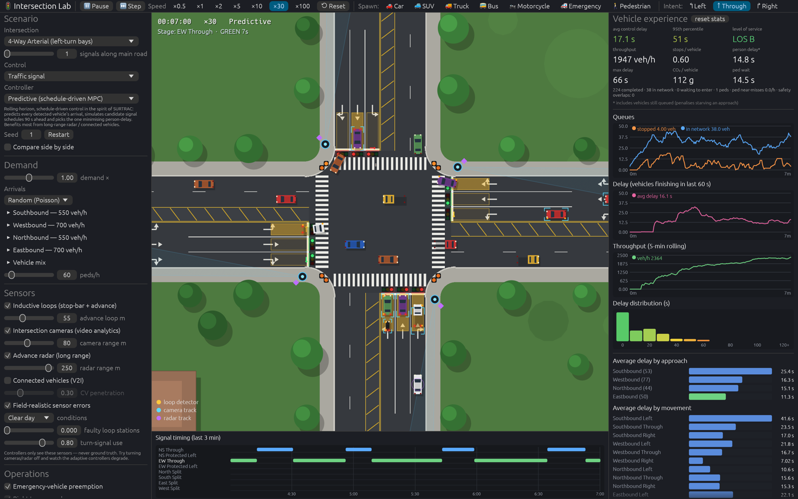
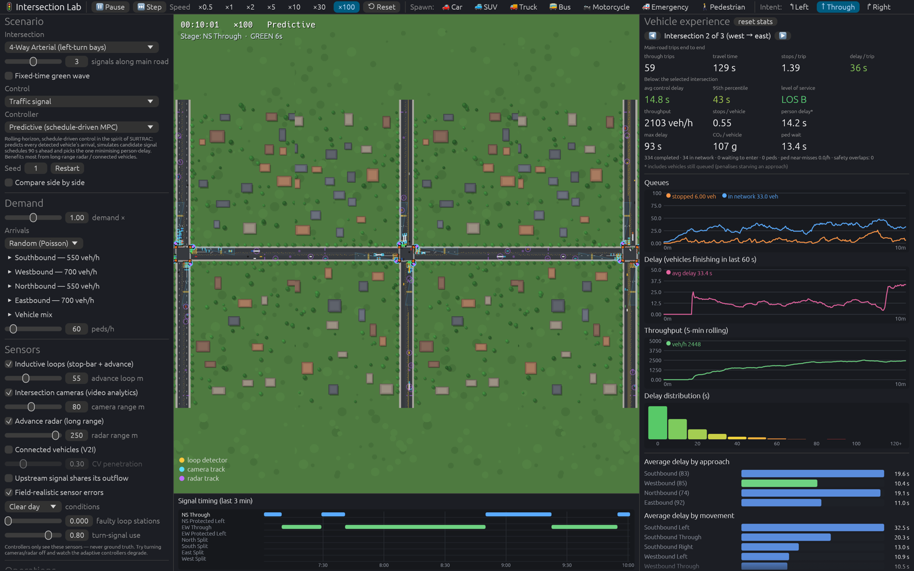
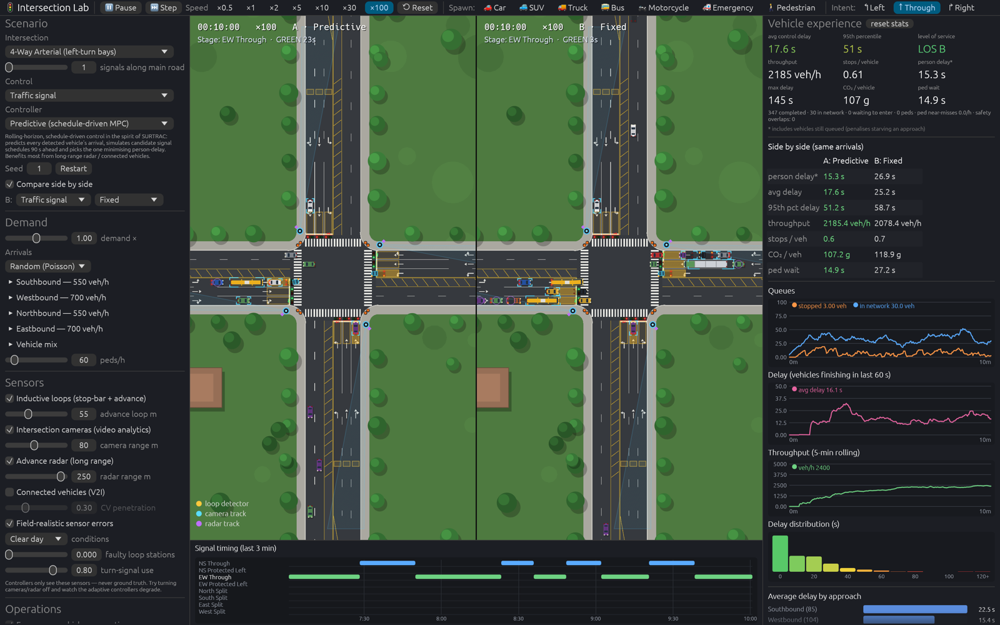

# Intersection Lab

A graphically rich, microscopic traffic-intersection simulator in Rust for exploring how
signal control, sensing, pedestrian treatments and AI affect what drivers, transit riders
and pedestrians actually experience, at one intersection or along a corridor.



```bash
cargo run --release                               # the interactive app
cargo run --release --bin bench                   # headless controller comparison (all layouts)
cargo run --release --bin bench sensors all       # sensor study: packages, weather, failed loops
cargo run --release --bin train all 400 900 both  # train the Deep-RL and hybrid agents (writes weights/)
cargo run --release --example corridor            # corridor study (green wave, adaptive, upstream link)
cargo run --release --example lpi                 # pedestrian safety treatments
cargo run --release --example fya                 # left-turn phasing modes
cargo run --release --example satflow             # calibration against HCM saturation flow
cargo test --release                              # safety + throughput regression tests
```

## What you can do in the app

* **Intersections:** 4-way arterial with left-turn bays, 4-way major/minor, 4-way
  single-lane town intersection, T-junction, single-lane roundabout.
* **Corridors:** set *signals along main road* (1–5). Intersections sit one block (420 m)
  apart; traffic flows between them, queues spill back, and fixed-time signals can run a
  coordinated **green wave**. The panels show end-to-end trip time and stops, plus any
  single intersection (◀ ▶ or click a vehicle).
* **Side by side:** *Compare side by side* runs a second copy with identical arrivals under
  another strategy (B), in a split view with an A/B table.
* **Control:** traffic signal (6 controllers, hot-swappable while traffic runs), all-way
  stop, two-way stop, roundabout yield.
* **Demand:** per-approach volume and turning shares, global multiplier, vehicle mix,
  pedestrian volume, and arrival pattern (Poisson, platoons, rush-hour peak, surges).
* **Spawn by hand:** pick a vehicle type and intent (left/through/right), then click an
  approach; pick *Pedestrian* and click a crosswalk corner.
* **Sensors:** loops, cameras, advance radar, connected vehicles, and in a corridor an
  upstream link. *Field-realistic sensor errors* (on by default) adds weather and lighting
  conditions, failed loop stations and turn-signal use.
* **Operations:** emergency preemption, right turn on red, a "no turn on red while
  pedestrians are present" blank-out sign, leading pedestrian interval, left-turn phasing
  (flashing yellow arrow / protected only / automatic), and a max-wait guard.
* **Inspect and measure:** click a vehicle for its speed, delay, stops, fuel, detecting
  sensor and who it yields to. KPIs, live charts, delay histogram, breakdowns by approach,
  movement and class, signal timing diagram, controller "brain", pedestrian near-misses.
* **Benchmark:** *Compare controllers* and *Sensor study* run every option headless on
  identical arrivals and chart the results.

Keyboard: `Space` pauses. Mouse wheel zooms, drag pans.

## How the simulation works

| Piece | Model |
|---|---|
| Car following | Intelligent Driver Model, per-class parameters, desired-speed spread, 0.6–1.2 s driver reaction when pulling away from a stop |
| Calibration | A saturated through lane of cars discharges at **1,863 veh/h/ln** with **2.2 s** start-up lost time (HCM base: 1,900 and ~2 s); the default mix (8% heavy vehicles) gives 1,698, in line with HCM's heavy-vehicle factor (`examples/satflow.rs`) |
| Yellow | Dilemma-zone behaviour: drivers under ~2 s from the line (or facing hard braking) continue; the all-red covers them |
| Turning speed | Curvature of each connector → comfortable lateral acceleration |
| Lanes | Left-turn bays are 75 m storage lanes carved out of the median; left-turners arrive in the next lane and merge in, and wait behind the bay queue when it is full (bay spillback). Discretionary lane changes use **MOBIL** (safety criterion + politeness-weighted incentive), never across the solid line in the last 25 m |
| Right of way | Paths are intersected into **conflict points** with measured zones. Vehicles compare priority (signal, stop order, circulating vs entering) and predicted occupancy windows, accept gaps for the whole manoeuvre, and **commit** once they can't stop. A commitment grants priority, not room: committed vehicles still stop for anyone stalled in the zone, and a vehicle waiting inside a zone holds it. Wait-for cycles are broken by ignoring vehicles that are themselves waiting |
| Corridors | Vehicles leaving an intersection enter the next one's approach; when it is full they wait on the exit road, and drivers don't enter the box without room to clear it |
| Signals | Stage-based state machine with yellow and all-red, pedestrian WALK + flashing DON'T WALK, min green stretched for pedestrians, right turn on red, optional LPI |
| Pedestrians | Push-button calls, walk in compatible stages, vehicles yield; at unsignalised crosswalks they assert right of way to vehicles that can stop comfortably |
| Stats | Control delay = travel time − free-flow time on the vehicle's own route; person delay weights by occupancy |
| Safety | Separating-axis overlap test between segmented vehicle bodies, in the intersection and within lanes. `tests/safety.rs` and `examples/sweep.rs` require zero overlaps |

Arrivals come from a dedicated random stream, so every controller faces the *same* vehicles.

## Signal controllers

All controllers see only the `SensorView`, never ground truth.

1. **Fixed-time (Webster).** Cycle and splits from critical flow ratios of historical
   demand; every green covers its pedestrian interval. In a corridor it can be
   **coordinated**: common cycle, main-road stage first, spare time to it, offsets chosen to
   maximise the two-way green band, force-offs, no late walk.
2. **Actuated (NEMA-style).** Min green, passage-time extension, gap-out/max-out, phase
   skipping, transit-priority extension. Detector stations flagged faulty go on max recall.
3. **Max-Pressure (Varaiya 2013).** Serve the stage with the largest upstream-minus-downstream
   queue pressure.
4. **Predictive, schedule-driven MPC (in the spirit of SURTRAC).** Every second, predicts
   each detected vehicle's arrival, simulates candidate schedules over 90 s, and minimises
   person delay with a fairness penalty on long waits.
5. **AI: Deep RL (Double DQN).** A pure-Rust MLP chooses the next stage from per-movement
   queues, predicted arrivals, waits, bus presence, stage and pedestrians, under a safety
   shield (max green, no holding or switching to empty stages).
6. **AI: Hybrid (RL-tuned predictive).** The predictive planner makes every signal decision;
   a DQN re-tunes it every 10 s (fairness weight, hold/switch bias, max green: 48 tunings).
   Training first searches for the layout's best *static* tuning, which becomes the fallback
   and the bar to clear; the network is kept only where it beats that bar.

Safety layers sit on top of every controller: emergency **preemption** (emergency-vehicle
delay 22.5 s → 4.0 s, `examples/preempt.rs`) and a **max-wait guard**.

## Sensors and their failure modes

| Sensor | What controllers get | Realistic errors |
|---|---|---|
| Inductive loops | Stop-bar presence, advance pulses, spot speed, input-output queue estimate | Stations fail stuck-on/off; motorcycles missed ~35%. Diagnostics (max presence 3 min; no activity for 10 expected headways) flag failures, and the lane falls back to volume-based estimates / recall |
| Intersection camera | Tracks within range with intent, class and individual waits; waiting pedestrians | Detection falls with distance and weather (night, rain, fog, snow shrink range and hit rate); trucks and buses hide vehicles behind them; intent only from drivers who signal (80%), others look like through traffic |
| Advance radar | Long-range position and speed | ±1.5 m / ±0.5 m/s noise, small miss rate in rain/snow |
| Connected vehicles | Position, speed, route, class at any distance | GPS noise (latency compensated by timestamps) |
| Upstream link (corridor) | Vehicles the upstream signal has released toward us | Intent unknown |

## Results

All tables: 20-minute runs after a 5-minute warm-up, realistic sensors (loops + camera +
radar), default demand. **Person delay\*** counts every vehicle that arrived, including
those still queued, so a policy can't look good by starving an approach. Lower is better.

### Controllers (`bench all 20 6`, 6 seeds)

| Person delay\* (s) | Arterial | Major/minor | Town | T-junction |
|---|---|---|---|---|
| Fixed-time (Webster) | 30.5 | 37.9 | 28.6 | 21.2 |
| Actuated (NEMA) | 38.4 | 54.2 | 25.5 | 17.9 |
| Max-Pressure | 20.1 | 21.6 | 29.9 | 15.8 |
| Predictive MPC | **16.7** | 25.4 | 23.1 | 14.0 |
| Deep RL | 28.5 | 33.4 | 44.9 | 13.7 † |
| **Hybrid (RL-tuned predictive)** | 17.4 | **19.8** | **22.0** | **13.1** |
| All-way stop | 147.2 | 104.7 | 61.0 | 28.3 |
| Two-way stop | — | 164.4 | — | 57.3 |
| Roundabout | 16.4 | | | |

† Deep RL's low delay on the T-junction comes with 43 s pedestrian waits (others ~22 s).
Zero vehicle overlaps in every run.

Hybrid training (evaluation set, person delay):

| | Predictive (defaults) | Best static tuning | Hybrid |
|---|---|---|---|
| Arterial | 17.9 | 17.2 | **17.0** (network kept) |
| Major/minor | 21.1 | 20.1 | 20.1 (static tuning) |
| Town | 20.9 | 19.7 | 19.7 (static tuning) |
| T-junction | 13.9 | 13.5 | **13.0** (network kept) |

### Sensors (`bench sensors all 20 4`)

Arterial, person delay\* (s):

| | loops | + camera | + radar | + 30% CV | 100% CV only | ideal sensors |
|---|---|---|---|---|---|---|
| Max-Pressure | 20.4 | 20.5 | 21.0 | 20.9 | 19.3 | 20.1 |
| Predictive | 21.6 | 18.1 | 17.2 | 17.8 | 16.2 | 17.5 |
| Hybrid | 21.4 | 18.3 | 18.5 | 20.6 | 17.6 | 18.1 |
| Deep RL | 37.9 | 27.6 | 31.1 | 25.2 | 27.5 | 29.0 |

Weather and failed loops (loops + camera + radar unless noted), predictive control:

| | Clear | Night | Rain | Fog | Snow | loops only, 25% failed |
|---|---|---|---|---|---|---|
| Arterial | 17.2 | 17.5 | 17.5 | 18.8 | 17.3 | 21.6 |
| Major/minor | 26.6 | 27.3 | 23.1 | 26.3 | 24.3 | 31.7 |
| Town | 23.9 | 23.3 | 24.0 | 24.8 | 21.6 | 42.6 |

### Corridor (`examples/corridor.rs`, 8 seeds)

| 3 × arterial | Person delay\* | Through-trip time | Stops / trip |
|---|---|---|---|
| Fixed (isolated Webster) | 30.8 | 197 s | 2.23 |
| Fixed (coordinated green wave) | 26.6 | 166 s | 1.93 |
| Actuated | 35.6 | 209 s | 2.11 |
| Max-Pressure | 19.1 | 143 s | 1.79 |
| Predictive | 17.8 | 141 s | 1.57 |
| Predictive + upstream link | **16.8** | **140 s** | **1.52** |

On a 4-signal major/minor corridor the green wave cuts through-trip stops from 3.19 to
**1.42** (time 249 s → 193 s). Predictive control is best overall (15.5 s); the upstream
link *hurts* there (16.5 s) and at 1.3× demand on the arterial.

### Pedestrian treatments (`examples/lpi.rs`, 12 seeds)

Near-misses = vehicles crossing within ~1.5 s of a walking pedestrian, per hour. At 240
pedestrians/h on the arterial: fixed-time 2.2 → **1.2** and predictive 2.3 → **1.2** with LPI
(4 s) + no-turn-on-red-with-pedestrians, for 1–5 s more person delay. LPI alone removes the
conflicts at the start of green; most of the rest come from right turns on red and from
turns later in the green.

### Left-turn phasing (`examples/fya.rs`)

Protected + permissive (flashing yellow arrow) gives the least delay at normal volumes on
the arterial; protected-only costs 23–76% more there. On the major/minor road the gap is
small (predictive control is even slightly better protected-only, 25.1 vs 27.9 s). At 1.3× demand on the major/minor road, fixed-time with
permissive lefts collapses (168 s) as bays fill and spill into the through lane;
protected-only holds at 89 s and *Auto* (volume cross-product) at 112 s.

## What the experiments say

* **Model-based adaptive control is the strong default.** Predictive MPC and Max-Pressure
  cut person delay 30–45% against an optimised Webster plan on the multi-lane layouts, and
  cut pedestrian waits by a third to a half.
* **The best use of RL here is tuning a planner, not replacing it.** The hybrid is the best
  or near-best controller on every layout. Most of its gain comes from a better *static*
  tuning of the planner, which a one-off search finds. The state-dependent network adds a
  little on two layouts (arterial, T-junction) and nothing on the other two. Pure Deep RL
  beats fixed-time and actuated control on the bigger layouts but not the model-based
  controllers, and stays brittle on the single-lane town layout.
* **Coverage matters more than per-sensor accuracy.** With realistic errors, a camera is
  still the most valuable single upgrade (intent and queues; town 43.6 → 20.3 s for
  predictive). Weather costs adaptive control only 0–2 s because radar backs up the camera.
  Failed loops matter a lot when loops are the only source. Diagnostics plus a
  volume-based fallback turn a collapse (~200 s) into graceful degradation (~40 s).
* **Corridors:** a coordinated green wave is worth having for fixed-time signals (stops
  per trip −13% to −55%). Adaptive control beats it without coordination. Naively sharing
  the upstream signal's outflow helps only on an uncongested arterial; real gains need
  coordinated schedules, not just more lookahead.
* **Pedestrian safety:** LPI plus a no-turn-on-red-with-pedestrians sign roughly halve
  near-misses at busy crosswalks for a small delay cost.
* **Right tool for the job:** with realistic reaction times an all-way stop is only
  competitive at low volumes (town at 0.6×: 15.0 s vs 10.2 s actuated), the roundabout is
  excellent at moderate volumes, and a two-way stop fails once the major road is busy.

## Repository layout

```
src/sim/        geometry, IDM + MOBIL vehicles, right of way, signals, sensors, demand, stats
src/sim/world.rs  worlds of one or more intersections (corridors, coordination)
src/control/    fixed, actuated, max-pressure, predictive MPC, deep-RL and hybrid controllers
src/rl/         MLP + Adam, Double DQN with replay
src/gui/        eframe/egui app: renderer, charts, panels, self-screenshot (TS_SHOT=…)
src/bin/        bench (comparisons, sensor study), train (RL training)
weights/        trained DQN and hybrid weights per layout
tests/          safety + throughput regression tests
examples/       corridor, lpi, fya, satflow, preempt, sweep (multi-seed safety sweep)
```

## Notes and limitations

* Corridors run along the east-west road only; side streets end at their own block.
* The upstream link shares released vehicles only; it does not coordinate schedules
  between intersections the way SURTRAC does.
* Drivers are well-behaved: no red-light running, distraction or crashes, so safety is
  measured with surrogates (overlaps, near-misses).
* Training is fast because the simulation runs thousands of times faster than real time
  per core: `RESUME=1 cargo run --release --bin train all 300 900 hybrid` fine-tunes the
  shipped weights.




