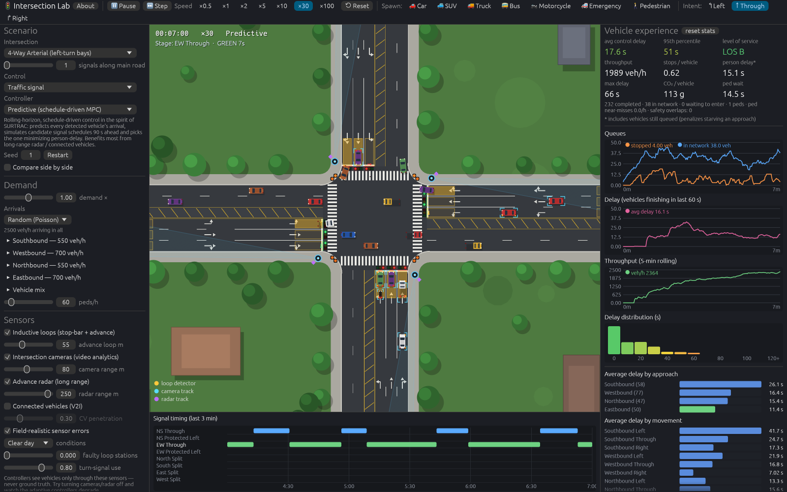
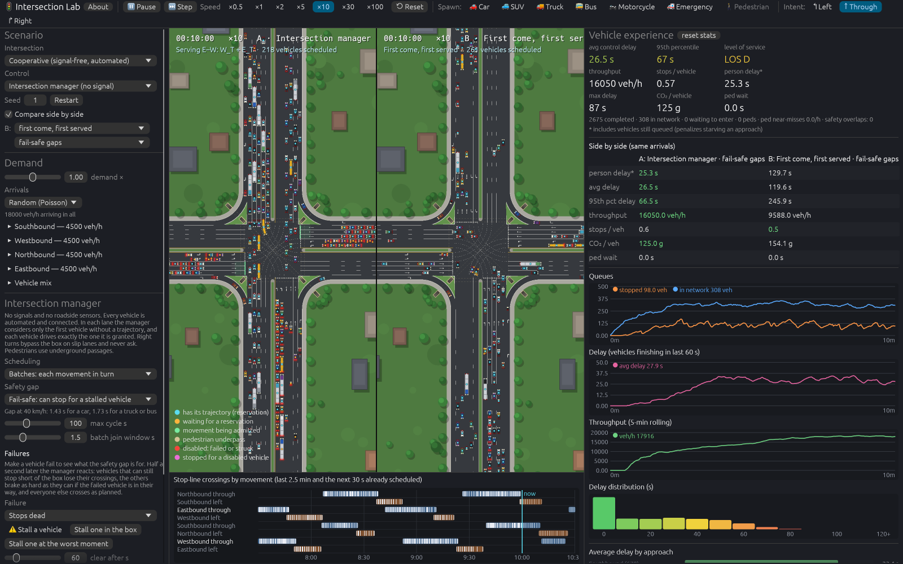
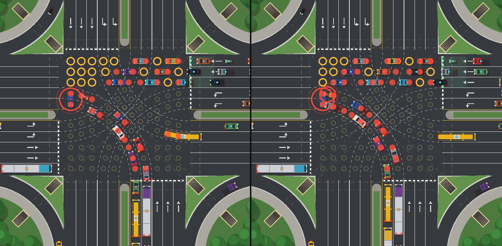
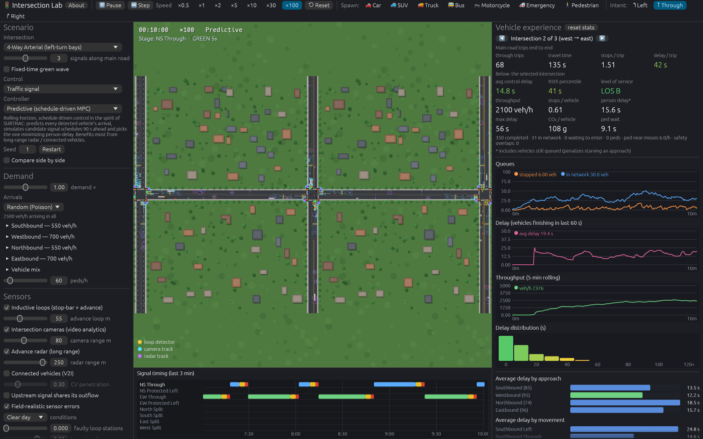
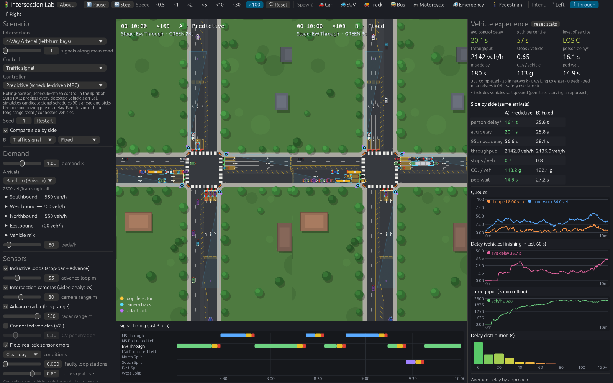

# Intersection Lab

[](https://www.bestpractices.dev/projects/16447)
[](https://scorecard.dev/viewer/?uri=github.com/schreck61/intersection-lab)

A graphically rich, microscopic traffic-intersection simulator in Rust for exploring how
signal control, sensing, pedestrian treatments and AI affect what drivers, transit riders
and pedestrians actually experience, at one intersection or along a corridor. It also
looks ahead to a [signal-free crossing](#the-signal-free-cooperative-crossing) for fully
automated, connected vehicles, to measure how much such a crossing could carry, why its
vehicles should still take turns in batches rather than weave through one another, and
what happens when one of them fails in the middle of it.

**[Try it in your browser](https://schreck61.github.io/intersection-lab/)**, no install
needed, or download it for your desktop below.



## Quick start

1. Open the [browser version](https://schreck61.github.io/intersection-lab/), or
   [install](#install) the app and start it. Traffic starts flowing right away.
2. In the *Scenario* panel on the left, pick an *Intersection* and how it's controlled:
   a *Control* mode and, for traffic signals, a *Controller*. Watch the delay and queue
   charts on the right respond.
3. Under *Benchmark* on the right, press *▶ Compare controllers* to run every option but
   manual control on identical arrivals and chart the results.
4. Click a vehicle to see its speed, delay, stops and who it's yielding to. `Space`
   pauses.

[What you can do in the app](#what-you-can-do-in-the-app) covers the rest.

## Install

Download the package for your platform from the
[Releases](https://github.com/schreck61/intersection-lab/releases) page: a universal DMG
for macOS, an MSI (or portable zip) for Windows on x64 and ARM64, and `.deb`, `.rpm` or
`.tar.gz` for Linux on x86_64 and aarch64. All are built by GitHub Actions and come with a
signed build-provenance attestation, and the macOS app and the Windows executable and
installer are also code-signed; see [packaging/README.md](packaging/README.md) for how
releases are made and verified.

If you have a current Rust toolchain, you can instead build and install it from
[crates.io](https://crates.io/crates/intersection-lab):

```bash
cargo install --locked intersection-lab
```

Run the same command again to update it, and `cargo uninstall intersection-lab` to
remove it.

## Build from source

```bash
cargo run --release                               # the interactive app
cargo run --release --bin bench                   # headless controller comparison (all layouts)
cargo run --release --bin bench sensors all       # sensor study: packages, weather, failed loops
cargo run --release --bin bench all 20 30 --csv runs.csv  # 30 seeds; every run also saved to runs.csv
cargo run --release --bin train all 800 900 dqn   # train the Deep-RL agents (writes weights/)
cargo run --release --bin train all 800 900 hybrid  # train the hybrid agents (writes weights/)
cargo run --release --bin train test all 900 both  # score the weights the app loads (writes nothing)
cargo run --release --example corridor            # corridor study (green wave, adaptive, upstream link)
cargo run --release --example lpi                 # pedestrian safety treatments
cargo run --release --example fya                 # left-turn phasing modes
cargo run --release --example satflow             # calibration against HCM saturation flow
cargo run --release --example cooperative         # capacity of the signal-free cooperative crossing
cargo run --release --example failures            # a vehicle fails there: what each gap survives
cargo test --release                              # regression tests: safety, throughput, app, tools
```

The browser version is the same app compiled to WebAssembly. Build and serve it locally
with [Trunk](https://trunk-rs.github.io/trunk/) (`rustup target add wasm32-unknown-unknown`
first); GitHub Actions publishes it to GitHub Pages from `main`
([`.github/workflows/pages.yml`](.github/workflows/pages.yml)):

```bash
trunk serve --release --open                      # http://127.0.0.1:8080
```

In the browser, benchmarks run one strategy at a time instead of in parallel, and trained
weights can't be saved; everything else matches the desktop app.

## What you can do in the app

* **Intersections:** 4-way arterial with left-turn bays, 4-way major/minor, 4-way
  single-lane town intersection, T-intersection, single-lane roundabout, and a
  signal-free **cooperative crossing** for automated, connected vehicles.
* **Corridors:** set *signals along main road* (1–5). Intersections sit one block (420 m)
  apart; traffic flows between them, queues spill back, and fixed-time signals can run a
  coordinated **green wave**. The panels show end-to-end trip time and stops, plus any
  single intersection (◀ ▶ or click a vehicle).
* **Side by side:** *Compare side by side* runs a second copy with identical arrivals under
  another strategy (B), in a split view with an A/B table. On the cooperative crossing, B
  is another schedule or safety gap; by default it weaves vehicles through first come,
  first served.
* **Control:** traffic signal (6 automatic controllers or manual control, hot-swappable
  while traffic runs), all-way stop, two-way stop, roundabout yield, and on the
  cooperative crossing an intersection manager that schedules every vehicle (no signals,
  no sensors), in batches or first come, first served.
* **Manual control:** be the controller. Choose each stage with a button, a number key
  or a click on an approach, which gives its lanes green; a Shift-click picks a stage
  that serves that approach alone. The signal still times the minimum green, the
  pedestrian intervals, yellow and all-red, and emergency preemption still overrides
  you. The map can show everything, or only what the sensors see: the vehicles they
  detect, the loop detectors and, at each approach, the queues and the longest wait that
  the controllers read.
* **Demand:** per-approach volume and turning shares, global multiplier, vehicle mix,
  pedestrian volume, and arrival pattern (Poisson, platoons, rush-hour peak, surges).
* **Spawn by hand:** pick a vehicle type and intent (left/through/right), then click an
  approach; pick *Pedestrian* and click a crosswalk corner.
* **Sensors:** loops, cameras, advance radar, connected vehicles, and in a corridor an
  upstream link. *Field-realistic sensor errors* (on by default) adds weather and lighting
  conditions, failed loop stations and turn-signal use.
* **Operations:** emergency preemption, right turn on red, a "no turn on red while
  pedestrians are present" blank-out sign, leading pedestrian interval, left-turn phasing
  (flashing yellow arrow / protected only / automatic), and a max-wait guard.
* **Failures** (cooperative crossing): make a vehicle stop dead or brake to a stop, by
  clicking it, in the middle of the box, at the worst moment for crossing traffic or at
  random, and see who stops short, who doesn't, and how the manager keeps the open lanes
  moving until the vehicle is cleared away. Side by side, both strategies get the same
  failure, except at the worst moment, which each reaches on its own.
* **Inspect and measure:** click a vehicle for its speed, delay, stops, fuel, detecting
  sensor and who it yields to. KPIs, live charts, delay histogram, breakdowns by approach,
  movement and class, signal timing diagram, controller "brain", pedestrian near-misses.
* **Benchmark:** *Compare controllers* and *Sensor study* run every option but manual
  control headless on identical arrivals and chart the results. On the cooperative
  crossing, *Compare schedules* runs batches under each of its three safety gaps, and
  first come, first served under fail-safe gaps.

Keyboard: `Space` pauses; under manual control, the number keys choose a stage and `N`
the next one. Mouse wheel zooms, drag pans.

## How the simulation works

| Piece | Model |
|---|---|
| Car following | Intelligent Driver Model, per-class parameters, desired-speed spread, 0.6–1.2 s driver reaction when pulling away from a stop |
| Calibration | A saturated through lane of cars discharges at **1,863 veh/h/ln** with **2.2 s** start-up lost time (HCM base: 1,900 and ~2 s); the default mix (8% heavy vehicles) gives 1,698, in line with HCM's heavy-vehicle factor (`examples/satflow.rs`). Nothing else is fitted to field data ([notes and limitations](#notes-and-limitations)) |
| Yellow | Dilemma-zone behavior: drivers under ~2 s from the line (or facing hard braking) continue; the all-red covers them |
| Turning speed | Curvature of each connector → comfortable lateral acceleration |
| Lanes | Left-turn bays are 75 m storage lanes carved out of the median; left-turners arrive in the next lane and merge in, and wait behind the bay queue when it is full (bay spillback). Discretionary lane changes use **MOBIL** (safety criterion + politeness-weighted incentive), never across the solid line in the last 25 m |
| Right of way | Paths are intersected into **conflict points** with measured zones. Vehicles compare priority (signal, stop order, circulating vs entering) and predicted occupancy windows, accept gaps for the whole maneuver, and **commit** once they can't stop. A commitment grants priority, not room: committed vehicles still stop for anyone stalled in the zone, and a vehicle waiting inside a zone holds it. Wait-for cycles are broken by ignoring vehicles that are themselves waiting, and gridlock is avoided by never pulling into a crossing behind a vehicle that is still creeping up to where it will wait, and by not waiting inside the box across a path whose traffic is only held by a red light. If two vehicles commit to a crossing in the same instant, the one that can still stop yields; followers keep seeing a long vehicle that turns off until its tail clears the split |
| Corridors | Vehicles leaving an intersection enter the next one's approach; when it is full they wait on the exit road, and drivers don't enter the box without room to clear it |
| Signals | Stage-based state machine with yellow and all-red, pedestrian WALK + flashing DON'T WALK, min green stretched for pedestrians, right turn on red, optional LPI |
| Pedestrians | Push-button calls, walk in compatible stages, vehicles yield; at unsignalized crosswalks they assert right of way to vehicles that can stop comfortably. A vehicle already on a crosswalk stops for anyone about to be in front of it, and one slow enough for people to step around (under 0.8 m/s) stops dead while someone is beside it |
| Stats | Control delay = travel time − free-flow time on the vehicle's own route; person delay weights by occupancy |
| Safety | Separating-axis overlap test between segmented vehicle bodies, in the intersection and within lanes. `tests/safety.rs` and `examples/sweep.rs` require zero overlaps, and `tests/safety.rs` replays busy seeds that used to gridlock and requires that no moving vehicle comes within half a meter of anyone on a crosswalk, on every layout and control mode and while emergency preemption cuts a pedestrian interval short |

Arrivals come from a dedicated random stream, so every controller faces the *same* vehicles.

## Signal controllers

The six automatic controllers see only the `SensorView`, built from their sensors rather
than ground truth. Pedestrians and emergency vehicles are the exceptions (below). Under
manual control, a person chooses the stages instead.

1. **Fixed-time (Webster).** Cycle and splits from critical flow ratios of historical
   demand; every green covers its pedestrian interval. In a corridor it can be
   **coordinated**: common cycle, main-road stage first, spare time to it, offsets chosen to
   maximize the two-way green band, force-offs, no late walk.
2. **Actuated (NEMA-style).** Min green, passage-time extension, gap-out/max-out, phase
   skipping, transit-priority extension. Detector stations flagged faulty go on max recall.
3. **Max-Pressure (Varaiya 2013).** Serve the stage with the largest upstream-minus-downstream
   queue pressure.
4. **Predictive, schedule-driven MPC (in the spirit of SURTRAC).** Every second, predicts
   each detected vehicle's arrival, simulates candidate schedules over 90 s, and minimizes
   person delay with a fairness penalty on long waits.
5. **AI: Deep RL (Double DQN).** A pure-Rust MLP with one hidden layer chooses the next
   stage from per-movement queues, predicted arrivals, waits, bus presence, stage and
   pedestrians, under a safety shield (max green, no holding or switching to empty
   stages, a walk for any pedestrian who has waited 40 s).
6. **AI: Hybrid (RL-tuned predictive).** The predictive planner makes every signal decision;
   a DQN re-tunes it every 10 s (fairness weight, hold/switch bias, max green: 48 tunings).
   Training first searches for the layout's best *static* tuning, which becomes the fallback
   and the bar to clear; the network is kept only where it beats that bar.

**Manual control.** A person chooses each stage, and the choice passes the same checks
as a controller's: the signal times the minimum green, the pedestrian intervals, yellow
and all-red in full, and only emergency preemption may cut the first two short. A stage
holds until the person chooses another. With the map showing only what the sensors see,
the person has what the controllers have.

Safety layers sit on top of the controllers: emergency **preemption** (emergency-vehicle
delay 22.1 s → 4.0 s, `examples/preempt.rs`) on every one, manual control included, and
a **max-wait guard** on the four adaptive ones (Max-Pressure, Predictive, Deep RL and
Hybrid).

## Sensors and their failure modes

| Sensor | What controllers get | Realistic errors |
|---|---|---|
| Inductive loops | Stop-bar presence, advance pulses, spot speed, input-output queue estimate | Stations fail stuck-on/off; motorcycles missed ~35%. Diagnostics (max presence 3 min; no activity for 10 expected headways) flag failures, and the lane falls back to volume-based estimates / recall |
| Intersection camera | Tracks within range with intent, class and individual waits | Detection falls with distance and weather (night, rain, fog, snow shrink range and hit rate); trucks and buses hide vehicles behind them; intent only from drivers who signal (80%), others look like through traffic |
| Advance radar | Long-range position and speed | ±1.5 m / ±0.5 m/s noise, small miss rate in rain/snow |
| Connected vehicles | Position, speed, route, class at any distance | GPS noise (latency compensated by timestamps) |
| Upstream link (corridor) | Vehicles the upstream signal has released toward us | Intent unknown |

The error rates are plausible values, not measurements of any product.

Pedestrians and emergency vehicles reach the `SensorView` straight from ground truth,
whichever sensors are on. Controllers use the push-button calls and the number of people
waiting at each crosswalk, with the longest wait. Only preemption reads the emergency
vehicles within 300 m of the stop line; controllers see them only through their sensors.

## The signal-free cooperative crossing

The last intersection is a look at a possible future rather than at today's streets. It
assumes every vehicle is automated, connected and fitted with crash avoidance. It has no
signals and no roadside sensors, and pedestrians cross in underpasses, so they never
stop traffic. An **intersection manager** schedules every vehicle that crosses the box.
In each lane it considers only the first vehicle without a slot; when it grants one, it
sends a complete trajectory, and the vehicle drives exactly that. Right turns leave on
slip lanes before the box and never ask for a slot.

The design notes in
[docs/cooperative-intersections.md](docs/cooperative-intersections.md) work through the
idea from first principles: what limits a conflict zone, what vehicles and the manager
would need to share, how to schedule for throughput, a reference design for a large
crossing, the safety case, security and privacy, mixed traffic, and the wider
ramifications. Their last section compares the estimates with what this simulator
measured.

| Piece | Design |
|---|---|
| Geometry | Each approach has two left-turn lanes, three through lanes and a right-turn slip lane around a corner island, so right turns never enter the box. Opposite left turns pass clear of each other and every lane has its own receiving lane: paths in the box only cross, never merge. Default demand: 4,500 veh/h per approach (18,000 in all), 20% turning left and 15% right |
| Reservations | Each pair of crossing paths has a conflict zone on each path. The manager builds every trajectory with the simulator's own integrator, so it knows when each vehicle will be in each zone, and grants it only if it keeps the required gap to every trajectory already granted. A granted trajectory never changes, unless a vehicle fails |
| Phases | By default the manager serves each movement in batches, in two rings with a barrier like an actuated signal, ending a batch when no vehicle can continue it (gap-out) or at its demand-weighted share of a 100 s maximum cycle (max-out). Left turns lag the through movements: a left turn can follow the opposing through traffic almost at once (0.3 s), while the reverse switch would cost about 6 s. The next batch starts as soon as its zones are free, with no yellow or all-red. Emergency vehicles are served out of turn |
| First come, first served | The alternative schedule has no phases. Of the vehicles first in their lanes without a slot, the one that could cross the stop line soonest goes next, with the earliest trajectory that fits around those already granted. It is the familiar picture of vehicles weaving through one another, and it carries about half as much (below) |
| Safety gaps | *Fail-safe* (default): enough time for a follower to stop short of the zone if the vehicle ahead stalls in it: two message latencies, the actuation delay and the time its braking distance takes at crossing speed (1.43 s for a car at 40 km/h). *Mitigated*: it could still slow to 25 km/h. *Nominal*: the two message latencies and the actuation delay only (0.5 s), sized for a vehicle ahead that brakes hard to a stop, not for one that stops dead |
| Monitors | Independently of the plans, the simulator measures what vehicles actually did: the closest post-encroachment time (PET), zones entered while occupied, box entries without a reservation, and any step off the granted trajectory |
| Failures | A vehicle can be made to fail: it stops dead, as after a collision, or brakes hard to a stop. Half a second later (two message latencies and the actuation delay, which every gap allows for) the manager reacts with new trajectories. A vehicle that can still stop short of the box loses its crossing and stops there. One that can't brakes as hard as it can if the failed vehicle is in a zone on its path, or follows the vehicle ahead until it rests behind it. Everyone whose path stays clear crosses as planned. Vehicles that can't stop in time touch: they stop where they touch and are disabled too, and the speed at which they closed is the measure of it. No new crossing is scheduled across a zone that a vehicle at rest holds, the other lanes are served as usual, and vehicles that stopped in the box are routed out once their way is clear. Disabled vehicles are cleared away after a minute by default |

### Why weaving one at a time carries less

The popular picture of automated vehicles at an intersection is a zipper: each vehicle
adjusts its speed on the approach and slips through a gap in the crossing traffic, and
nobody ever stops. Scheduled that way, first come, first served, the crossing does
better only in light traffic, and it saturates at about half the demand that batches
carry. Average delay with fail-safe gaps, the default vehicle mix and the same arrivals
for both (3 seeds × 20 min):

| Demand (veh/h) | First come, first served | Batches |
|---|---|---|
| 2,000 | **0.4 s** | 0.6 s |
| 4,000 | **1.2 s** | 1.8 s |
| 6,000 | 3.1 s | 3.0 s |
| 8,000 | 7.4 s | **5.1 s** |
| 10,000 | 21.8 s | **7.7 s** |
| 12,000 | 102 s, queue growing | **12.5 s** |
| 14,000 | 186 s, queue growing | **17.0 s** |
| 18,000 (design) | 293 s, queue growing | **28.6 s** |
| Capacity | about 10,100 | **about 19,000** |

Three things cost the zipper its throughput:

* **Every switch pays a safety gap; a follower doesn't.** A vehicle following another on
  the same path needs only its car-following gap, about 1.0 s at 40 km/h. A vehicle
  crossing behind one from a conflicting path must wait for the first to clear the
  zone, about 0.7 s, and then for the fail-safe gap, 1.43 s for a car: about 2.1 s in
  all. Served one vehicle at a time, alternating between two paths, a single conflict
  zone carries about 1,700 veh/h; in batches of 8 it carries about 3,100.
* **Each path crosses ten other lanes.** A weaving vehicle needs a free window at every
  one of them, at times its speed fixes. Fitting it into the first set of windows that
  works leaves slivers of time at the other zones, too short for anyone else.
* **One vehicle waiting holds up its lane.** Vehicles can't pass each other in a lane,
  so a vehicle whose windows don't line up delays everyone behind it, while a batch
  keeps every lane of a movement streaming together.

Shorter gaps help the zipper more than batches, since they make switching cheap. With
nominal gaps (latency and actuation delay only) first come, first served reaches about
12,600 veh/h, 25% more, while batches gain only 3.5%, to 19,700; the zipper still
carries about a third less. So the schedule that carries the most looks like a signal
without its yellow and all-red: each movement goes in a batch, and the next starts the
moment its zones are free. To watch the difference, pick the cooperative crossing and
turn on *Compare side by side*: B weaves the same arrivals through first come, first
served, slows its vehicles far out on the approaches and, at the design demand, soon has
a queue waiting to enter the map.



### What the safety gap is for

The gaps are sized for a failure that normal running never shows, so the app can cause
one: under *Failures*, a vehicle can be made to **stop dead** or to **brake hard to a
stop**. The hardest case for crossing traffic is a vehicle that stops dead just as it is
about to clear a zone, with a crossing vehicle due right behind it at the smallest gap
the policy allows. *Stall one at the worst moment* waits for exactly that.



*Twelve seconds after a southbound car, ringed in red, stopped dead as it was about to
clear the path of a platoon of left turns. Left, with fail-safe gaps, the platoon has
stopped short of it. Right, with nominal gaps and the same arrivals, its first vehicle
reached it. Westbound traffic, whose lanes stay clear, keeps crossing.*

One failure in the box per run, 400 runs per row, in batches at 16,000 veh/h and first
come, first served at 8,000 veh/h (`examples/failures.rs`; the [results](#results) have
every case):

| A vehicle stops dead at the worst moment | Batches: crossing contact | Fastest | Closest emergency stop | First come, first served: crossing contact | Fastest | Closest emergency stop |
|---|---|---|---|---|---|---|
| Fail-safe gaps | **none** | | **0.6 m short of its zone** | **none** | | 0.4 m inside it |
| Mitigated gaps | 85% of failures | 21 km/h | 4.5 m inside | 54% | 22 km/h | 6.6 m inside |
| Nominal gaps | 96% | 35 km/h | 12.5 m inside | 89% | 35 km/h | 12.8 m inside |

* **Each gap survives what it is sized for, with little to spare.** With fail-safe gaps
  no crossing vehicle touched the failed one in 800 failures at the worst moment.
  Mitigated gaps let one arrive at up to 22 km/h, under the 25 km/h they allow, and
  nominal gaps at up to 35 km/h, close to the crossing speed. A vehicle that only brakes
  to a stop, the failure the nominal gap is sized for, was reached in 5 of 800 such
  failures with nominal gaps, at 12 km/h at most, and never with the wider ones.
* **Batches make most failures harmless to crossing traffic.** At a random place and
  time, the next vehicle to cross the failed one's path is usually a whole phase away:
  its crossing is withdrawn, it stops short of the box, and it never needs the gap. Even
  with nominal gaps, 2 of 400 such failures led to a crossing contact, against 11%
  first come, first served, which needs its gap at almost every vehicle.
* **No gap protects the vehicle behind.** In a lane, cars follow about 0.6 s apart at
  the crossing speed (a 2 m standstill gap plus a 0.42 s time gap), which lets them
  survive the one ahead braking, not stopping dead. In batches, a vehicle that stopped
  dead at a random moment was struck from behind in 86–89% of failures, at up to
  38 km/h, whatever the gap. One that braked to a stop was struck 3 times in 4,800
  failures, at 6 km/h at most, and never in batches.
* **The fail-safe gap has a blind spot.** It is sized for the speed at which a vehicle
  enters a zone, and a vehicle still slowing from the approach speed to the crossing
  speed carries more than that when it has to react. First come, first served, an
  emergency stop ended up to 0.4 m inside its zone in 4 of 400 failures, clear of the
  failed vehicle. In batches, where the first vehicle of a phase isn't slowing as it
  enters, none did.
* **A disabled vehicle costs about a sixth of the flow while it stands, and the backlog
  takes minutes to clear.** The manager closes the zones the vehicle holds and goes on
  serving the lanes that stay open. With the same arrivals and no failure for
  comparison, and the vehicle cleared away after 60 s:

  | A vehicle stops dead in the box | Served while it stands | Most vehicles held up | Back to normal after it is cleared away | Delay added, per vehicle over 15 minutes |
  |---|---|---|---|---|
  | Batches, 12,000 veh/h | 84% | 74 veh | 3 minutes | 2.4 s |
  | Batches, 16,000 veh/h | 83% | 106 veh | 5 minutes | 4.5 s |
  | Batches, 18,000 veh/h (design) | 83% | 121 veh | over 13 minutes in 53 runs of 100 | 10.8 s |
  | First come, first served, 8,000 veh/h | 88% | 31 veh | 1.5 minutes | 1.0 s |

To watch it, pick the cooperative crossing, turn on *Compare side by side*, give B
*batches* and *nominal gaps*, and press *Stall one at the worst moment*.

## Results

All tables: 20-minute runs after a 5-minute warm-up, realistic sensors (loops + camera +
radar), default demand. **Person delay\*** counts every vehicle that arrived, including
those still queued, so a policy can't look good by starving an approach. Lower is better.

### Controllers (`bench all 20 6`, 6 seeds)

| Person delay\* (s) | Arterial | Major/minor | Town | T-intersection |
|---|---|---|---|---|
| Fixed-time (Webster) | 30.5 | 37.9 | 28.1 | 21.2 |
| Actuated (NEMA) | 37.5 | 57.5 | 26.6 | 18.3 |
| Max-Pressure | 20.5 | 23.2 | 30.8 | 15.8 |
| Predictive MPC | **16.9** | 25.4 | 24.1 | 14.7 |
| Deep RL | 20.9 | 26.0 | 31.0 | **12.2** |
| Hybrid (RL-tuned predictive) | **16.9** | **21.5** | **21.8** | 13.7 |
| All-way stop | 142.2 | 103.7 | 61.9 | 28.7 |
| Two-way stop | — | 157.4 | — | 42.2 |
| Roundabout | 16.2 | | | |

Zero vehicle overlaps in every run. The roundabout is a single-lane layout of its own,
with less traffic than the arterial (about 1,540 vehicles an hour against 2,500), and
its delay varies widely from seed to seed: over 30 seeds it averages 23.4 s. Bold marks
the lowest signal-control figure on each layout, but six seeds rank the strategies only
roughly. Beside each strategy `bench` prints its difference in person delay from
predictive control on the same seeds, with the half-width of the difference's 95%
interval. Over 30 seeds (`bench all 20 30`):

| Against predictive control (s) | Arterial | Major/minor | Town | T-intersection |
|---|---|---|---|---|
| Fixed-time (Webster) | +13.1 ± 1.1 | +14.4 ± 3.3 | +5.1 ± 2.8 | +8.1 ± 1.4 |
| Actuated (NEMA) | +19.6 ± 1.0 | +29.7 ± 6.4 | +6.9 ± 3.5 | +3.3 ± 1.0 |
| Max-Pressure | +2.6 ± 0.6 | +0.1 ± 1.5 | +9.2 ± 2.8 | +0.7 ± 0.6 |
| Deep RL | +2.6 ± 0.8 | +1.2 ± 2.1 | +3.9 ± 3.3 | **−1.7 ± 1.0** |
| Hybrid (RL-tuned predictive) | +0.7 ± 0.7 | **−2.9 ± 1.5** | +0.3 ± 2.6 | −0.6 ± 0.7 |

Only two differences favor a strategy over predictive control by more than their
interval: the Hybrid's on major/minor and Deep RL's on the T-intersection. Elsewhere the
Hybrid is within noise of predictive control, and Deep RL trails it on the arterial and
town layouts.

Training rewards every person's delay: people in vehicles on the road, in vehicles held
at the edge of the map, and pedestrians waiting to cross. Episodes vary demand, weather
and failed loop detectors. Checkpoints are chosen on 16 validation scenarios (design
demand, 0.8× and 1.2× traffic, randomized demand, bad weather, a quarter of the loops
failed), and a checkpoint is accepted only if its pedestrian waits stay within 5 s of the
predictive controller's. The chosen weights are then scored on 24 test scenarios of the
same kinds that no choice ever uses.

Both networks have one hidden layer of 128 units and were trained this way for 800
episodes. For Deep RL, one hidden layer beat two on every layout, by 1.8 to 4.5 s on
held-out scenarios; for the hybrid, one and two did the same within noise. Held-out test
set, person delay / pedestrian wait (s):

| | Predictive | Best static tuning | Hybrid | Deep RL |
|---|---|---|---|---|
| Arterial | 18.1 / 13.6 | 17.8 / 12.8 | **17.5 / 12.3** (network kept) | 19.7 / 18.5 |
| Major/minor | 22.6 / 11.7 | **21.2 / 10.3** | **21.2 / 10.3** (static tuning) | 22.9 / 15.7 |
| Town | 25.6 / 9.5 | 25.2 / 9.5 | **24.2 / 8.7** (network kept) | 26.8 / 11.2 |
| T-intersection | 14.1 / 20.8 | 14.2 / 20.2 | 14.2 / 20.2 (static tuning) | **12.8 / 19.7** |

`train test all 900 both` scores the shipped weights this way. Against predictive control
on the same 24 scenarios, the Hybrid's person delay is lower by 0.6 ± 0.9 s on the
arterial, 1.3 ± 1.8 s on major/minor and 1.4 ± 2.7 s on the town layout, and higher by
0.1 ± 0.8 s on the T-intersection: no difference is larger than its 95% interval. Its
network, against the static tuning it adjusts, changes person delay by −0.3 ± 0.7 s on
the arterial and −1.0 ± 3.1 s on the town layout. Deep RL is 1.3 ± 1.0 s lower than
predictive control on the T-intersection and 1.6 ± 1.1 s higher on the arterial, and
within noise of it on the other two layouts.

Counting each waiting pedestrian like one vehicle occupant wasn't enough to protect
pedestrians, who are a small share of the people at an intersection: Deep RL trained that
way found a checkpoint that passed the pedestrian check in only 2 of 9 runs on the
arterial, major/minor and T-intersection layouts. So Deep RL's safety shield now also
gives the next walk to any pedestrian who has waited 40 s. With that rule every run
passed, and the check never had to reject a checkpoint.

The rule costs people in vehicles little, and on most layouts it helps them. Deep RL
trained three ways, held-out test set, mean of three training seeds, person delay /
pedestrian wait (s), from version 0.4.0, so predictive control's figures differ a little
from those above:

| | 0.3.0 | New training, no rule | New training + 40 s rule | Predictive |
|---|---|---|---|---|
| Arterial | 19.9 / 21.5 | 21.7 / 25.1 | 20.3 / 17.7 | 18.2 / 13.2 |
| Major/minor | 25.5 / 28.3 | 24.8 / 27.7 | 23.4 / 16.0 | 22.4 / 11.8 |
| Town | 27.3 / 14.8 | 28.7 / 11.8 | 26.7 / 10.7 | 25.6 / 9.6 |
| T-intersection | 12.0 / 45.6 | 11.5 / 36.8 | 12.6 / 19.7 | 14.4 / 21.3 |

With everything else the same, the rule cut person delay by 1.4 to 2.0 s on the four-way
layouts as well as shortening pedestrian waits; only on the T-intersection did it cost
1.1 s. Against 0.3.0, person delay is within 0.6 s on three layouts and 2.1 s lower on
major/minor, and pedestrian waits are 4 to 26 s shorter. A single network's benchmark
score can mislead here: Deep RL networks trained from different seeds differ by 1 to
3 s.

### Sensors (`bench sensors all 20 4`)

Arterial, person delay\* (s):

| | loops | + camera | + radar | + 30% CV | 100% CV only | ideal sensors |
|---|---|---|---|---|---|---|
| Max-Pressure | 21.3 | 21.5 | 21.3 | 21.3 | 20.9 | 20.6 |
| Predictive | 20.4 | 17.6 | 17.3 | 17.5 | 17.3 | 18.0 |
| Hybrid | 20.9 | 19.0 | 17.5 | 18.0 | 17.5 | 19.0 |
| Deep RL | 30.3 | 20.8 | 21.9 | 21.6 | 21.6 | 21.4 |

Weather and failed loops (loops + camera + radar unless noted), predictive control:

| | Clear | Night | Rain | Fog | Snow | loops only, 25% failed |
|---|---|---|---|---|---|---|
| Arterial | 17.3 | 18.1 | 17.8 | 18.4 | 17.1 | 22.6 |
| Major/minor | 26.4 | 27.2 | 24.4 | 28.3 | 27.5 | 31.4 |
| Town | 26.5 | 30.2 | 26.3 | 22.7 | 27.5 | 46.9 |

### Corridor (`examples/corridor.rs`, 8 seeds)

| 3 × arterial | Person delay\* | Through-trip time | Stops / trip |
|---|---|---|---|
| Fixed (isolated Webster) | 30.5 | 198 s | 2.27 |
| Fixed (coordinated green wave) | 26.6 | 166 s | 1.93 |
| Actuated | 36.4 | 211 s | 2.10 |
| Max-Pressure | 19.4 | 144 s | 1.84 |
| Predictive | 18.4 | **139 s** | **1.50** |
| Predictive + upstream link | **17.8** | 143 s | 1.68 |
| Hybrid + upstream link | 18.4 | 143 s | 1.66 |
| Deep RL + upstream link | 19.8 | 142 s | **1.50** |

On a 4-signal major/minor corridor the green wave cuts through-trip stops from 3.21 to
**1.46** (time 250 s → 194 s). Predictive control is best overall (15.3 s); the upstream
link *hurts* there (16.1 s). On the arterial it changes little: 18.4 → 17.8 s at normal
demand and 36.2 → 35.7 s at 1.3×.

### Signal-free cooperative crossing (`examples/cooperative.rs`, 3 seeds)

`cooperative p2 2 mix 1200 3 14000,16000,17000,18000,19000,20000,22000`: 20-minute runs
after a 2-minute warm-up, no sensors, default vehicle mix, fail-safe gaps; each figure
is the mean over the runs. "Served" counts vehicles that finished their trip; it trails
the arrivals slightly while the approaches fill after the short warm-up.

| Demand (veh/h) | Arrived | Served | Average delay | 95th percentile | Longest wait | Waiting to enter at the end |
|---|---|---|---|---|---|---|
| 14,000 | 13,958 | 13,848 | 17.0 s | 51 s | 98 s | 0 |
| 16,000 | 16,002 | 15,919 | 24.4 s | 65 s | 116 s | 0 |
| 17,000 | 16,977 | 16,868 | 24.5 s | 62 s | 108 s | 0 |
| **18,000 (design)** | 18,034 | **17,659** | **28.6 s** | 68 s | 143 s | 29 |
| 19,000 | 19,010 | 18,653 | 42.7 s | 94 s | 142 s | 29 |
| 20,000 | 20,017 | 18,913 | 61.3 s | 121 s | 192 s | 223 |
| 22,000 | 21,999 | 19,045 | 106.6 s | 215 s | 273 s | 891 |

Capacity (served at 22,000 veh/h, or 24,000 for an all-car fleet) and the closest
crossing measured. First come, first served serves the most at 14,000–16,000 veh/h of
demand and slightly less as its queues grow (9,834 at 22,000), so its rows give that
peak:

| | Default mix | All cars | Closest crossing (PET) |
|---|---|---|---|
| Batches, fail-safe | 19,045 | 21,660 | 1.19 s |
| Batches, mitigated | 19,386 | | 0.68 s |
| Batches, nominal | 19,702 | 22,329 | 0.50 s |
| Batches, fail-safe, one left-turn lane per approach | about 13,500 | | 1.13 s |
| First come, first served, fail-safe | about 10,100 | about 10,900 | 0.82 s |
| First come, first served, nominal | about 12,600 | | 0.50 s |

Under first come, first served the closest crossings fall below a car's fail-safe gap
at 40 km/h because the gap shrinks with speed, and vehicles that have slowed for their
slot enter the zones slowly.

No run had a zone overlap, a box entry without a reservation or a step off a granted
trajectory. Other arrival patterns at the design demand, 8 seeds each (`cooperative p2 2
mix 1200 8 18000 platoons`): platoons from an upstream signal average 34 s of delay,
against 31 s for random arrivals on the same seeds. Random surges, which average 4% over
the design demand with 2-minute bursts of up to 1.7× on an approach, average 48 s and
leave about 160 vehicles waiting. The rush-hour peak (1.5×, about 27,000 veh/h) is far
beyond capacity.

### Failures at the cooperative crossing (`examples/failures.rs`, 400 runs per row)

`failures 400`: one vehicle fails in the box in each run, four minutes are simulated
after it, and disabled vehicles are cleared away after 60 s. Batches at 16,000 veh/h,
first come, first served at 8,000 veh/h. A failure comes at a random place in the box
to the next vehicle that gets there, or at the worst moment: to a vehicle about to clear
a zone with a crossing vehicle due right behind it at the smallest gap its policy
allows. Contacts are the share of failures with one and the fastest closing speed.
Stops and withdrawals are per failure. The closest stop is how far short of the zone it
braked for the closest emergency stop of the 400 runs came to rest.

| A vehicle stops dead | Gaps | Crossing contact | Struck from behind | Emergency stops | Crossings withdrawn | Closest stop |
|---|---|---|---|---|---|---|
| Random place and time, batches | fail-safe | none | 89%, 38 km/h | 2.5 | 22 | 1.3 m short |
| | mitigated | none | 87%, 38 km/h | 2.5 | 21 | 1.4 m short |
| | nominal | 0.5%, 29 km/h | 86%, 38 km/h | 2.5 | 21 | 6.9 m inside |
| Random place and time, first come, first served | fail-safe | none | 26%, 38 km/h | 1.0 | 11 | 0.3 m short |
| | mitigated | 3%, 14 km/h | 15%, 38 km/h | 1.1 | 9 | 4.1 m inside |
| | nominal | 11%, 34 km/h | 8%, 38 km/h | 1.3 | 8 | 9.9 m inside |
| Worst moment, batches | fail-safe | **none** | none | 5.6 | 39 | **0.6 m short** |
| | mitigated | 85%, 21 km/h | none | 6.0 | 37 | 4.5 m inside |
| | nominal | 96%, 35 km/h | 15%, 9 km/h | 6.5 | 36 | 12.5 m inside |
| Worst moment, first come, first served | fail-safe | **none** | none | 2.0 | 15 | 0.4 m inside |
| | mitigated | 54%, 22 km/h | none | 2.2 | 12 | 6.6 m inside |
| | nominal | 89%, 35 km/h | 3%, 18 km/h | 2.7 | 13 | 12.8 m inside |

A vehicle that brakes hard to a stop instead was never reached by crossing traffic with
fail-safe or mitigated gaps, in 3,200 failures, and the closest emergency stop ended
0.8 m short of its zone. With nominal gaps it was reached in 5 of 1,600 failures, at
up to 12 km/h. It was struck from behind 3 times in 4,800 failures, at up to 6 km/h,
each time first come, first served.

The last emergency stop a failure caused was at rest 5.1 s after it at the latest: half a
second of reaction time, then braking at 6 m/s² (4.5 m/s² for trucks and buses), and
the same again for the vehicles that a later contact endangered. In all 9,600 runs no
vehicle left the trajectory it held, entered the box without one, or overlapped another
outside a recorded contact. Vehicles stopped in the box got in one another's way until
one was towed 40 times, all first come, first served and all but one with mitigated or
nominal gaps.

### Pedestrian treatments (`examples/lpi.rs`, 12 seeds)

Near-misses = vehicles crossing within ~1.5 s of a walking pedestrian, per hour, over
12 runs of 30 minutes (6 hours) per row. At 240 pedestrians/h on the arterial, predictive
control has 2.0 an hour untreated; the no-turn-on-red-with-pedestrians sign cuts that to
**0.3**, alone or with LPI (4 s), for 3–5 s more person delay. LPI alone helps little
(1.8): most conflicts come from right turns on red. Fixed-time signals have 0.8 an hour
untreated, about five in six hours, too few for the treatments to show a clear effect,
and the same is true on the single-lane town layout.

### Left-turn phasing (`examples/fya.rs`)

Protected + permissive (flashing yellow arrow) gives the least delay at normal volumes on
the arterial; protected-only costs 21–67% more there. On the major/minor road fixed-time
and actuated control still prefer permissive lefts, but predictive control does better
protected-only (24.4 vs 28.7 s). At 1.3× demand on the major/minor road, fixed-time with
permissive lefts collapses (165 s) as bays fill and spill into the through lane;
protected-only holds at 99 s and *Auto* (volume cross-product) at 127 s.

## What the experiments say

A fuller write-up of every finding, with the commands that reproduce it, is in
[docs/insights.md](docs/insights.md).

* **Model-based adaptive control is the strong default.** Over 30 seeds, Predictive MPC
  and Max-Pressure cut person delay by 34–42% against an optimized Webster plan on the
  multi-lane layouts, and cut pedestrian waits there by 30–53%.
* **RL helps most tuning a planner rather than replacing it, and then only a little.**
  Over 30 seeds the Hybrid is reliably ahead of predictive control only on major/minor
  (2.9 ± 1.5 s) and within noise of it on the other layouts. On the held-out test set it
  is 0.6 to 1.4 s lower on three layouts, each within its 95% interval. What it gains
  comes mostly from a better *static* tuning of the planner, which a one-off search
  finds; the state-dependent network's own effect is within noise. Pure Deep RL cuts
  person delay by about 30% against fixed-time on the multi-lane layouts, but it is
  ahead of predictive control only on the T-intersection (1.7 ± 1.0 s) and trails it on
  the arterial (2.6 ± 0.8 s) and the single-lane town layout (3.9 ± 3.3 s).
* **Pedestrians need a hard rule, not just a share of the reward.** Counting waiting
  pedestrians in Deep RL's reward left their waits long; a 40 s maximum wait in its
  shield fixed that on every layout, and on the three four-way layouts it lowered
  vehicle delay too.
* **Smaller networks learned better for Deep RL.** One hidden layer of 128 units beat two
  on every layout and cut Deep RL's person delay by 10–12 s on the four-way layouts. For
  the hybrid, one and two layers did the same.
* **Coverage matters more than per-sensor accuracy.** With realistic errors, a camera is
  still the most valuable single upgrade (intent and queues; town 48.8 → 22.5 s for
  predictive). Weather costs adaptive control at most 2.4 s on the multi-lane layouts,
  because radar backs up the camera; on the single-lane town layout four seeds can't
  separate the conditions. Failed loops matter a lot when loops are the only source.
  Diagnostics plus a volume-based fallback turn a collapse (~200 s) into graceful
  degradation (23–47 s).
* **Corridors:** a coordinated green wave is worth having for fixed-time signals (stops
  per trip −15% to −55%). Adaptive control beats it without coordination. Naively sharing
  the upstream signal's outflow barely changes the arterial and hurts on the major/minor
  road; real gains need coordinated schedules, not just more lookahead.
* **Pedestrian safety:** with predictive control, a no-turn-on-red-with-pedestrians sign
  cut near-misses at busy arterial crosswalks from 2.0 to 0.3 an hour, with or without
  LPI, for 3–5 s more person delay.
* **Right tool for the job:** with realistic reaction times an all-way stop is only
  competitive at low volumes (town at 0.6×: 15.0 s vs 10.5 s actuated), the roundabout
  usually does well at moderate volumes (a median of 18.4 s over 30 seeds) but not on
  every seed, and a two-way stop fails once the major road is busy.
* **Signal-free crossings still need phases.** With every vehicle automated, an
  intersection manager carries the design demand of 18,000 veh/h at 29 s average delay
  and saturates near 19,000 veh/h with fail-safe gaps (19,700 with nominal gaps, about
  21,700 if every vehicle were a car). The capacity comes from serving each
  movement in batches, like a signal without its yellow and all-red, not from weaving
  vehicles through one at a time: every switch between conflicting movements costs a
  clearance gap, and a weaving vehicle must find one in up to ten crossing lanes at
  once. Served first come, first served, the same crossing saturates near 10,100 veh/h;
  the zipper wins only below about 6,000 veh/h. The second left-turn lane on each
  approach is worth about 5,500 veh/h.
* **The safety gap is for the vehicle that crosses last.** When a vehicle was made to
  stop dead in the box at the worst moment for crossing traffic, fail-safe gaps stopped
  that traffic short of it every time, mitigated gaps let it arrive at up to 22 km/h and
  nominal gaps at up to 35 km/h. In batches that moment comes only at a change of
  phase: at a random moment the next crossing vehicle is a whole phase away, and even
  nominal gaps almost never led to a crossing contact, while the zipper needs its gap at
  almost every vehicle. No gap protects the vehicle behind one that stops dead, which
  was struck in nine failures in ten mid-batch. A disabled vehicle costs the crossing
  about a sixth of its flow while it stands.

## Repository layout

```
src/sim/        geometry, IDM + MOBIL vehicles, right of way, signals, sensors, demand, stats
src/sim/coop.rs   intersection manager for the signal-free cooperative crossing
src/sim/coop/failures.rs  a vehicle fails there: the reaction, contacts and recovery
src/sim/world.rs  worlds of one or more intersections (corridors, coordination)
src/control/    fixed, actuated, max-pressure, predictive MPC, deep-RL and hybrid controllers,
                and manual control
src/rl/         MLP + Adam, Double DQN with replay
src/gui/        eframe/egui app: renderer, charts, panels, self-screenshot (TS_SHOT=…)
src/bin/        bench (comparisons, sensor study), train (RL training and testing)
weights/        trained DQN and hybrid weights per layout
tests/          regression tests: safety, throughput, the app (headless) and the tools
examples/       corridor, lpi, fya, satflow, preempt, sweep (multi-seed safety sweep),
                cooperative, failures (a vehicle fails at the cooperative crossing)
docs/           architecture.md (how the code fits together, with a tour of the app),
                insights.md (every finding), cooperative-intersections.md (design notes for the
                signal-free crossing, with the scripts behind its estimates and figures),
                assurance-case.md (why SECURITY.md's expectations hold), screenshots
```

[docs/architecture.md](docs/architecture.md) explains what each source file does, how one
simulation step runs and how to add a controller, layout or sensor.

## Notes and limitations

* Corridors run along the east-west road only; side streets end at their own block.
* The cooperative crossing is a single intersection. It assumes every vehicle is
  automated and connected, and it does not model human drivers, lost messages or a failed
  manager. A vehicle that is made to fail stops on its path, and the manager learns of
  it at once from the vehicle itself; one that couldn't report would have to be seen
  from the roadside, which isn't modeled. Vehicles that touch stop where they touch:
  nothing more of a collision is simulated.
* The fail-safe gap is sized for the speed at which a vehicle enters a zone, so a
  vehicle still slowing to the crossing speed can end an emergency stop a few decimeters
  inside the zone ([above](#what-the-safety-gap-is-for)).
* The upstream link shares released vehicles only; it does not coordinate schedules
  between intersections the way SURTRAC does.
* Only queue discharge is calibrated: a lane of queued cars leaves at close to the HCM's
  base saturation flow and start-up lost time, and the default vehicle mix lowers that
  about as the HCM's heavy-vehicle factor does (`examples/satflow.rs`). The rest are
  plausible values, not fitted to measurements. Among them are the other driving
  parameters, reaction times, yellow behavior, turn-signal use, walking speeds and every
  sensor error rate (camera and radar detection in each kind of weather, missed and
  failed loops). The results compare strategies under the same assumptions; they aren't
  forecasts for a particular intersection.
* Drivers are well-behaved: no red-light running, distraction or crashes, so safety is
  measured with surrogates (overlaps, near-misses). The failures of the cooperative
  crossing are made on purpose.
* Where two paths merge, vehicles go in the order they will reach the merge point, though
  the paths already run close together before it. In about 1,700 stress runs with
  frequent emergency vehicles, this once let an emergency vehicle on a green touch a
  truck still clearing the intersection, for 0.4 s. The benchmarks and
  `examples/sweep.rs` have no overlaps.
* Training is fast because the simulation runs thousands of times faster than real time
  per core: `RESUME=1 cargo run --release --bin train all 300 900 hybrid` fine-tunes the
  shipped weights.

[ROADMAP.md](ROADMAP.md) says which of these the project plans to work on.





## Contributing

Bug reports, realism fixes and new experiments are welcome; see
[CONTRIBUTING.md](CONTRIBUTING.md) and the [Code of Conduct](CODE_OF_CONDUCT.md).
[ROADMAP.md](ROADMAP.md) says what's planned and what isn't. Every commit must be
signed off under the
[Developer Certificate of Origin](https://developercertificate.org/) (`git commit -s`).
[GOVERNANCE.md](GOVERNANCE.md) describes how decisions are made and who does what. Please
report security vulnerabilities privately, as described in [SECURITY.md](SECURITY.md).
[ACCESSIBILITY.md](ACCESSIBILITY.md) describes what works with assistive technology,
the known barriers, and how to report one.

## License

Copyright (c) 2026 Jim Schreckengast.

Licensed under either of [Apache License, Version 2.0](LICENSE-APACHE) or
[MIT license](LICENSE-MIT) at your option; [LICENSES/](LICENSES) has the same texts
under their SPDX names. Third-party components and their licenses
are listed in [THIRD_PARTY_LICENSES.md](THIRD_PARTY_LICENSES.md) and ship with every
binary package.

Unless you explicitly state otherwise, any contribution intentionally submitted for
inclusion in this project by you, as defined in the Apache-2.0 license, shall be dual
licensed as above, without any additional terms or conditions.
