# Intersection Lab architecture

This document describes how Intersection Lab is put together. It covers what each Rust
source file does, how the code is split into layers, and how those layers work together
during a simulation step, a corridor run, a cooperative crossing, a benchmark and a
training run. It describes version 0.5.1. Section 9.4 is an illustrated tour of the
app's window, and Appendix A says how the screenshots were made.

The diagrams are written in [Mermaid](https://mermaid.js.org/), which GitHub renders
inline. Their colors mean the same thing throughout:

| Color | Stands for |
|---|---|
| Orange | Front ends: the app, the command-line programs, studies and tests |
| Green | The simulation core, `src/sim/` |
| Blue | Signal control, `src/control/` |
| Purple | Learning, `src/rl/` |
| Teal | The cooperative crossing (`sim/coop.rs`) |
| Red | Safety checks |
| Gray | Shared code and data files |

---

## 1. What the program is

Intersection Lab is a *microscopic* traffic simulator. Every vehicle and pedestrian is
modeled individually, 10 times per simulated second. It is used to compare ways of
running an intersection, on six layouts:

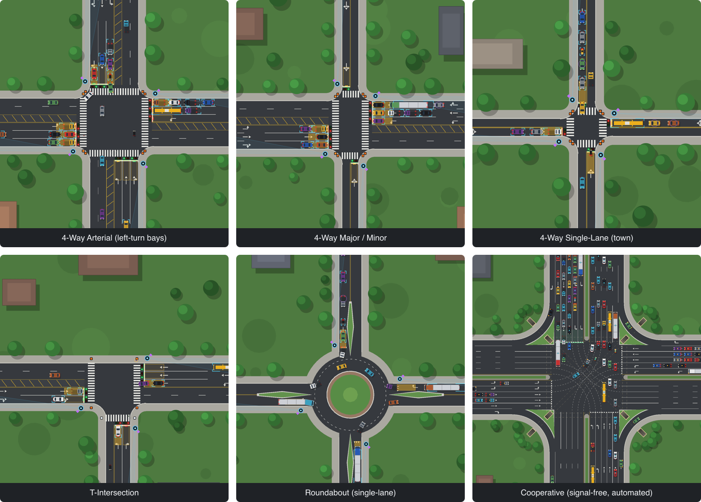

| Layout | Ways to run it | Default demand (veh/h per approach, east–west / north–south) |
|---|---|---|
| 4-Way Arterial (left-turn bays) | Traffic signal, all-way stop | 700 / 550 |
| 4-Way Major / Minor | Traffic signal, two-way stop, all-way stop | 750 / 200 |
| 4-Way Single-Lane (town) | Traffic signal, all-way stop | 300 / 260 |
| T-Intersection | Traffic signal, two-way stop, all-way stop | 650 / 260 |
| Roundabout (single-lane) | Yield | 420 / 350 |
| Cooperative (signal-free, automated) | Intersection manager | 4,500 / 4,500 |

What can be compared:

* **Signal controllers:**
  * fixed-time (Webster);
  * actuated (NEMA gap-out);
  * max-pressure;
  * predictive (schedule-driven model predictive control);
  * Deep RL (reinforcement learning with a Double DQN, a deep Q-network);
  * the Hybrid, in which RL re-tunes the predictive planner.
* **Unsignalized control:** all-way stop, two-way stop and the roundabout's yield rule.
* **A signal-free crossing for automated, connected vehicles,** where an intersection
  manager gives each vehicle an exact trajectory through the box. It schedules them
  either in batches that serve one movement per ring at a time or first come, first
  served, under any of three safety margins.
* **Sensor packages:** loops, camera, radar and connected vehicles, with ideal or
  field-realistic errors, in five weather and light conditions.
* **Pedestrian and turn treatments:** leading pedestrian interval, no turn on red while
  pedestrians are present and a choice of protected, protected-plus-permissive (flashing
  yellow arrow) or automatically chosen left-turn phasing.
* **Single intersections or corridors**, where several signals hand vehicles to each
  other, optionally on a fixed-time green wave.

The same library is used in five ways:

* the interactive app, on the desktop and in the browser;
* the headless `bench` and `train` programs;
* the study programs in `examples/`;
* the regression tests in `tests/`;
* the fuzz target in `fuzz/`, which feeds arbitrary files to the weights loaders.

---

## 2. Architecture at a glance

The crate has four top-level modules, `sim`, `control`, `rl` and `gui`, declared in the
library root `lib.rs`. They form layers, with two exceptions, both kept narrow on
purpose:

* **`sim` and `control` use each other.** `sim` builds the chosen controller with
  `control::make`, holds it as a `Box<dyn Controller>` and calls it once a step, and
  `control` reads `sim`'s data types. The interface between them is a single struct in
  and a stage number out (see §2.2).
* **`rl` uses `sim`'s random number generator,** so that training runs are repeatable.
  It knows nothing else about traffic.

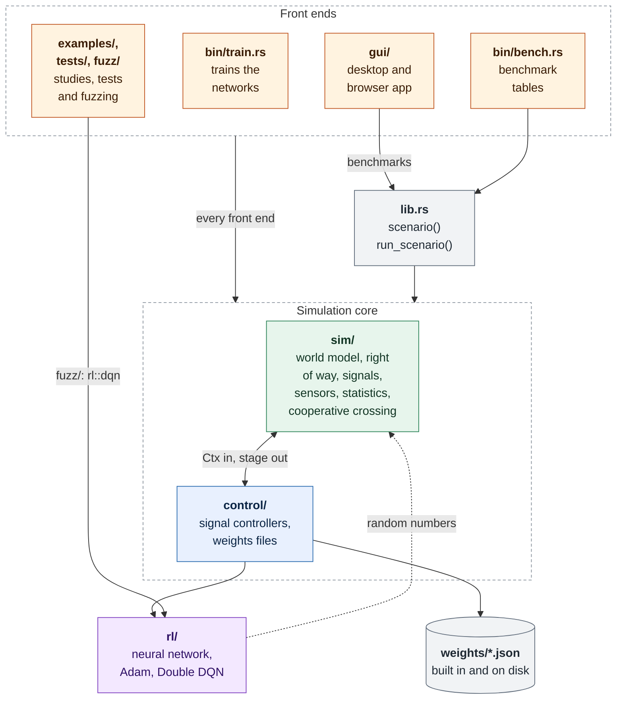

Each front end uses only the library's public modules:

| Front end | Uses |
|---|---|
| `gui/` | `sim` and `control`; `lib.rs` for its benchmark windows |
| `bin/bench.rs` | `lib.rs` (`scenario`, `run_scenario`), `sim` and `control` |
| `bin/train.rs` | `sim` and `control` (it drives `Sim` itself) |
| `examples/` | `sim` and `control`; `make_icons` uses only `gui::shot` |
| `tests/` | `sim` and `control` |
| `fuzz/` | `sim`, `control` and `rl::dqn` |

### 2.1 Responsibilities by layer

| Layer | Owns | Does not do |
|---|---|---|
| `sim` | Ground truth: geometry, vehicles, pedestrians, the signal state machine, sensors, demand, statistics, corridor hand-over and the cooperative crossing's intersection manager. Also the parts of signal control a controller must not override: minimum green, pedestrian clearance, emergency preemption and the max-wait guard. | Pick a controller's stages; draw anything; read files |
| `control` | Signal decisions made from a `SensorView`; loading and saving trained weights | See ground truth, apart from pedestrians and emergency vehicles (§6.5) and the learning reward (§2.2); move vehicles; change clearance timing |
| `rl` | A generic neural network, the Adam optimizer and the Double DQN algorithm | Know anything about traffic |
| `gui` | Input, rendering, charts, the benchmark windows and screenshots. It steps the `World`, changes settings, swaps controllers and spawns vehicles by hand. | Move vehicles or decide anything itself |
| `bin`, `examples`, `tests`, `fuzz` | Experiment scripts and command-line output | Contain simulation logic |

### 2.2 The key boundary: controllers only see sensors

The most important design rule is that **a controller decides from sensor data, never
from ground truth.** Every step, `Sim` builds a `SensorView` from whichever sensors are
enabled, applying their errors, and hands it to the controller inside a `Ctx`. The
controller's only output is "switch to stage *j*" or "hold". `Sim` then decides whether
the switch may happen yet, and the vehicles' behavior stays with `Sim`, so a controller
cannot:

* skip the yellow or all-red clearance intervals;
* cut a minimum green or a pedestrian interval short;
* cause a collision.

This rule is what makes sensor studies meaningful. If a controller does better with
radar, it is because it saw more, not because it peeked. The exception is pedestrians
and emergency vehicles, which reach the `SensorView` straight from ground truth,
whatever sensors are fitted (§6.5). No controller reads the emergency vehicles, though:
only `Sim`'s preemption does (§7.2), so controllers see them only through their sensors.

`Ctx` carries the network, the `SensorView`, the signal state, the configured demand and
sensor settings, the time, `can_switch` and `reward_delay`. Two of those deserve a note:

* **`reward_delay` is ground truth:** the total person delay of the last step, including
  people queued at the edge of the map and pedestrians waiting. The Deep RL and Hybrid
  controllers use it only as their training reward, never as an input to a decision.
* **The demand is the configured design volume,** the counts an engineer would plan
  with. The fixed-time controller computes its plan from it when it is built; no
  controller reads it while deciding.

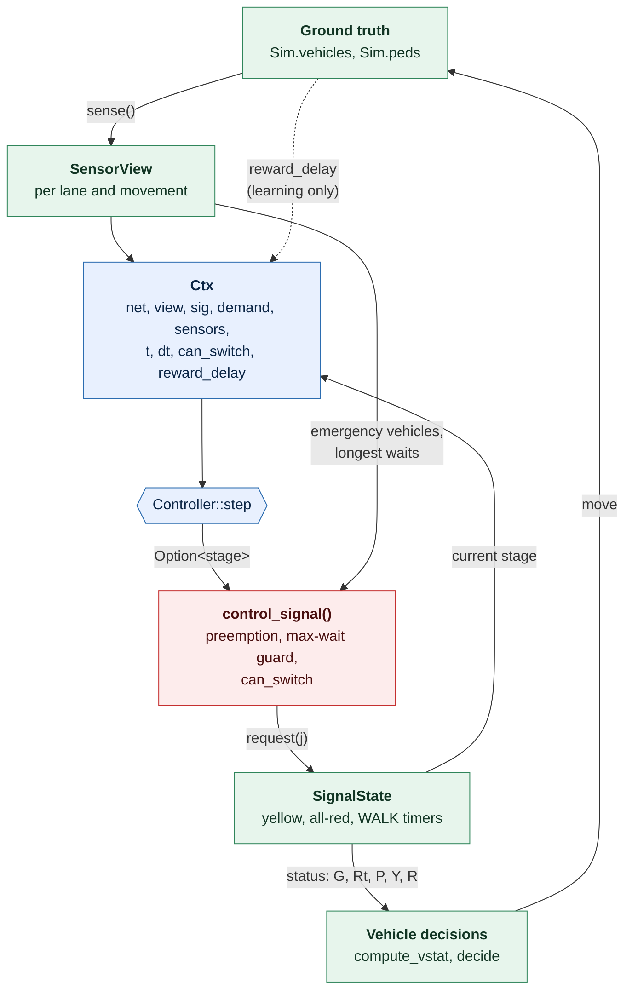

The cooperative crossing has neither sensors nor a controller. Its vehicles are
automated and connected, so the intersection manager (§6.11) reads their positions and
speeds directly, as their own reports would give them.

---

## 3. Crate layout and build targets

```
src/
  lib.rs            library root: scenario() and run_scenario()
  main.rs           app entry point (native window or browser canvas)
  sim/              simulation core, including the cooperative crossing (11 files)
  control/          signal controllers and weights files (8 files)
  rl/               neural network and Double DQN (3 files)
  gui/              egui front end (5 files)
  bin/bench.rs      headless controller and sensor benchmarks
  bin/train.rs      headless training of the Deep RL and Hybrid networks
examples/           studies: cooperative, corridor, fya, lpi, preempt, satflow, sweep,
                    plus make_icons
tests/              safety, cooperative, pedestrian_rule, weights_files
fuzz/               cargo-fuzz target for weights files (a workspace of its own)
weights/            trained networks (JSON), also compiled into the binary
web/index.html      page that hosts the browser build (Trunk)
assets/             the window icon
packaging/          installer scripts for macOS, Windows and Linux; license notices
.github/workflows/  CI, CodeQL, DCO, Pages, release, crate publishing, Scorecard
docs/               this document, insights.md, cooperative-intersections.md (with the
                    scripts behind it in cooperative-scripts/), assurance-case.md and
                    the images these and the README use
```

| Directory | Files | Lines |
|---|---:|---:|
| `src/sim/` | 11 | 7,602 |
| `src/control/` | 8 | 1,474 |
| `src/rl/` | 3 | 360 |
| `src/gui/` | 5 | 3,644 |
| `src/bin/` | 2 | 589 |
| `src/lib.rs`, `src/main.rs` | 2 | 78 |
| `examples/` | 8 | 575 |
| `tests/` | 4 | 749 |
| `fuzz/fuzz_targets/` | 1 | 54 |

| Target | Built from | Purpose |
|---|---|---|
| library `intersection_lab` | `src/lib.rs` | Everything below is built on it |
| `intersection-lab` (the default) | `src/main.rs` | The desktop app (eframe, native) or the browser app (`wasm32-unknown-unknown`, built with Trunk and published to GitHub Pages) |
| `bench` | `src/bin/bench.rs` | Print controller and sensor tables |
| `train` | `src/bin/train.rs` | Train the Deep RL and Hybrid networks |
| examples | `examples/*.rs` | Studies behind `docs/insights.md` and `docs/cooperative-intersections.md`, plus the icon renderer |
| tests | `tests/*.rs` | Regression tests, run by CI on Linux, macOS and Windows |
| `weights` fuzz target | `fuzz/fuzz_targets/weights.rs` | Feeds arbitrary bytes to the weights loaders |

The crate is edition 2024 and has four dependencies: `eframe` and `egui` 0.37, `serde`
and `serde_json`. The browser build adds two more, `web-time` and
`wasm-bindgen-futures`. The crate has no features and no dev-dependencies. The package
published to crates.io holds only the library, the app, the weights files, the icon, the
licenses and the README, so `bench`, `train`, the examples and the tests are not in it.

Platform differences are kept to a few places:

* **`main.rs`:** how the app starts (a native window or a canvas in the page), and no
  console window for Windows release builds.
* **`gui/mod.rs`:** `Instant` comes from `web-time` in the browser, and the `WEB`
  constant hides the buttons that save weights and the hints about training.
* **`gui/bench.rs`:** benchmarks run on threads on the desktop and in slices of each
  frame in the browser.
* **`control/weights.rs`:** the per-user weights folder differs on macOS, Windows and
  Linux.
* **`Cargo.toml`:** the browser-only dependencies.

The rest of the code has no platform-specific parts.

---

## 4. Module dependencies

Inside `sim`, four files share one type: `sim/mod.rs` defines `Sim`, and `sensors.rs`,
`stats.rs` and `coop.rs` add `impl Sim` blocks or read its vehicles. That keeps each
model next to its own data types while giving it the engine's private state. The graph
below shows how the groups of files depend on each other; the table after it lists
every dependency between files.

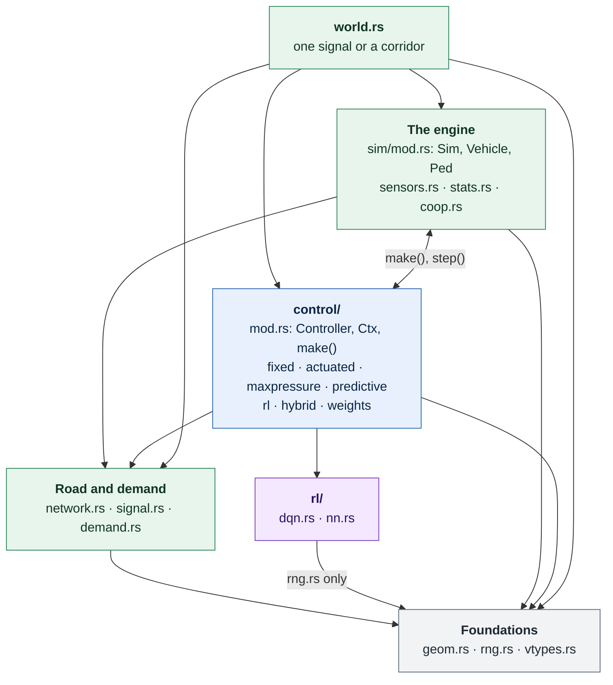

The table lists every dependency between files inside the crate, as `use` statements
and fully qualified paths show them.

| File | Uses |
|---|---|
| `sim/mod.rs` | `coop`, `demand`, `geom`, `network`, `rng`, `sensors`, `signal`, `stats`, `vtypes`; `control/mod.rs` |
| `sim/coop.rs` | `sim/mod.rs`, `network`, `vtypes` |
| `sim/sensors.rs` | `sim/mod.rs`, `network`, `signal`, `vtypes` |
| `sim/stats.rs` | `sim/mod.rs`, `demand`, `network`, `vtypes` |
| `sim/world.rs` | `sim/mod.rs`, `demand`, `geom`, `network`, `rng`; `control/mod.rs` |
| `sim/demand.rs` | `network`, `rng`, `vtypes` |
| `sim/signal.rs` | `network` |
| `sim/network.rs` | `geom` |
| `sim/geom.rs`, `sim/rng.rs`, `sim/vtypes.rs` | nothing |
| `control/mod.rs` | the six controllers; `sim`: `demand`, `network`, `sensors`, `signal` |
| `control/fixed.rs` | `control/mod.rs`; `sim`: `demand`, `network`, `signal` |
| `control/actuated.rs` | `control/mod.rs`; `sim`: `network`, `signal`, `vtypes` |
| `control/maxpressure.rs` | `control/mod.rs`; `sim`: `network`, `signal` |
| `control/predictive.rs` | `control/mod.rs`; `sim`: `network`, `signal`, `vtypes` |
| `control/rl.rs` | `control/mod.rs`, `maxpressure`, `predictive`, `weights`; `rl/dqn.rs`; `sim`: `network`, `rng`, `signal` |
| `control/hybrid.rs` | `control/mod.rs`, `predictive`, `rl`, `weights`; `rl/dqn.rs`; `sim`: `network`, `rng` |
| `control/weights.rs` | nothing (it embeds `weights/*.json`) |
| `rl/dqn.rs` | `rl/nn.rs`; `sim/rng.rs` |
| `rl/nn.rs` | `sim/rng.rs` |
| `lib.rs` | `control/mod.rs`; `sim`: `mod`, `demand`, `network`, `sensors`, `stats` |
| `gui/mod.rs` | `gui/bench`, `charts`, `render`, `shot`; `control`: `mod`, `rl`, `hybrid`; `sim`: `mod`, `coop`, `demand`, `geom`, `network`, `sensors`, `stats`, `vtypes`, `world` |
| `gui/bench.rs` | `lib.rs`; `control/mod.rs`; `sim`: `mod`, `coop`, `demand`, `network`, `sensors`, `stats` |
| `gui/render.rs` | `sim`: `mod`, `coop`, `geom`, `network`, `rng`, `sensors`, `signal`, `vtypes` |
| `gui/charts.rs` | `gui/render.rs`; `sim`: `mod`, `network`, `signal` |
| `gui/shot.rs` | nothing |

Two calls cross from `sim` into one controller without a `use`: `Sim` and `World` reach
the fixed-time controller's `coordinate_plan` through `Controller::as_fixed()` to set
up a green wave.

---

## 5. One simulation step

`Sim::step` (`src/sim/mod.rs`) advances one intersection by `dt` = 0.1 s, in a fixed
order. Every stage reads what the previous one wrote, so the order is part of the
model. Signalized and unsignalized intersections share most of it; the cooperative
crossing swaps sensing, signal control and driver decisions for its intersection
manager.

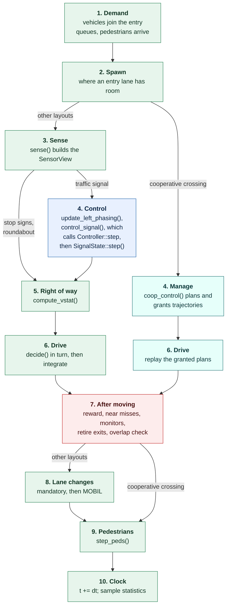

Three things about this ordering matter:

* **Sensing happens before control, and control before driving.** A controller decides
  on what the sensors saw at the start of the step, and vehicles react to the
  indication that results. This adds the one-step latency that real systems have.
* **`compute_vstat` runs after the signal is updated,** so every vehicle's right-of-way
  status reflects the current indication before anyone moves.
* **The intersection manager runs after spawning,** so a vehicle can be given its plan
  in the step it appears.

---

## 6. The simulation core: `src/sim/`

| File | Lines | What it holds |
|---|---:|---|
| `mod.rs` | 2,353 | `Sim`, `Vehicle` and `Ped`: spawning, car following, right of way, lane changes, pedestrians and the safety check |
| `coop.rs` | 1,883 | The cooperative crossing's intersection manager |
| `network.rs` | 1,074 | The layouts: legs, lanes, paths, movements, stages and conflict points |
| `sensors.rs` | 572 | Sensor models and `Sim::sense` |
| `world.rs` | 387 | One intersection or a corridor |
| `signal.rs` | 286 | The signal state machine |
| `demand.rs` | 273 | Arrivals |
| `geom.rs` | 268 | Vectors, paths and curves |
| `stats.rs` | 254 | Measurement |
| `vtypes.rs` | 167 | Vehicle classes |
| `rng.rs` | 85 | Random numbers |

### 6.1 `sim/mod.rs`: the `Sim` engine

`Sim` is one intersection. It owns:

| Group | Fields |
|---|---|
| Road | `net: Network` |
| Clock | `t`; `dt`, which is 0.1 s; `steps`, the step count |
| Traffic | `vehicles`, `peds`; `queues`, the arrivals waiting at the edge of the map, one queue per leg; `occ`, the vehicles on each link, front first |
| Control | `mode`; `signal: SignalState`; `controller: Box<dyn Controller>` and its `ctrl_kind`; `coop: Option<CoopManager>`, built only for the cooperative crossing |
| Inputs | `demand: DemandConfig` and its generator `demand_gen`; `sensors: SensorConfig` and the `view: SensorView` they produce |
| Settings | `rtor` (right turn on red, on), `ntor_peds` (no turn on red while pedestrians are present, off), `left_mode` (flashing yellow arrow), `preemption` (on), `max_wait_guard` (150 s), `check_safety` (off) |
| Corridor hooks | `collect_exits`, `exits`, `exit_room`, `upstream`, `coordination` |
| Results | `stats: Stats`, `collisions`, `collision_log`, `lane_changes`, `last_reward` |

The file also defines:

* **`Vehicle`:**
  * its route as a list of `LinkId`s, with an index `ri` and a distance `s` along the
    current link;
  * its class, movement, turn and leg;
  * speed, acceleration and desired speed `v0`;
  * a reaction time before pulling away from a stop: 0.6–1.2 s for drivers, 0.3 s
    for emergency vehicles and none for automated vehicles;
  * delay, stops, stopped time and fuel;
  * the conflict points it has *committed* to;
  * its stop-sign and yellow decisions;
  * the `Reason` it is braking, and the vehicle it is yielding to, both shown in the
    app;
  * lane-change state, and a `Trip` for corridor journeys.
* **`Ped`:** a pedestrian on a crosswalk, with a position `u` along it, a walking speed
  of 1.35 ± 0.18 m/s (kept between 0.9 and 1.8 m/s) and a state of `Waiting`, `Crossing`
  or `Leaving`.
* **`ControlMode`:** how the intersection is run. `ControlMode::options` lists the
  modes each layout allows, and `Sim::with_demand` replaces a mode the layout doesn't
  allow with the layout's first option.

  | Mode | Shown as | Layouts |
  |---|---|---|
  | `Signal` | Traffic signal | Arterial, major/minor, town, T-intersection |
  | `AllWayStop` | All-way stop | Arterial, major/minor, town, T-intersection |
  | `TwoWayStop` | Two-way stop (minor street) | Major/minor, T-intersection |
  | `Roundabout` | Yield (roundabout) | Roundabout |
  | `Cooperative` | Intersection manager (no signal) | Cooperative |

* **`LeftMode`:** how left turns are phased. `Fya`, the default, is a protected arrow
  plus a permissive flashing yellow arrow. `Protected` allows protected arrows only.
  `Auto` chooses per movement every 30 s by the product of the left-turn and opposing
  through volumes, with thresholds of 50,000, 90,000 and 110,000 for one, two and three
  or more opposing lanes. `update_left_phasing` makes the change only while the
  movement is red, by rewriting the stages from a saved copy.
* **`Reason`:** why a vehicle is braking: free flow, following, stopping for a signal,
  a stop sign, yielding right-of-way, yielding to a pedestrian, slowing for a turn or
  waiting to change lanes, plus three for automated vehicles: slowing to meet its
  reserved slot, waiting for a reservation and slowing to the crossing speed.
* **`Exit` and `UpstreamObs`:** what a corridor passes between neighbors: a vehicle
  leaving toward the next intersection, and a vehicle reported to be on its way.

`Sim::step` (§5) calls the method groups below; §5 gives their order.

#### Spawning and lanes

* `spawn_from_queues` lets the first arrival in each leg's queue enter on the lane
  with the most room (`entry_lane`), provided that lane has room for it. Otherwise it
  waits. The queue has no limit, so a full approach backs up out of sight, and that
  wait still counts as delay. On the cooperative crossing every movement has its own
  lanes, so the first arrival of each movement may enter.
* `entry_lanes`, `route_from`, `lane_ok` and `lane_target` work out which lane a
  movement may use. A vehicle bound for a turn bay enters next to the bay and changes
  into it later.
* `spawn_vehicle` sets the desired speed: the leg's limit times the class's factor
  times a per-driver factor. Automated vehicles keep to the limit, except emergency
  vehicles.
* `free_flow_time` gives each vehicle's travel time on an empty network, with a cache.
  Control delay is the actual travel time minus this, as in the Highway Capacity Manual
  (HCM).

#### Longitudinal motion

* `idm` is the Intelligent Driver Model (IDM). Each vehicle class has its own
  parameters, from `vtypes`.
* `leader` and `scan_siblings` find the vehicle ahead, including vehicles on a link
  that branches off alongside ours and vehicles that have just changed lanes but are
  still partly in the old one (`ghosts`, for 1.5 s).
* Curve speeds come from `Link::curve_speed`, which comes from the path's tightest
  radius.
* `exit_gap` treats the queue of a backed-up downstream intersection as a leader
  beyond the end of the route, up to 250 m away. This is how queues spill back along a
  corridor.
* `exit_space` asks whether there is room on the far side to clear the box. A vehicle
  near the stop line waits there rather than enter without it, on every layout.

#### Right of way

There is no central planner, except on the cooperative crossing (§6.11). Each pair of
paths through the box was intersected ahead of time into **conflict points**, each
with a **zone** on both paths where two bodies could touch (§6.2). Every step, each
vehicle decides for itself.

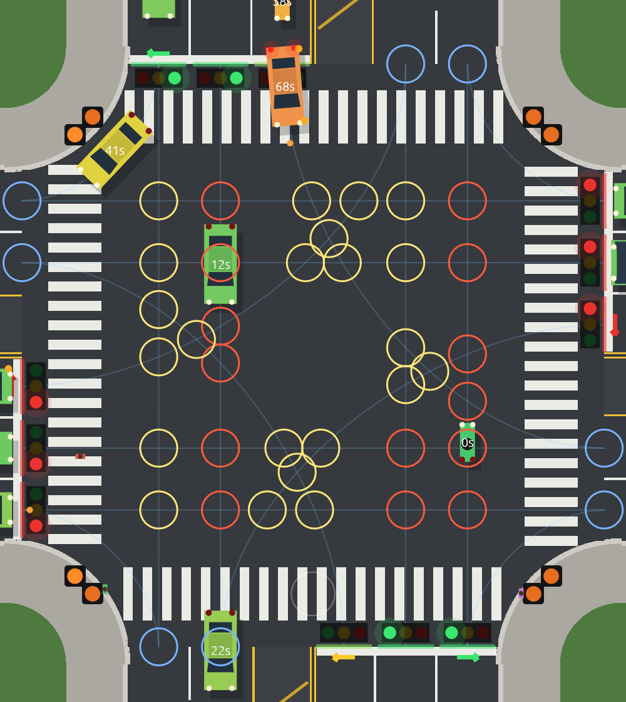

*The arterial with the conflict-point, path and delay-label overlays on, zoomed in.
Yellow rings are crossings, blue rings are merges and red rings are points that some
vehicle has committed to. The labels show each vehicle's delay so far.*

`compute_vstat` first gives every vehicle a `VStat` for the step (`vstat_of`):

* **`rank`:** its priority. A vehicle yields to higher ranks.

  | Situation | Rank |
  |---|---:|
  | Emergency vehicle | 5 |
  | Signal: in the box after its indication has ended | 3 |
  | Signal: green (`G`, or `Rt`, which yields only to pedestrians), or decided to go on yellow | 2 |
  | Signal: permissive (flashing yellow arrow) | 1 |
  | Signal: right turn on red, at least 1.0 s after stopping | 0 |
  | All-way stop: served, at least 0.8 s after stopping (ties go by stop order) | 1 |
  | All-way stop, or the minor street of a two-way stop: in the box | 3 |
  | Two-way stop: major-street left turn / other major-street movements | 1 / 2 |
  | Two-way stop: minor street, at least 0.8 s after stopping | 0.5 |
  | Roundabout: entering / circulating | 1 / 2 |

* **`key`:** the tie-breaker within a rank. On an all-way stop it is the time the
  vehicle stopped; elsewhere a tie goes to whichever vehicle would reach the zone
  first, then to the lower id.
* **`must_stop`:** the vehicle must stop at its line, and **`reason_stop`** says why: 1
  for a signal, 2 for a sign.
* **`excluded`:** the vehicle will stop at its line, so it is not a threat to anyone
  downstream.
* **`hold_line`:** a vehicle turning right on red or already served at a stop sign. It
  waits at the line, not inside the box, whenever it must yield, and commits to every
  crossing it takes.

Then each vehicle runs `decide`, which uses these helpers:

* **`threats`:** the vehicles that will pass a given point on another link, with their
  distance to it.
* **`must_yield`:** the vehicle this one must yield to at a conflict point, if any. The
  other vehicle has priority if it has committed, is inside the zone, can no longer stop
  or has a higher rank, or else if it wins the tie-break. Vehicles that will stop at
  their line are ignored unless they have committed, are inside the zone or can no
  longer stop. Stopped vehicles that are themselves waiting are ignored unless they are
  inside the zone. If the other vehicle has priority, the two vehicles' times in the
  zone must be at least 0.8 s apart at a crossing or 1.2 s at a merge, and 2.0 s when a
  vehicle of rank 1 or lower yields to a higher rank.
* **Commitment:** once a vehicle that need not yield is within v²/6 + 3 m of a
  conflict zone (its stopping distance at 3 m/s², plus 3 m), it *commits* to it, and
  **committed vehicles keep the right of way.** This is what keeps the box free of
  collisions without a global scheduler. Merges are never committed: they are settled
  afresh every step. A commitment made by a vehicle that has since come to a stop
  before the zone lapses, and it must check again.
* **Guards against blocking the box:**
  * `stalled_in_zone`: a vehicle stopped inside the zone.
  * `unstoppable_rival`: another vehicle that committed at the same moment and can no
    longer stop.
  * `rest_blocker`: for vehicles of rank 1 or lower, such as a permissive left turn, a
    later conflict on the same turn that would make the vehicle stop in the middle of
    it. Such a vehicle accepts a gap only if it lasts for the whole turn.
  * `live_threat`: whether anyone is expected at a zone within 12 s. Vehicles held at
    a red count, because the light may change while we wait. This was the 0.2.1
    gridlock fix.
  * `unblock` in `decide`: don't come to rest inside a conflict zone that live traffic
    needs, if the vehicle can still stop short of it. A stop behind a waiting queue
    checks only crossing zones.
* **`ped_blocks`:** whether a pedestrian on the crosswalk, or about to step onto it,
  would be within 1 s of the vehicle there. At a signal, waiting pedestrians count
  only during WALK.

`decide` works in two parts. The first decides whether the vehicle may go past its
stop line at all:

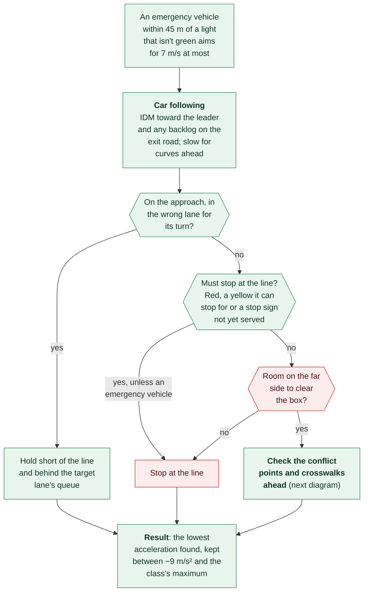

The second walks the route ahead, link by link, up to 70 m or 5 s at the current
speed plus 20 m, whichever is farther. On each link it checks the conflict points,
nearest first, then the crosswalks. The first point where the vehicle has to stop
ends the walk.

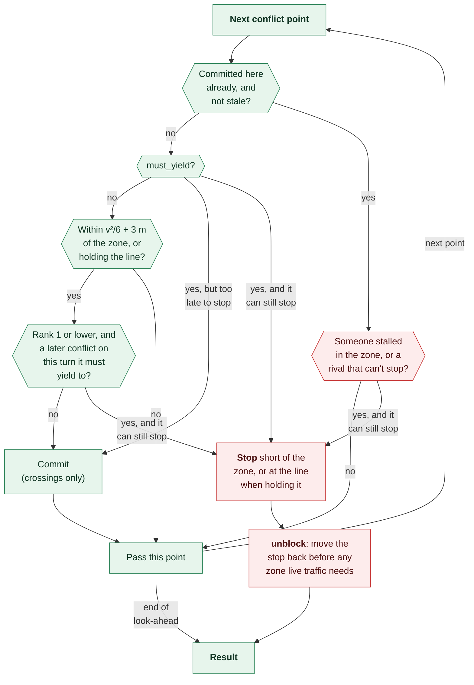

*Red boxes are the steps that keep the box clear. "Can still stop" means stopping
would take less than 6.5 m/s², or the vehicle is already slower than 1 m/s.*

Three more checks complete the walk:

* **Crosswalks:** `ped_blocks` stops the vehicle short of a crosswalk in the same way.
* **Holding the line:** a vehicle that is holding the line skips `unblock`. It gives
  back the commitments it made this step and waits at the line.
* **Queues:** if the leader is waiting, the place where the vehicle will come to rest
  behind it gets the same `unblock` check, for crossings only, so a queue doesn't
  leave it standing across someone's path.

Two details of the stop-line check:

* **Dilemma zone:** when a yellow starts, a driver who would need more than 3 m/s² to
  stop, or is under 1 m or under 2 s from the line, keeps going. The decision is
  stored with the signal's `change_id`, so the driver doesn't change their mind
  during that yellow.
* **Emergency vehicles** ignore the stop line. They have rank 5, so everyone else
  yields to them.

`drive` asks `decide_all` for every vehicle's acceleration, in order of closeness to
the conflict area: vehicles in the box first, then those approaching, by distance to
the stop line, then those leaving. Commitments made earlier in the loop are therefore
visible to the vehicles behind. All the accelerations are collected first and applied
afterward by `integrate`, so no decision depends on which neighbors have already moved
this step. A stopped driver waits out their reaction time before pulling away.

#### Other parts

* **Lane changes (`lane_changes`):**
  * Mandatory changes move a vehicle into the lane or bay its turn needs. They accept
    gaps of 0.8 m and braking of up to 4 m/s², for the vehicle and its new follower.
  * Discretionary changes use MOBIL (minimizing overall braking induced by lane
    changes): the vehicle's gain, plus 0.3 times the gain or loss to the followers
    involved, must beat 0.3 m/s², with gaps of at least 2 m and nobody braking harder
    than 2 m/s². They are not made in the first 10 m of an approach or across the solid
    line in the last 25 m.
  * A vehicle changes lanes at most once every 4 s.
  * The change itself takes one step. Followers in the old lane keep treating the
    vehicle as a leader for 1.5 s (`GHOST_T`), and the sideways slide drawn over
    2.5 s (`lc_offset`, `LC_DUR`) is only for display.
* **Pedestrians (`step_peds`):**
  * At a signal they wait for WALK. Elsewhere they wait at least 1.5 s, until no
    vehicle near the crosswalk is still coming.
  * They cross at their own speed and hurry, at 1.25 times their speed, once WALK ends.
  * They pause while a moving vehicle is about 1 m ahead of them.
* **After moving (`after_integrate`):**
  * It computes `last_reward`, the person delay of the step, including people still
    queued at the edge of the map and pedestrians waiting.
  * It logs a near miss when a vehicle crosses a crosswalk within about 1.5 s of a
    walking pedestrian.
  * On the cooperative crossing, it runs the manager's safety monitors (§6.11).
  * It retires vehicles that have reached the end of their route. Each becomes a
    `stats::Done` record and, in a corridor, an `Exit` for `World` to hand over.
* **Safety check (`check_overlaps`):** when `check_safety` is on, as it is in the app,
  the safety and cooperative tests, the sweeps and the corridor and cooperative studies,
  every step looks for touching vehicles. Bodies are chains of oriented rectangles that
  bend through turns (`body`, `obb_overlap`). It flags vehicles on the same lane that
  overlap by more than 0.3 m, and runs the rectangle test, with rectangles shrunk by
  0.25 m, on pairs in or just past the box. Each pair counts once per step in
  `collisions`.
* **Drawing helpers (`body_lagged`, `lag`, `lc_offset`, `ped_pos_lerp`):** let the app
  draw positions *between* steps for smooth motion. The safety check and lane changes
  use the same functions with no lag.

### 6.2 `sim/network.rs`: the road network

`Network::build(LayoutKind)` builds a complete `Network` for one layout. Each layout is
written out in `build` itself:

* The four signal layouts each list a `LegDef` per approach (its compass direction, its
  lanes as lists of turns, its number of exit lanes and whether it is a minor street)
  and pass them to `build_signal` with the lane width, speed limit, yellow and all-red
  times. Then `add_stages` adds the signal stages, each a name plus the movements it
  serves as `G` (protected), `Rt` (protected from vehicles but yielding to pedestrians)
  and `P` (permissive, yielding to everyone), and `build` sets `fixed_sequence`.
* The roundabout and the cooperative crossing have builders of their own,
  `build_roundabout` and `build_cooperative`. They have no stages.

The network is fixed once built, with one exception: when left turns become
protected-only, `Sim::update_left_phasing` rewrites the stages (§6.1).

| Item | Meaning |
|---|---|
| `Leg` | An approach: compass direction, lanes and their turns, lane width, speed limit, stop-line distance, crosswalk and minor-street flag |
| `Link` | One lane-length of road with an arc-length `Path`. Its `LinkKind` is `Inbound`, `Connector` (through the box) or `Outbound`, or, on the roundabout, `Ring`, `Entry` or `Exit`. It lists its successors and predecessors, the movements it carries, where a turn bay opens and its conflict points in order |
| `Movement` | A leg and a turn, named like `N_L` (north approach, left turn): its destination leg, the routes that carry it and the crosswalks it crosses |
| `Stage` | A named signal stage: an `MStat` (`G`, `Rt` or `P`) for each movement it serves and the crosswalks that get WALK |
| `Conflict` | Two links in the box and, along each, the point where they cross or merge and the zone where the two bodies could touch |
| `PedConflict` | Where a link crosses a crosswalk |
| `Crosswalk` | The two ends of a crosswalk and its length |

`compute_conflicts` intersects every pair of paths in the box. It skips pairs that are
adjacent or that leave the same lane and diverge. Merges become conflicts at the merge
point. Paths that never cross but pass within `CLEAR` (2.7 m) of each other still get a
conflict, and `zone_along` works out each zone by walking along the paths, so a wide
truck turning beside another vehicle is protected even where the center lines never
cross. The cooperative crossing replaces these zones with tighter ones of its own
(§6.11).

#### Stages

| Layout | Stages | `fixed_sequence` |
|---|---|---|
| Arterial | 0 NS Through, 1 NS Protected Left, 2 EW Through, 3 EW Protected Left, 4 North Split, 5 South Split, 6 East Split, 7 West Split | 1, 0, 3, 2 |
| Major/minor | 0 EW Through, 1 EW Protected Left, 2 East Split, 3 West Split, 4 NS Side Street, 5 North Split, 6 South Split | 1, 0, 4 |
| Town | 0 NS (permissive), 1 EW (permissive), 2 North Split, 3 South Split, 4 East Split, 5 West Split | 0, 1 |
| T-intersection | 0 Main Street, 1 East + Protected Left, 2 Side Street, 3 Left In + Right Out | 0, 1, 2 |

The fixed-time and actuated controllers run the stages in `fixed_sequence`; the first
stage in it is also the first green. The adaptive controllers may choose any stage. On
the arterial the stages serve:

| Stage | `G` | `Rt` | `P` | WALK across |
|---|---|---|---|---|
| 0 NS Through | `N_T`, `S_T` | `N_R`, `S_R` | `N_L`, `S_L` | east and west legs |
| 1 NS Protected Left | `N_L`, `S_L` | `N_R`, `S_R` | | none |
| 2 EW Through | `E_T`, `W_T` | `E_R`, `W_R` | `E_L`, `W_L` | north and south legs |
| 3 EW Protected Left | `E_L`, `W_L` | `E_R`, `W_R` | | none |
| 4 North Split | `N_L`, `N_T` | `N_R` | | west leg |
| 5 South Split | `S_L`, `S_T` | `S_R` | | east leg |
| 6 East Split | `E_L`, `E_T` | `E_R` | | north leg |
| 7 West Split | `W_L`, `W_T` | `W_R` | | south leg |

`walk_for` works out the WALK column: a crosswalk may walk unless a protected movement
crosses it, or a served movement enters the box across it.

A **split stage** serves one approach alone and holds every other approach at red.
Because no opposing traffic moves, the left turn needs no gap. Traffic engineers call
this split phasing. It helps when one approach has heavy left turns, or when lefts
share a lane with through traffic, as on the town layout. The arterial, major/minor
and town layouts have split stages, and none of them is in `fixed_sequence`, so only
the adaptive controllers use them.

"Split" has two other meanings in this project. In signal timing, a stage's *split*
is its share of the cycle, as in "Webster cycle and splits" for the fixed-time
controller. In the right-of-way rules, a *split* is the point where two paths from the
same lane diverge.

#### Dimensions

| | Arterial, major/minor, T-intersection | Town | Roundabout | Cooperative |
|---|---|---|---|---|
| Lane width | 3.5 m | 3.4 m | 3.6 m | 3.5 m |
| Speed limit | 13.9 m/s (50 km/h) | 11.1 m/s (40 km/h) | 13.9 m/s (50 km/h) | 13.9 m/s (50 km/h); 40 km/h on through paths in the box (§6.11) |
| Yellow / all-red | 3.5 s / 2.0 s | 3.0 s / 1.5 s | none | none |

Every approach starts 260 m from the center (`IN_LEN`) and every exit ends 160 m from it
(`OUT_LEN`). Curve speeds are √(2.6 m/s² × the tightest radius), kept between 3.5 m/s
and the limit. On the signal layouts the stop line sits 6 m back from the edge of the
widest crossing road, and a left-turn bay is 75 m long (`BAY_LEN`). The figure shows one
approach of the arterial to scale, with its detectors:

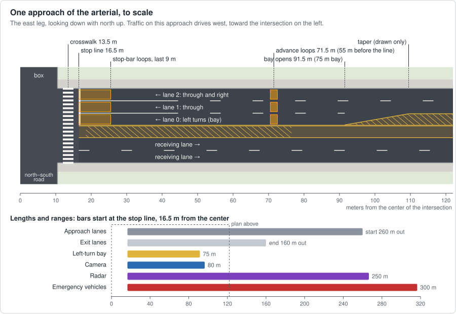

### 6.3 `sim/geom.rs`: geometry

* `V2` is a 2D vector in meters, with +x east and +y south, as on the screen.
* `Path` is a polyline resampled every 0.5 m (`DS`), so `point(s)` and `tangent(s)`
  take constant time. It also records its tightest radius, from which the curve speed
  comes.
* `intersections` and `closest` find where two paths cross, or how close they come, to
  discover conflict points.
* `cubic` and `connector` build the turn paths as Bézier curves that approximate arcs,
  and `arc` builds true arcs: the roundabout's ring and the cooperative crossing's
  turns.

`geom` knows nothing about traffic. It is used by `network` to build the layouts, by
`sim` for positions and bodies and by `gui` to draw.

### 6.4 `sim/signal.rs`: the signal state machine

`SignalState` is the only thing that changes signal indications. A controller can
only *request* a stage; the state machine runs the yellow and all-red clearance
intervals, which follow the MUTCD, the US manual on traffic control devices:

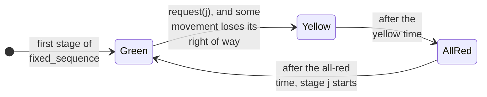

* **`request(j)`** is ignored unless the signal is green, `j` is a different stage and
  `j` exists. It does **not** check the minimum green; `Sim::control_signal` does that,
  except for emergency preemption (§7.2). A movement loses its right of way if stage `j`
  doesn't serve it, if it drops from protected to permissive, or, with a leading
  pedestrian interval, if it crosses a called crosswalk that `j` walks. If none does,
  stage `j` starts at once, with no yellow or all-red. Every accepted request sets every
  crosswalk to DON'T WALK and increments `change_id` and `switches`.
* **`status(net, m)`** is what a driver of movement `m` sees: `G`, `Rt`, `P`, `Y` or
  `R`. During the change, movements that keep their right of way keep their indication.
  A layout without stages shows `G` to everyone.
* **`can_switch()`** is true once the green has run its current minimum, `cur_min`.
  That is 6 s (`min_green`), raised to cover any WALK plus flashing DON'T WALK that
  starts during the green, and, with a leading pedestrian interval, to the interval
  plus 6 s.
* **Leading pedestrian interval:** for `lpi` seconds after a stage starts with WALK,
  the turns that cross those crosswalks are held at red (`lpi_held`), and they may not
  turn right on red either.
* **`no_late_walk`** is set while a coordinated fixed-time corridor runs. WALK then
  starts only with its stage, so a pedestrian call never pushes a stage past its
  force-off.
* **`history`** holds the last 400 `StageSpan`s, which the app draws as the signal
  timeline.

Each crosswalk has its own small machine (`CwSignal`), with a push-button `called`
flag:

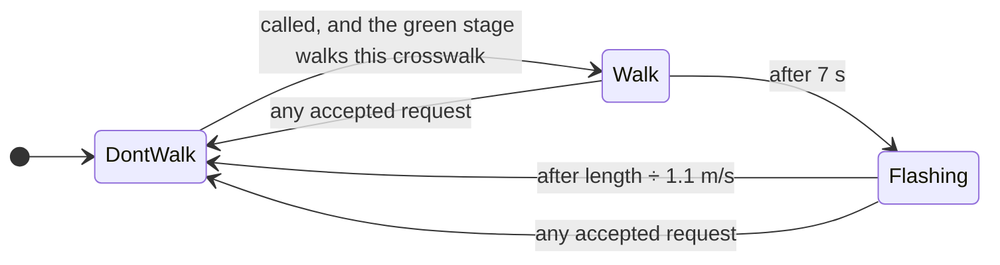

Vehicles read more than `status`: the `change_id` their yellow decision is stored
against, `lpi_held` in the right-turn-on-red check and each crosswalk's WALK state in
`ped_blocks`.

### 6.5 `sim/sensors.rs`: what controllers can know

This file defines what a controller sees and the `impl Sim { fn sense() }` that fills
it in. The cooperative crossing doesn't use it.

* **`SensorConfig`:** which sensors are fitted and how they behave. The defaults are:
  * loops, camera and radar on, and connected vehicles off (30% of vehicles when on);
  * realistic errors on, in clear weather (`Conditions`: clear day, night, heavy rain,
    fog or snow);
  * the advance loops 55 m before the stop line, the camera reaching 80 m and the
    radar 250 m;
  * 80% of drivers using their turn signals;
  * no faulty loops, and the upstream link off.

  `SensorConfig::ideal()` turns the errors off.
* **`SensorView`:**
  * per lane (`LaneObs`): stop-bar presence, advance-loop pulses, an input-output
    count and the fault diagnosis;
  * per movement (`MoveObs`): the queue estimate, the person-weighted queue, a list of
    `Obs` (each a vehicle's distance, speed, arrival time, weight, persons, wait,
    whether it is queued and, if known, its class), the longest wait, the stop-bar
    state and the last actuation;
  * per crosswalk: pedestrians waiting, the longest wait and the push-button call;
  * approaching emergency vehicles, and, with a camera, the queue on each exit road.

In this diagram the dashed boxes are the simulation's own state, which `sense()` turns
into the view a controller reads:

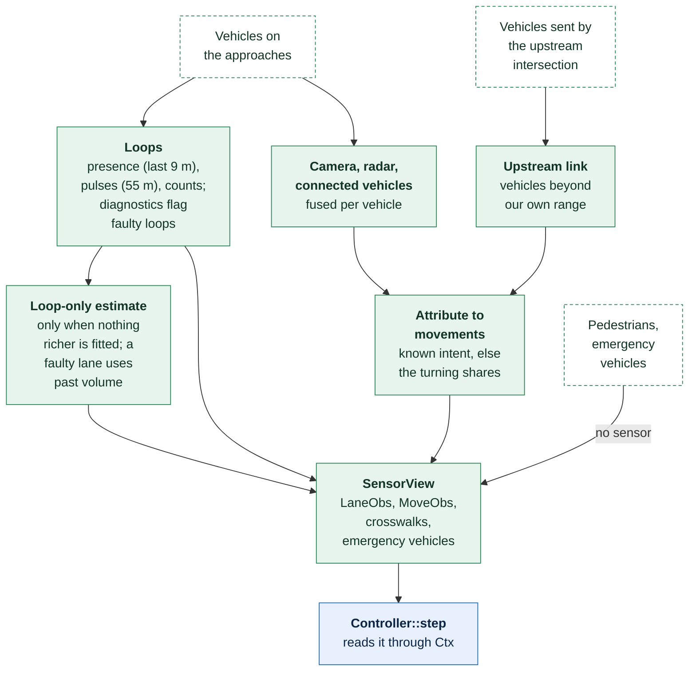

* **Loops** sit in every approach lane: a presence zone over the last 9 m before the
  stop line, and a point detector 55 m before it. With realistic errors they miss 1%
  of vehicles and 35% of motorcycles, and a configured fraction of the stations are
  stuck on or stuck off. They report presence and pulses for every lane, but their
  counts become queue estimates only when nothing richer is fitted.
* **Diagnostics** run when loops have realistic errors. A loop that has been on for more
  than 3 minutes, or silent for 10 expected headways (between 2 and 15 minutes) while
  the rest of its approach is busy, is marked faulty. The actuated controller then puts
  its lane on recall, and the loop-only estimate falls back to the volume expected since
  the lane's last green.
* **Camera, radar and connected vehicles** are fused per vehicle. Position and speed
  come from the camera, which is exact, else the radar (errors with a standard deviation
  of 1.5 m and 0.5 m/s), else the vehicle's own messages (3 m and 0.3 m/s, drifting over
  2 s). Class comes from the camera or the vehicle. Intent comes from the vehicle's own
  messages, from a lane that serves one movement only or from the camera, which reads
  turn signals: 80% of drivers signal, and one who doesn't is taken for through traffic
  if the lane has a through movement. A vehicle whose intent is unknown is split across
  its lane's movements by the turning shares. The camera's detection rate and reach drop
  at night and in rain, fog and snow, and the radar's detection rate drops a little in
  rain and snow.
* **Pedestrians and emergency vehicles** come straight from ground truth, whatever
  sensors are fitted: the waiting pedestrians and push-button calls at each crosswalk,
  and emergency vehicles within 300 m of the stop line or already in the box. Only
  `Sim`'s preemption reads the emergency vehicles (§7.2); controllers see them only
  through the sensors above.
* **The upstream link** (`upstream_link`, off by default; *Upstream signal shares its
  outflow* in the app) adds the vehicles the upstream intersection has released toward
  this one, but only beyond the reach of our own sensors. Their intent is unknown, so
  they too are split by the turning shares. The link is experimental and helps little in
  this simple form.

The error models are deterministic: `h01` and `noise` are hashes of a vehicle's id,
the lane and the time, not random draws. Turning sensors on or off therefore never
changes the arrival stream, and runs with different sensor packages see exactly the
same traffic.

### 6.6 `sim/demand.rs`: arrivals

* **`DemandConfig`:**
  * vehicles per hour on each approach, indexed by compass direction (N, E, S, W);
  * the left, through and right shares on each approach;
  * the vehicle mix;
  * pedestrians per hour, across all crosswalks;
  * the arrival `Pattern`;
  * a global scale;
  * `fed`: in a corridor, an approach fed by the neighboring intersection gets no
    random arrivals of its own, but its rate still describes the flow it expects.

  `default_for` gives each layout the volumes listed in §1, turns of 15/70/15% (the
  cooperative crossing 20/65/15%, and the T-intersection its own per leg), a mix
  weighted 0.62 cars, 0.24 SUVs, 0.05 trucks, 0.03 buses and 0.04 motorcycles, with no
  emergency vehicles (the weights sum to 0.98, so about 63% of vehicles are cars) and 60
  pedestrians per hour (none on the roundabout and the cooperative crossing).
* **`DemandGen`** generates Poisson arrivals on each approach whose rate follows the
  pattern over time. It draws them by thinning: candidates arrive at the pattern's peak
  rate and each is kept with probability rate ÷ peak. Every candidate draws its class,
  movement, desired-speed factor (normal, mean 1, s.d. 0.08, kept within 0.82–1.18)
  and sensor attributes, kept or not, so the random stream stays aligned. Each kept
  arrival is a `Pending` that waits in `Sim.queues` until it can enter.
* **`Trip`:** carries a vehicle's corridor journey (start time, intersections passed,
  stops and delay so far) from one intersection to the next.

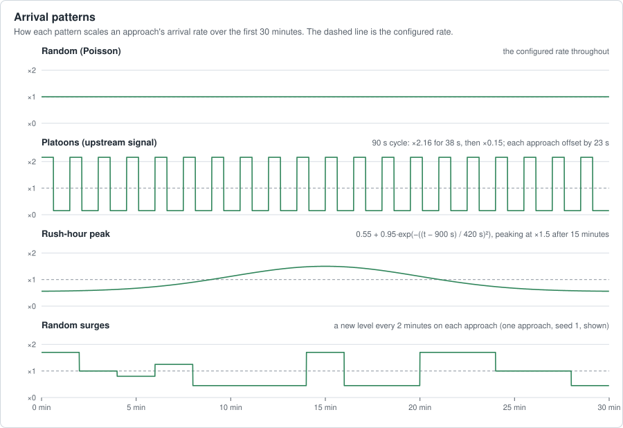

### 6.7 `sim/vtypes.rs`: vehicle classes

`VKind` is `Car`, `Suv`, `Truck`, `Bus`, `Motorcycle` or `Emergency`. Each has a static
`VSpec`:

| Class | Length | Width | Speed factor | Accel. | Comfortable decel. | Headway | Min. gap | Occupancy | Fuel |
|---|---:|---:|---:|---:|---:|---:|---:|---:|---|
| Car | 4.5 m | 1.85 m | 1.00 | 2.0 m/s² | 2.5 m/s² | 1.0 s | 2.0 m | 1.4 | gasoline |
| SUV | 5.1 m | 2.0 m | 1.00 | 1.8 m/s² | 2.5 m/s² | 1.1 s | 2.0 m | 1.6 | gasoline |
| Truck | 16.5 m | 2.55 m | 0.90 | 0.8 m/s² | 1.8 m/s² | 1.6 s | 3.0 m | 1.0 | diesel |
| Bus | 12.2 m | 2.55 m | 0.88 | 1.0 m/s² | 1.8 m/s² | 1.4 s | 2.5 m | 25.0 | diesel |
| Motorcycle | 2.2 m | 0.85 m | 1.05 | 3.2 m/s² | 3.0 m/s² | 0.9 s | 1.5 m | 1.1 | gasoline |
| Emergency | 6.5 m | 2.2 m | 1.15 | 2.6 m/s² | 3.5 m/s² | 0.9 s | 2.0 m | 3.0 | diesel |

* The speed factor multiplies the speed limit to give the class's desired speed.
* The acceleration, comfortable deceleration, desired time headway and minimum gap are
  the Intelligent Driver Model's parameters. The headways are calibrated so a queue of
  cars leaves at about the HCM's base saturation flow, 1,900 vehicles per hour per
  lane; `examples/satflow.rs` checks this.
* Occupancy, the average number of people on board, weights person delay.
* `fuel_ml` is a power-based fuel model: an idle rate plus the tractive power for
  inertia, rolling resistance and drag, divided by the energy in a liter of gasoline
  (34.2 MJ) at 30% engine efficiency, using each class's mass, drag area and idle
  rate. CO₂ is fuel
  times 2.31 kg/L for gasoline or 2.68 kg/L for diesel, worked out when the vehicle
  leaves.

### 6.8 `sim/stats.rs`: measurement

* `Stats::record(Done)` keeps one record per vehicle that has left: delay, stops,
  stopped time, travel time, fuel, CO₂ and persons. It also fills a delay histogram of
  13 bins of 10 s.
* `Stats::sample` adds a `Sample` to a time series every 2 s, keeping the last 900:
  queue, vehicles in the network, vehicles waiting to enter, throughput and recent
  delay. The app's charts draw it.
* `Stats::summary(from_t, …)` produces a `Summary` for everything that left after the
  warm-up:
  * averages and percentiles, throughput, fuel and CO₂;
  * person delay;
  * breakdowns by approach, movement and class;
  * pedestrian waits and near misses per hour.

  It also counts as **unserved** the vehicles still waiting to enter and those in the
  network with more than 30 s of delay so far. `person_delay_all` and `avg_delay_all`
  include every vehicle still in the network or waiting to enter, at its delay so
  far. This keeps a controller that starves an approach from looking good.
* `los` maps delay to the HCM's level of service, A to F. The thresholds are 10, 20, 35,
  55 and 80 s under signal control, and 10, 15, 25, 35 and 50 s otherwise.

`Summary` is what every front end reports: the app's panels, the bench tables, the
training evaluations and the tests.

### 6.9 `sim/rng.rs`: determinism

`Rng` is xoshiro256\*\* seeded through SplitMix64. It needs no external crate, it is
fast and its integer stream is the same on every platform, including WebAssembly. Its
`normal()` and `exp()` use the platform's floating-point `ln`, `cos` and `sqrt`, so runs
on different platforms are repeatable but not guaranteed to be bit-identical. Each
consumer has its own stream:

| Stream | Seeded from | Draws |
|---|---|---|
| `DemandGen` | the run's seed | arrivals, classes, movements, desired speeds, pedestrian arrivals |
| Surges | the run's seed, approach and 2-minute block | each block's multiplier |
| `Sim.misc` | the run's seed | vehicle colors and reaction times, pedestrian speeds and positions |
| `World` | the run's seed (corridors) | turns of vehicles handed to the next intersection |
| `Dqn` | 7 for Deep RL and 11 for the Hybrid; 42 + `SEED` for a network `train` starts | network weights and replay sampling |
| Deep RL, Hybrid | fixed, one each | exploration |
| `gui/render.rs` | fixed | scenery |
| `train` | the layout, Deep RL or Hybrid, `RESUME` and `SEED` | each training episode's demand, weather and loop faults (§8.5) |

Because the arrivals depend only on the seed, two runs with the same seed and
different controllers receive **identical arrivals at the edge of the map**. Every
comparison in the program relies on this: the bench, the app's side-by-side twin and
the training baselines. Two kinds of draws can still differ between such runs, because
they depend on what happened inside the network:

* in a corridor, the turns drawn for vehicles handed to the next intersection;
* in congestion, the reaction times and pedestrian speeds drawn from `Sim.misc`, which
  depend on the order in which vehicles get in.

### 6.10 `sim/world.rs`: one intersection or a corridor

`World` holds one `Sim`, or several placed along the east–west main road 420 m apart
(`SPACING` = `IN_LEN` + `OUT_LEN`). `World::single` builds one intersection, and
`World::corridor` builds a row of them, each seeded differently. In a corridor the
approaches between neighbors are marked `fed` and every `Sim` collects its exits; each
keeps its own controller, sensors and statistics. `World::step` adds the coupling around
the intersections' own steps:

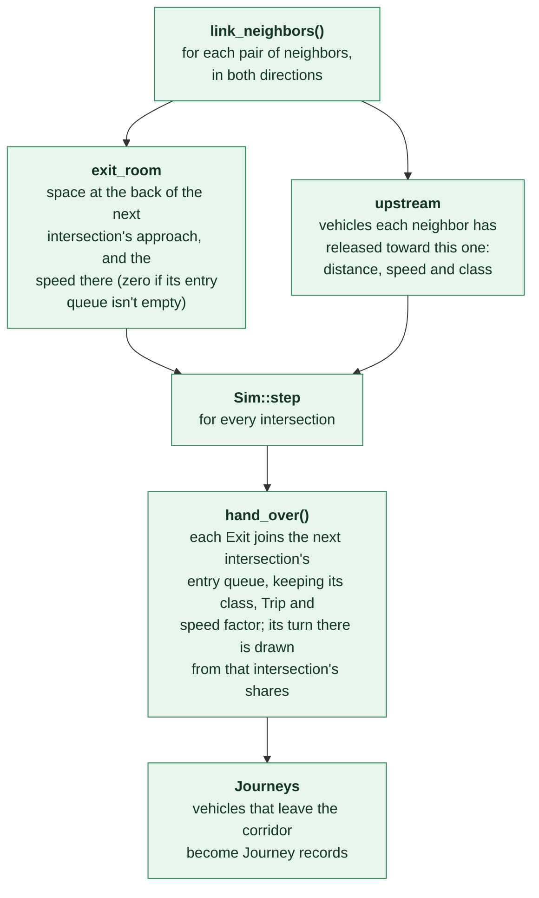

* **Spillback:** a vehicle heading into a full approach sees the space left there as
  a stopped leader at the end of its exit road (`exit_gap`), so queues back up
  physically from one intersection into the next.
* **`set_coordination`:** gives the fixed-time intersections a common cycle, the
  longest of their Webster cycles, and offsets for a green wave. The offsets are chosen
  one intersection at a time, in 1 s steps, to give the most green to platoons in both
  directions traveling at 92% of the speed limit. It first sets every signalized
  intersection to fixed-time control.
* **`sync_settings` and `follow`:** copy settings edited in the app to the other
  intersections and to the comparison twin. Each intersection keeps its own `fed`
  flags.
* **`corridor_summary`:** reports end-to-end main-road journeys (`Journey`,
  `CorridorSummary`).

### 6.11 `sim/coop.rs`: the cooperative crossing

On the cooperative layout every vehicle is automated and connected, and there are no
signals, signs or roadside sensors. An intersection manager, `CoopManager`, gives each
vehicle a complete trajectory: one acceleration for every step from now until it
leaves the map. The vehicle drives exactly that trajectory. The manager builds each
one with the simulator's own integrator, so it knows, to rounding error, when every
vehicle will be in every part of the box. It grants a trajectory only after checking
it against every trajectory it has already granted, and it never changes one it has
granted.

`Sim::with_demand` creates the manager only in `ControlMode::Cooperative`, the one mode
the cooperative layout allows. In that mode `Sim::step` (§5) skips sensing, the signal,
right-of-way statuses and lane changes. A `SignalState` and a controller still exist,
but they never run. The layout has no crosswalks: the pedestrian underpasses at the
corners are only drawn.

#### Geometry

`Network::build` calls `build_cooperative(2)`, which gives each leg six lanes, 3.5 m
wide. From the 4 m raised median outward they are two left-turn lanes, three through
lanes and a right-turn lane. Every lane carries one movement, and entry lane *k* of a
movement leaves on exit lane *k*.

| | Paths in the box | Speed in the box |
|---|---|---|
| Through | Straight, 43 m long | 40 km/h (the approaches are 50 km/h) |
| Left turns | Quarter circles of 25.25 m and 28.75 m radius around the box's corner | About 29 and 31 km/h |
| Right turns | A 25 m quarter circle that leaves the approach 24.75 m before the stop line and never enters the box | Not managed |

The box is 43 m square, from stop line to stop line. Its 20 paths (five per leg) give
100 conflict points, 10 on each path: 36 between through paths, 48 between a left turn
and a through path and 16 between left turns. Opposite left turns pass clear of each
other. `Network::reservation_zones` replaces the usual zones with tighter ones: a path's
zone is the stretch within 1.275 × (1 + |cos θ|) + 0.3 m of the other path's center
line, where θ is the angle between the paths. That is half the width of the widest
vehicle, 2.55 m, more where the paths meet at a shallow angle, plus a 0.3 m margin. At
right angles a zone is about 3.2 m long (the search runs in 5 cm steps).

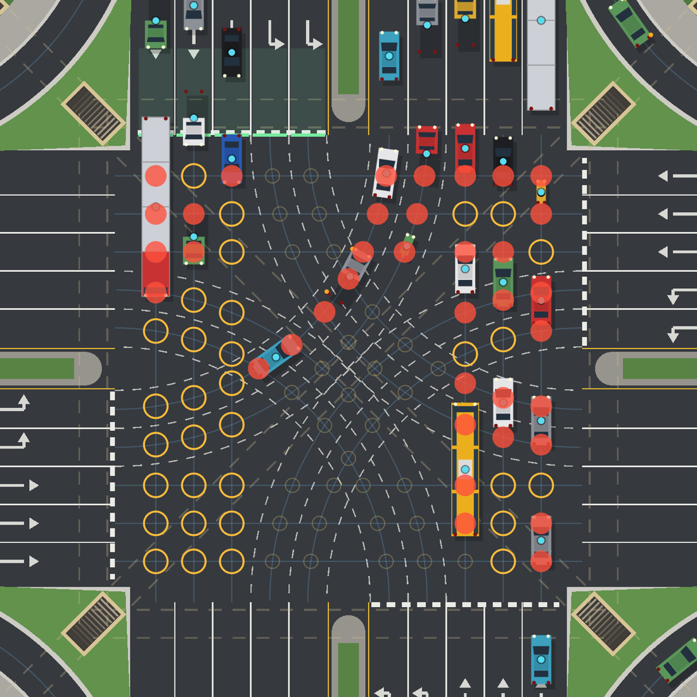

*The cooperative crossing, zoomed in, with the reservation-zone and path overlays on.
Each circle is a conflict point's reservation zone: red while a vehicle with a
trajectory is in it, amber when one is due within 3 s and faint otherwise. A cyan dot on
a vehicle means it has a trajectory, and an amber one that it is waiting for one. The
green line marks the lanes being admitted, and the dashed white lines are the stop
lines.*

#### The manager's step

`Sim::coop_control` runs `CoopManager::step` once per step, after spawning, so a
vehicle can get its trajectory in the step it appears. The step grants as many
trajectories as it can:

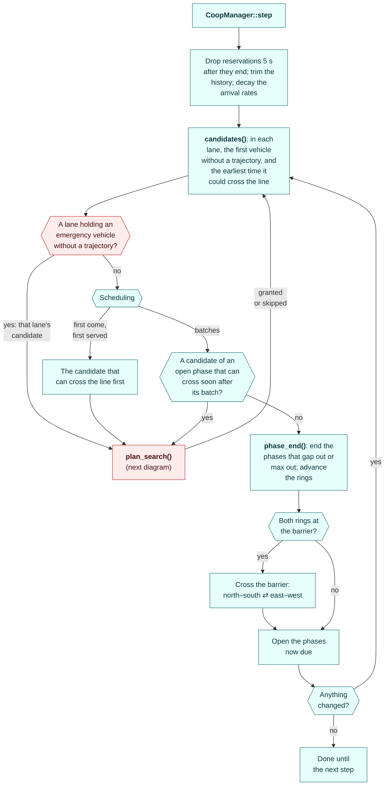

*One step of the intersection manager. It loops until nothing changes; first come,
first served stops when no candidate is left. The barrier is crossed at most twice
per step.*

* **Candidates:** in each managed lane, only the first vehicle without a trajectory is
  a candidate. Its estimate is the earliest time it could reach the line at the
  crossing speed, no earlier than the lane's last granted vehicle plus a following
  headway, and clear of every reservation at that speed.
* **Emergency vehicles** go first: if a lane holds an emergency vehicle without a
  trajectory, that lane's candidate, the emergency vehicle or one ahead of it, gets
  the earliest trajectory that fits, whatever the phase.
* **First come, first served** (`Scheduling::FirstCome`) gives the earliest trajectory
  that fits to the candidate with the earliest estimate, one vehicle at a time.
* **Batches** (`Scheduling::Batches`, the default) serve one movement at a time per
  ring, like an actuated signal without clearance intervals. A phase's next vehicle
  joins the batch if it can cross the line no later than the batch's latest vehicle
  plus its own following headway plus the batch join window (`slack`, 1.5 s by
  default), and before the phase's maximum. The first vehicle of a phase with a queue
  waiting goes after every conflicting reservation, so the queue crosses together; a
  lone vehicle may take an earlier gap.

#### Building a trajectory

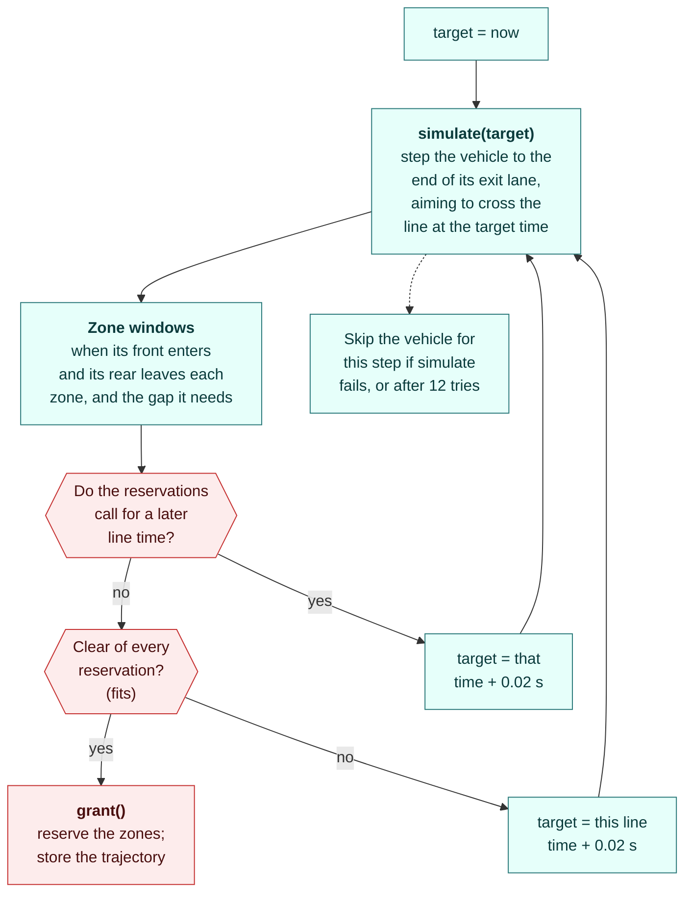

*`plan_search`, which looks for the earliest trajectory that fits.*

* **The approach profile** (`approach_profile`) is the fastest way to the line, or,
  if the vehicle must arrive later, slowing down early and cruising (no slower than
  2.5 m/s), or, for a long wait, stopping near the line and leaving with a flying
  start. Either way the vehicle crosses the line at the crossing speed, holds it
  through the box and accelerates freely after it, out to the end of the exit lane.
  The plan never brakes harder than 3.5 m/s². It is stepped with `integrate`, the
  function that moves every vehicle, so a granted vehicle replays it exactly.
* **Following:** the trajectory is simulated behind the granted trajectory of the
  vehicle ahead in its lane, with a constant-time-gap cooperative adaptive cruise
  control law: a standstill gap of 2 m (1.5 m for motorcycles) plus 0.42 s (0.75 s
  for trucks and buses). It is rejected if the gap ever drops below 1 m.
* **Zones:** a vehicle holds a zone from the moment its front enters it until its
  rear leaves it. Two windows on crossing paths fit if one ends before the other
  begins by at least the gap of the vehicle that comes second. `earliest` first
  shifts the trajectory past the reservations it would overlap; `fits` then checks
  the trajectory actually simulated, since arriving later changes its speeds.

#### Safety gaps

The gap (`GapPolicy`) is how long a vehicle must wait after a conflicting vehicle
leaves a zone before entering it. Every policy starts from two message latencies of
0.1 s and an actuation delay of 0.3 s, 0.5 s in all. The fail-safe policy adds the
time the entering vehicle takes, at its entry speed, to cover its braking distance, so
it can stop short of the zone if the other vehicle stalls there. The vehicles'
emergency deceleration is 6 m/s², or 4.5 m/s² for trucks and buses.

| Policy | Shown as | Gap | Car / truck or bus at 40 km/h |
|---|---|---|---:|
| `FailSafe` (P2, the default) | Fail-safe: can stop for a stalled vehicle | 0.5 s + braking distance ÷ speed | 1.43 s / 1.73 s |
| `Mitigated` (PH) | Mitigated: can slow to 25 km/h | 0.5 s + distance to slow to 25 km/h ÷ speed | 1.06 s / 1.25 s |
| `Nominal` (P1) | Nominal: latency and actuation (no failures) | 0.5 s | 0.50 s |

P2, PH and P1 are the names `docs/cooperative-intersections.md` gives these policies
(stop-safe, harm-limited and brake-safe), and `TS_POLICY` takes them in lower case.

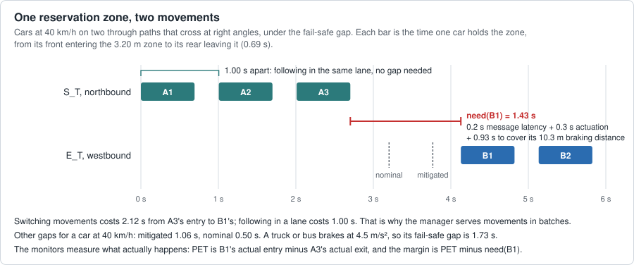

#### Phases

In batch scheduling the manager uses the ring-and-barrier structure of an actuated
signal. Two rings each serve a through movement and a left turn of the north–south
approaches, then both cross the barrier to the east–west ones:

| | North–south group | | East–west group | |
|---|---|---|---|---|
| Ring 1 | `S_T` | `N_L` | `W_T` | `E_L` |
| Ring 2 | `N_T` | `S_L` | `E_T` | `W_L` |

* **Order:** `order_rings` tries all 16 combinations of leading and lagging left turns
  and keeps the one whose switches between conflicting movements cost the least time.
  With this geometry the lefts lag.
* **Ending a phase:** a phase *gaps out* when no vehicle of its movement can join the
  batch, and *maxes out* when one could, but only after the phase's maximum. The last
  phase of a ring before the barrier may run on while the other ring finishes, since
  the barrier waits for that ring anyway.
* **Maximum phase lengths** follow Webster: the cycle (`max_cycle`, 100 s by default)
  minus the time lost to switching is split by each movement's measured flow ratio,
  with each phase getting at least 6 s.
* **No clearance intervals:** the next batch starts as soon as the reservations allow,
  zone by zone, instead of after a yellow and an all-red.

#### Vehicles without a trajectory

`coop_accels` gives every vehicle with a trajectory the acceleration it planned for this
step; replaying it open-loop is exact because automated vehicles react instantly and the
planner used the same integrator. A vehicle without a trajectory uses `free_av_acc`: it
follows the vehicle ahead with the same following law, slows for the right-turn slip
lane and stops far enough before the line to reach the crossing speed by the time it
crosses, with the reason "waiting for a reservation". For a car on a through lane that
is about 32 m back, and for a truck about 78 m.

#### Monitors and statistics

Independently of the plans, `observe` measures when each vehicle actually enters and
leaves each zone, interpolating within the step:

| Monitor | What it counts |
|---|---|
| Post-encroachment time (PET) | A vehicle's entry minus the last conflicting vehicle's exit, for every pair within 10 s; its minimum and a histogram in bins of 0.25 s |
| Margin | The PET minus the gap the policy required; its minimum |
| Zone overlaps | A vehicle entering a zone while a conflicting vehicle is still in it |
| Entries without a reservation | A vehicle without a trajectory crossing a managed stop line |
| Off trajectory | A vehicle more than a micrometer, or 10⁻⁹ m/s, off its trajectory |
| Timing error | The largest difference between planned and actual line and zone times |

`check_overlaps` (§6.1) runs as well. `CoopStats` keeps these counts with the manager's
own: trajectories granted, simulations run, failures, batches, max-outs, vehicles served
out of turn for an emergency vehicle (it and those ahead of it in its lane) and barrier
crossings. The manager also keeps the measured arrival rates, the current maximum phase
lengths, the time lost to switching, the reservations and 600 s of served batches and
line crossings, which the app shows (§9.4).

---

## 7. Signal control: `src/control/`

A controller decides from the `SensorView` (§6.5), the signal's state, which sensors
are fitted and, for the fixed-time plan, the design demand. It asks the signal state
machine for a stage. The learning controllers also get each step's true person delay,
but only as their reward (§8.3).

| File | Lines | What it holds |
|---|---:|---|
| `rl.rs` | 335 | `RlController`, the Deep RL controller, with its input features and safety shield |
| `predictive.rs` | 289 | `Predictive`, the rolling-horizon planner |
| `hybrid.rs` | 246 | `Hybrid`, the planner re-tuned by a network |
| `fixed.rs` | 183 | `FixedTime`: Webster's plan and corridor coordination |
| `mod.rs` | 141 | The `Controller` trait, `Ctx`, `Brain`, `CtrlKind` and `make` |
| `actuated.rs` | 134 | `Actuated`: gap-out and max-out control |
| `maxpressure.rs` | 86 | `MaxPressure` |
| `weights.rs` | 60 | Where trained networks are loaded from and saved to (§8.7) |

### 7.1 `control/mod.rs`: the contract

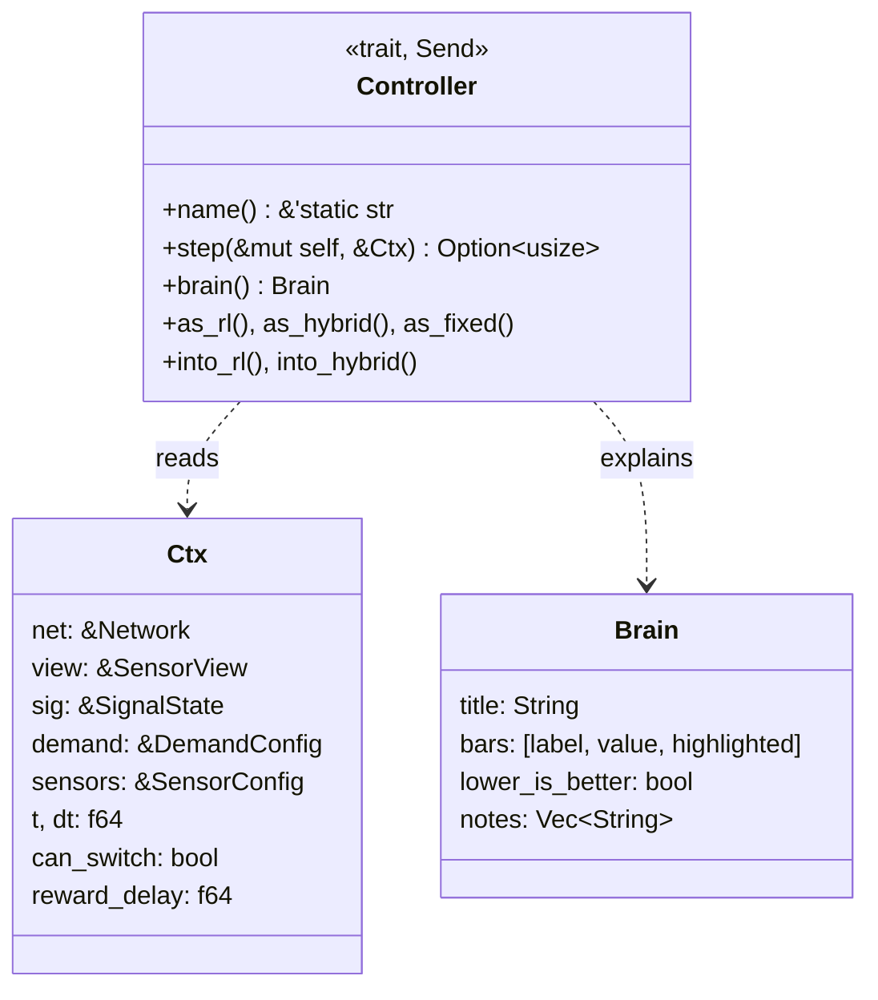

The six controllers, and what the two learned ones are built from:

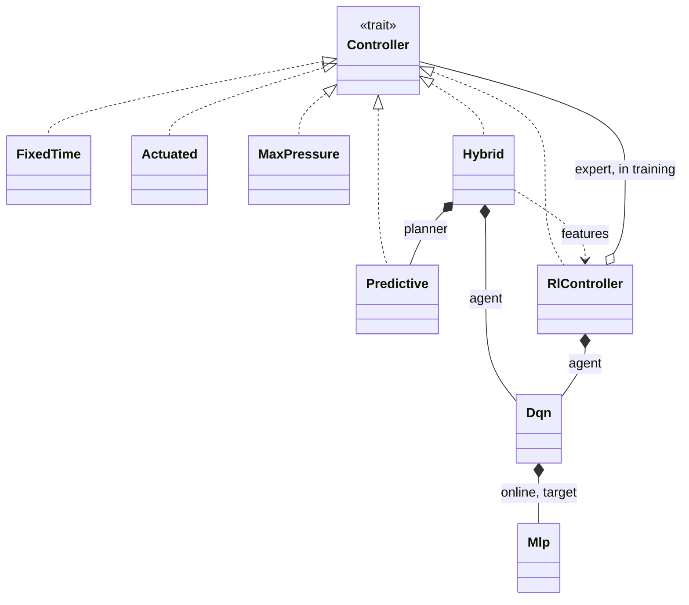

* **`step`** is called every simulation step, whatever the signal is doing, so a
  learning controller keeps adding up its reward. It returns `Some(j)` to ask for stage
  `j` and `None` to hold. Each controller here asks only while the signal is green and
  `ctx.can_switch` is true, and `Sim::control_signal` checks `can_switch` again (§7.2).
* **`brain()`** fills the app's *Controller brain* panel with a title, bars, notes and
  whether lower is better. Each controller explains itself in its own terms: green
  times, the gap since the last actuation, stage pressures, plan costs or Q-values.
* **The `as_*` and `into_*` methods** are narrow downcasts. Their default
  implementations return `None`, and only the matching controller overrides one. The app
  uses `as_rl` and `as_hybrid` for the learning controls, corridor coordination uses
  `as_fixed` to install a coordinated plan and `train` uses `into_rl` and `into_hybrid`
  to take an agent back out of a `Sim` after an episode. They avoid `Any` and keep the
  trait object-safe.
* **`Controller: Send`**, so a `Sim` can move to another thread with its controller.
* **`CtrlKind`** names the six controllers (`ALL`), each with a display `name`, a
  `short` name, a `description` and `adaptive()`, which is true for max-pressure,
  predictive, Deep RL and the Hybrid. **`make()`** is the only place that maps a
  `CtrlKind` to a concrete type. For Deep RL and the Hybrid it loads the trained
  weights (§8.7).
* **Helpers:** `stat` gives a movement's `MStat` in a stage, `lanes_for` the number of
  inbound lanes that can carry a movement and `needs_clearance` whether a switch between
  two stages needs a yellow and an all-red.

### 7.2 What `Sim` does with the controller's wish

`Sim::control_signal` runs in step 4 of §5. It calls the controller first, every step,
so the learning controllers keep counting their reward even when something overrides
them. Then:

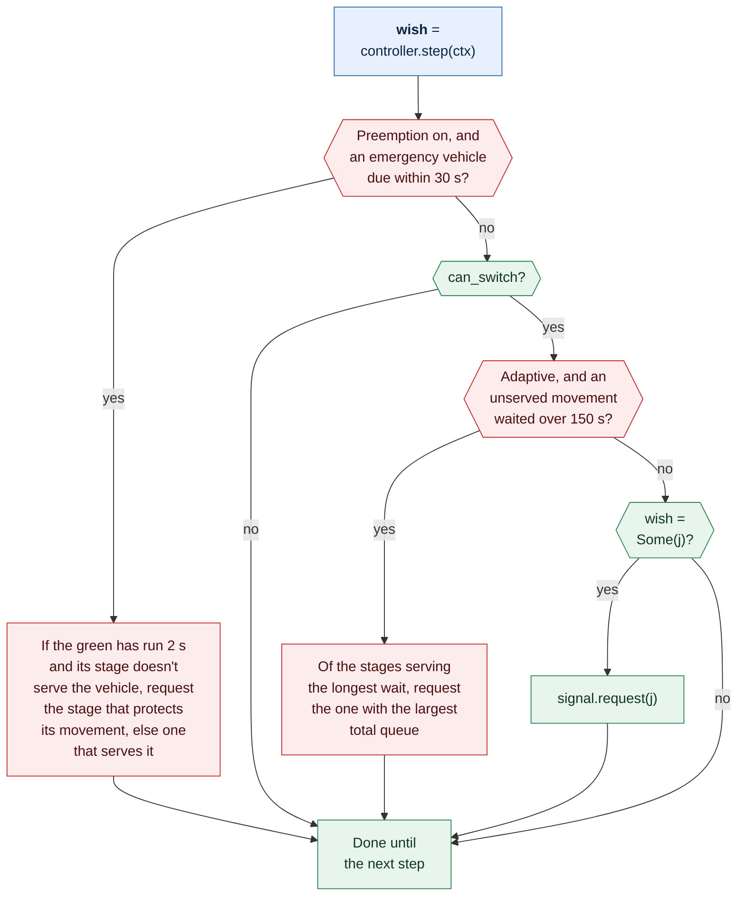

* **Emergency preemption** (`preemption`, on by default) follows the emergency vehicle
  that the sensor view says will arrive first: one on an approach lane within 300 m of
  the stop line, due within 30 s at its current speed (taken as at least 3 m/s), or one
  already in the box. While such a vehicle is due, neither the max-wait guard nor the
  controller's wish is considered, even when no request is made. It is the only request
  that doesn't wait for `can_switch`: after 2 s of green it can cut a minimum green
  short, and with it any WALK or flashing DON'T WALK. While it is active, the app adds
  *EMERGENCY PREEMPTION* to the signal's status line.
* **The max-wait guard** (`max_wait_guard`, 150 s by default, 0 turns it off) applies
  to the adaptive controllers only. It looks at the movements the current stage doesn't
  serve at all, and at their longest sensed waits.
* Otherwise the controller's wish, if any, goes to `SignalState::request` (§6.4).

### 7.3 The controllers

| Controller | What it uses | When it asks for another stage |
|---|---|---|
| Fixed-time (`FixedTime`) | The design demand; no sensors | When the stage's green time is up |
| Actuated (`Actuated`) | Stop-bar presence, advance pulses, push buttons, buses, loop faults | On gap-out or max-out |
| Max-pressure (`MaxPressure`) | Queues, arrivals within 8 s, exit queues, waiting pedestrians | When another stage's pressure is higher by more than 3.0 |
| Predictive (`Predictive`) | Every `Obs`: arrival time, people, wait and class; waiting pedestrians | When switching now is the cheapest plan, checked every second |
| Deep RL (`RlController`) | `features(ctx)` (§8.2) | When the network picks another stage, every 2 s |
| Hybrid (`Hybrid`) | `features(ctx)`, and everything `Predictive` uses | As `Predictive`, re-tuned every 10 s |

* **Fixed-time** applies Webster's method to the design demand when it is built. A
  stage's critical flow ratio y is the highest ratio of flow to saturation flow among
  the lanes that discharge in it. The saturation flow is 1,800 vehicles per hour, or 70%
  of that for a lane with a permissive movement. Their sum Y is capped at 0.92, and the
  cycle C₀ = (1.5L + 5)/(1 − Y), with L the yellow and all-red time per cycle, is held
  between 40 and 150 s. The green time is split in proportion to y. Each green is then
  raised to at least 7 s, or, where pedestrians are expected, to the 7 s WALK plus the
  longest crosswalk at 1.1 m/s, so the final cycle can be longer than 150 s. After a
  preemption, a planned stage that was left running keeps its place: it ends when its
  own green time is up, and the plan continues from it. A stage outside the plan ends as
  soon as it can, and the plan resumes after the last planned stage that ran.

  In a corridor, `coordinate_plan` installs a common cycle. The main-road stage comes
  first, at the intersection's offset, and gets the spare time, and every stage ends at
  a fixed force-off point. A stage that starts after its force-off point ends as soon
  as it can.
* **Actuated** control is NEMA-style, on a single ring over `fixed_sequence`, and skips
  stages with no call. A call comes from stop-bar presence, a queue estimate of at least
  half a vehicle or a push button.
  * The green extends while the lanes the stage fully serves keep producing actuations
    within the 2.5 s passage time, and gaps out when they stop.
  * It maxes out at 22 s for a stage with a protected left turn and no protected
    through movement, and at 50 s otherwise.
  * A bus that the camera or its own messages place less than 8 s from the stop line, on
    a movement the stage gives a protected or right-turn green, holds the green for up
    to 10 s past the maximum.
  * A lane flagged faulty by the diagnostics (§6.5) is on max recall: it places a call
    and always extends.
  * Without loops, a green can't gap out, so it runs to its maximum when another stage
    has a call. With neither loops nor a camera, every stage is on recall.
* **Max-pressure** follows Varaiya's rule. For each movement a stage serves, it adds
  w × max(0, up/√n − down) × √n, where:
  * n is the number of lanes that can carry the movement;
  * w is 1 for a protected or right-turn green and 0.45 for a permissive one;
  * up is the movement's queue plus half the weight of the moving vehicles due within
    8 s;
  * down is the queue on its exit road per outbound lane, which only a camera
    measures.

  Each pedestrian waiting at a crosswalk the stage walks adds 1.5. The controller
  switches when another stage's pressure is higher than the current one's by more than
  3.0.
* **Predictive** control is a rolling-horizon planner in the spirit of SURTRAC. Every
  second, it builds a list of arrivals from the sensor view:
  * each observed vehicle's predicted arrival at the stop line, weighted by its people,
    with an emergency vehicle counting 40 times;
  * each waiting pedestrian as a person already queued on the first protected movement
    of each stage that walks them.

  It then tries holding the current stage for 0, 2, 4, 7, 10, 15, 20 or 30 s, no longer
  than `max_green`, before switching to each other stage, and serves the remaining
  stages greedily to the end of a 90 s horizon. Each schedule is costed by simulating
  how the queues discharge:
  * saturation headways of 2.0 s for a protected movement, 2.4 s for a right turn and
    4.2 s for a permissive one, shared among the movement's lanes;
  * 2 s of start-up lost time, and 1.5 s of the yellow used;
  * a green from the minimum green up to 45 s, long enough for the queue.

  The cost is the person delay plus `fairness` × the growth of each person's squared
  wait. A vehicle not served within the horizon costs its remaining horizon plus 25 s,
  and the holding schedules' costs are multiplied by 1 + `hold_bias`. Only the first
  decision of the cheapest schedule is acted on, and only if it is to switch now. The
  plan is made again a second later. `max_green` (60 s), `fairness` (0.004) and
  `hold_bias` (0) are public, so the Hybrid can tune them.
* **Deep RL** picks the next stage with a neural network every 2 s of green, once the
  minimum green has run, through a safety shield (§8.2).
* **The Hybrid** leaves every signal decision to an embedded `Predictive`. Every 10 s,
  whatever the signal is doing, its network picks one of 48 tunings of that planner.
  Where training kept no network, it applies its best static tuning (§8.5).

The two learned controllers share code. The Hybrid reuses `RlController::features`,
`n_inputs`, the discount `GAMMA_PER_2S` and the reward scale `REWARD_SCALE`.
`RlController` can also hold another controller as an **expert**, which `train` uses
to guide exploration (§8.5).

---

## 8. Learning: `src/rl/` and training

The program ships two learned controllers, and both use the same kind of network:

* **Deep RL** (`control/rl.rs`): the network picks the next signal stage.
* **Hybrid** (`control/hybrid.rs`): the network picks a tuning for the predictive
  planner, and the planner picks the stages.

Each signalized layout has a weights file for each controller in `weights/`. The four
Deep RL files and the Hybrid's arterial and town files hold a trained network; the
Hybrid's major/minor and T-intersection files hold only its best static tuning
(§8.5).

| File | Lines | What it holds |
|---|---:|---|
| `src/bin/train.rs` | 428 | Training, model selection and the test report |
| `rl/nn.rs` | 190 | `Mlp`, `Grads` and `Adam` |
| `rl/dqn.rs` | 165 | `Dqn`, `Transition`, `SavedModel` and `argmax_masked` |
| `rl/mod.rs` | 5 | The module list |

Version 0.3.0 cut the Deep RL networks from two hidden layers to one, because one layer
trained to lower delay on every layout (§8.6). Version 0.4.0 changed training in three
ways: the reward counts every delayed person; checkpoints are chosen on a validation set
and must pass a pedestrian check; a separate test set reports the result. Deep RL's
shield also gained a maximum pedestrian wait, because the reward alone did not protect
pedestrians. Both controllers were retrained this way, and version 0.5.1 ships those
networks. Version 0.5.1 added the checks on weights files (§8.7).

### 8.1 At a glance

| Property | Deep RL | Hybrid |
|---|---|---|
| Network type | Fully connected multilayer perceptron (MLP) | Same |
| Layers | Input → 128 ReLU → linear output | Same |
| Inputs | 6 per movement + 1 per stage + 1 + 4 (45 to 85 values) | The same features |
| Outputs | One Q-value per stage (4 to 8) | One Q-value per tuning (48) |
| Parameters | 6,404 (T-intersection) to 12,040 (arterial) | 16,944 (town), 17,200 (arterial) |
| Network size in memory | About 26 to 48 KB (`f32`) | About 68 KB |
| Size on disk | 72 to 136 KB of JSON per layout | About 190 KB with a network, 61 bytes without |
| Decision interval | Every 2 s of green, once the minimum green has run | Every 10 s, whatever the signal is doing |
| Learning algorithm | Double DQN, experience replay, Polyak-averaged target | Same |
| Hardware | CPU only, one thread per agent | Same |
| Code | 360 lines of Rust in `src/rl/`, with no machine-learning library | Same |

The parameter count for the arterial Deep RL network is 85 × 128 + 128 = 11,008 for
the hidden layer and 128 × 8 + 8 = 1,032 for the output layer: 12,040 in all. The
Hybrid's arterial network has the same hidden layer and 48 outputs
(128 × 48 + 48 = 6,192): 17,200 in all.

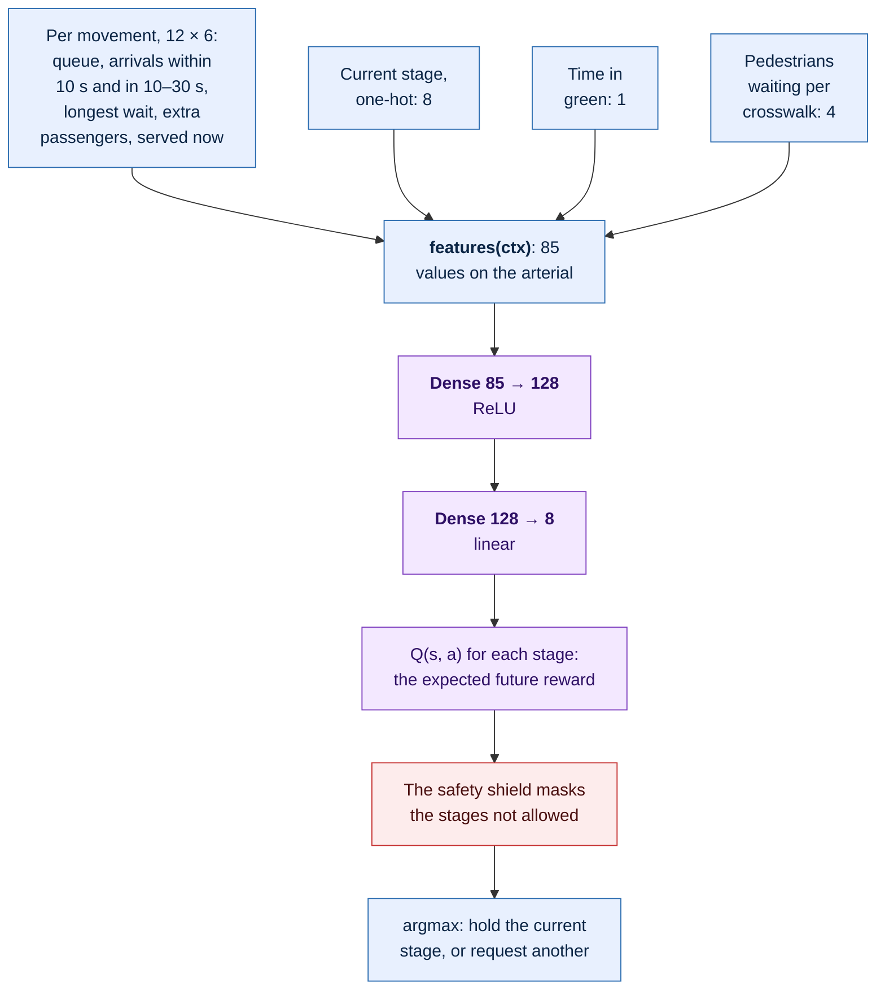

### 8.2 Inputs, outputs and the safety shield

`RlController::features` builds the input vector from the `SensorView`, the same
sensor data every other adaptive controller sees. Vehicles come only from the
sensors, so the network has to cope with missed detections, noise and faulty loops
just as the other controllers do. Waiting pedestrians come straight from ground truth,
as they do for every controller (§6.5). The Hybrid uses the same function.

| Feature | Scaling | Cap | Meaning |
|---|---|---|---|
| Queue | ÷ 8 | 3 | Estimated stopped or slow vehicles on the movement |
| Arrivals within 10 s | ÷ 8 | 3 | Detected moving vehicles due at the stop line within 10 s |
| Arrivals in 10–30 s | ÷ 8 | 3 | The same, 10 to 30 s out |
| Longest wait | ÷ 60 s | 3 | The longest current wait on the movement |
| Extra passengers | ÷ 20 | 3 | Person-weighted queue beyond 1.4 people per vehicle, which shows buses |
| Served now | 1, 0.5 or 0 | | 1 for a protected or right-turn green, 0.5 for a permissive one and 0 for red, in the current stage |
| Current stage | One-hot | | Which stage is running |
| Time in green | ÷ 60 s | 2 | How long the current green has run |
| Pedestrians waiting | ÷ 4 | 1.5 | Per crosswalk, padded to 4 slots |

Arrival counts are weighted by how likely each vehicle is to be making that movement,
since a vehicle's intended turn is often unknown (§6.5). Every feature is divided by a
typical value and capped, so all inputs lie between 0 and 3. That keeps the first
layer's inputs on a similar scale without learned normalization, and stops a
gridlocked approach from producing values far outside anything seen in training.

The Deep RL network has one output per stage. Choosing the current stage means
"extend it", and choosing another means "switch to it". The network never sets
durations or clearance times: `SignalState` still runs every yellow and all-red, and
`can_switch` every minimum green, so the network can't produce an unsafe signal.

Before the network's choice is used, `RlController::shield` decides which actions are
allowed:

* Once a pedestrian has waited more than 40 s (`PED_MAX_WAIT`), the crosswalk with
  the longest such wait decides: if the current stage doesn't walk it, only the
  stages that walk it are allowed.
* Otherwise a stage is allowed if it has demand: at least half a vehicle queued or due
  within 12 s on its movements, counting the pedestrians waiting at its crosswalks.
* The current stage may be held only before 60 s of green, and only if it has demand
  or no other stage does.
* If that leaves nothing allowed, holding is allowed.

The pedestrian rule uses the sensor view's longest wait at each crosswalk, which a
push-button call provides in the field.

The argmax is taken over the allowed actions only. The same mask is stored with each
transition (`mask2`), so the learning target also considers only actions that would
have been allowed. That keeps the values the network learns consistent with what it
can actually do.

The Hybrid's 48 outputs are combinations of three planner settings: 3 fairness weights
(0, 0.004, 0.012) × 4 hold-or-switch biases (−0.05, 0, +0.08, +0.2) × 4 maximum greens
(35, 45, 60, 90 s). It needs no shield, because every tuning is safe: the planner and
`SignalState` enforce the rules whatever the tuning.

### 8.3 Reward and discounting

The reward is the negative person delay accrued between decisions, divided by 150
(`REWARD_SCALE`). Each step adds up:

* each vehicle's lost time compared with its free-flow speed, multiplied by its
  occupancy, so a full bus counts for more than a car;
* the time of every person in a vehicle held at the edge of the map because its
  approach has backed up that far;
* the time of every pedestrian waiting to cross, one person each.

Dividing by 150 keeps rewards and temporal-difference (TD) errors near 1 in size, where
the Huber loss behaves well.

Version 0.4.0 added the second and third terms. Without the second, once a starved
approach backed up past the map edge its extra waiting stopped costing anything, while
the evaluation score still counted it. Without the third, the network gained nothing
from serving pedestrians sooner, which is why 0.3.0's Deep RL networks for the
T-intersection left pedestrians waiting 46 s on average. The third term alone did not
fix that; the shield's pedestrian rule did (§8.5).

The discount is γ = 0.96 per 2 s, which gives a half-life of about 34 s and an
effective horizon of about 50 s. That is long enough to value clearing a queue whose
payoff comes after the yellow and all-red, and short enough to keep Q-values bounded.

Decisions are not evenly spaced: none are made during a yellow, an all-red or a
minimum green. Each transition therefore stores `disc` = γ^(elapsed / 2 s), and the
target uses that instead of a fixed γ. This is the semi-Markov form of Q-learning.

### 8.4 `rl/nn.rs` and `rl/dqn.rs`: the learning step

These files know nothing about traffic, and they use no machine-learning library: only
`serde`, to save networks as JSON, and the crate's own `Rng` (§6.9).

* **`nn.rs`:**
  * `Mlp`, a stack of `Dense` layers (row-major `f32` weights) with ReLU on the hidden
    layers and He initialization;
  * `forward`, `forward_all` and `backward`, which backpropagates into `Grads`;
  * `soft_update`, the Polyak averaging for target networks, and `Adam`;
  * `fits(n_in, n_out)`, which checks a network read from a file before it runs
    (§8.7).
* **`dqn.rs`:**
  * `Dqn::new(n_in, n_out, hidden, seed)` builds the online network and a target
    copy. Both controllers ask for one hidden layer of 128
    (`control::rl::HIDDEN` and `control::hybrid::HIDDEN`).
  * `push` stores a `Transition` in a 60,000-transition replay ring, and
    `train_step` does nothing until it holds 1,000.
  * `argmax_masked` takes the argmax over the allowed actions, or over all of them if
    the mask allows none.
  * The last 500 losses are kept for the app's TD-loss chart.
  * `SavedModel` is the on-disk form: layout, input and output sizes, episode count
    and the network.

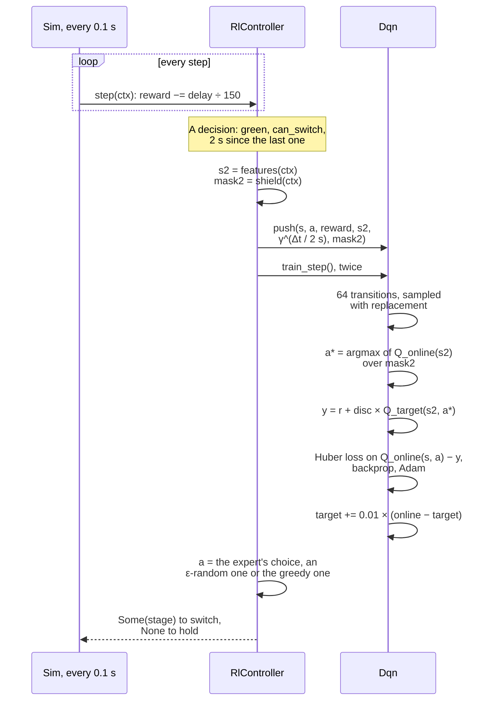

A transition is stored only while learning is on, and not at an episode's first
decision, which has no previous one. The Hybrid's step is the same, except that it
decides every 10 s, trains four times per decision and stores a mask that allows every
tuning.

| Setting | Value | Why |
|---|---|---|
| Algorithm | Double DQN | The action set is small and discrete. Learning off-policy lets the agent learn from replayed transitions and from the expert's actions. Double DQN reduces the overestimation that plain DQN shows when many actions have similar values, as hold and switch often do |
| Loss | Huber, δ = 1 | The gradient is capped at ±1, so a rare very large delay can't destabilize training |
| Optimizer | Adam, learning rate 5 × 10⁻⁴ (1.5 × 10⁻⁴ when resuming) | Standard for DQN, and insensitive to the scale of each weight |
| Batch | 64 transitions, uniform sampling | Small enough to be quick on a CPU |
| Replay buffer | 60,000 transitions, training starts at 1,000 | Holds the last 130 or more Deep RL episodes, which breaks the correlation between consecutive decisions |
| Gradient steps | 2 per decision (Deep RL), 4 per decision (Hybrid) | The Hybrid decides five times less often, so it takes more steps per decision |
| Target network | Polyak averaging, τ = 0.01 per step | The target trails the online network by about 100 steps, which stabilizes the bootstrap target |
| Initialization | He normal (σ = √(2 / inputs)), zero biases | Suited to ReLU layers |
| Episode boundaries | `new_episode` drops the pending transition | No transition spans two episodes, so no terminal flag is needed. Each 900 s episode is treated as a slice of continuing traffic |

### 8.5 `bin/train.rs`: training and model selection

`train [layout|all] [episodes] [episode-seconds] [dqn|hybrid|both]` trains on the
signalized layouts. The defaults are `all 200 900 both`; the README's commands train
800 episodes of 900 s. It runs one thread per layout and controller, so `train all`
trains eight agents at once, and the private `Agent` enum wraps the two controllers
behind one interface. It moves the boxed controller into a `Sim`, runs an episode, and
takes it back out with `into_rl` or `into_hybrid`.

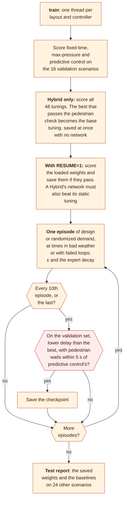

The schedules below are fractions of the run, so a longer run stretches them.

* **Demand:**
  * 35% of episodes use the layout's design demand, scaled by 0.8 to 1.2;
  * the rest are randomized: each flow scaled by 0.35 to 1.35, turning shares by 0.5
    to 1.6, a random arrival pattern, 0 to 140 pedestrians per hour and 0 to 8% buses.

  Training on varied traffic makes the network work across demand levels instead of
  memorizing one.
* **Sensors:** 25% of episodes run at night or in rain, fog or snow, and 10% with a
  quarter of the loop detectors failed.
* **Exploration:**
  * the exploration rate ε falls linearly from 0.25 to a floor of 0.03, reached at about
    62% of training;
  * Deep RL draws its random actions from the shield-allowed set and, when the shield
    allows holding, half of them hold the current stage, because a random switch
    every 2 s would never let a queue clear;
  * half of the Hybrid's random choices keep the current tuning.
* **Expert guidance:** with a probability that falls from 0.6 to 0 over the first 45%
  of training, the agent takes the expert's choice instead of its own.
  * For Deep RL, the expert is a predictive controller running alongside it: its
    latest switch request, if it made one in the last 1.15 s, and otherwise holding.
  * For the Hybrid, the expert is the best static tuning, `base_action`.

  Because DQN learns off-policy, these expert actions teach the network what good
  timing looks like early on, and the agent then improves on them by itself.
* **Model selection:**
  * every 10 episodes, and after the last, the greedy policy is evaluated on a
    validation set of 16 fixed scenarios. Each block of eight has two at design demand,
    one at 0.8×, one at 1.2×, two with randomized demand, one in bad weather and one
    with a quarter of the loops failed;
  * the score is the mean of `person_delay_all`, the measure the README's benchmark
    uses, here over the last 780 s of a 900 s episode, after a 120 s warm-up (the
    benchmark warms up for 300 s and then measures 20 minutes);
  * weights are saved only when the score beats the best so far *and* the mean
    pedestrian wait is no more than 5 s (`PED_MARGIN`) above the predictive
    controller's on the same scenarios.

  This is early stopping, so the shipped network is the best checkpoint, not the last.
* **The Hybrid's bar:** before its network trains, all 48 tunings are scored as fixed
  settings on the validation set. The best one that passes the pedestrian check
  becomes `base_action` and is saved at once, with no network, and its score is the
  one to beat. A Hybrid whose network never beats it ships as `base_action` alone.
* **Test set:** after training, the saved weights, the baselines and, for the Hybrid,
  the static tuning are scored on 24 more scenarios of the same kinds, with different
  seeds. Nothing is chosen on this set; it only reports. Before this split, the Hybrid
  was chosen and reported on the same 12 scenarios, where it looked 0.9 s better than
  predictive control, and it then came out 1.0 s worse in the README's benchmark.
* **The pedestrian check in practice:** the Hybrid passed it on every layout, because
  the planner serves pedestrians itself. Deep RL retrained with the new reward passed
  on the town layout in all three seeds, but found a passing checkpoint in only 2 of 9
  runs on the other layouts, and both of those did poorly on the test set. Counting
  each waiting pedestrian like one vehicle occupant is not enough: pedestrians are a
  small share of the people at an intersection, so the network still trades their
  waits for vehicle delay. Short trials (400 episodes, one seed, on the three failing
  layouts) compared a pedestrian weight of 3 without a wait limit, and limits of 40 s
  and 30 s with weights of 1, 3 and 5. The weight alone still failed on major/minor;
  every setting with a limit passed everywhere. A 40 s limit with no extra weight had
  the best validation score, and it is the simplest, so that is the shield rule.
  Retrained with it, all 12 Deep RL runs (four layouts, three seeds) passed. When no
  checkpoint passes, `train` writes no Deep RL weights for that layout; a Hybrid file
  is always written, because its static tuning is saved first.

The episode counts in the weights files are the episodes where each best checkpoint
occurred: 670 to 790 for Deep RL, 300 and 560 for the Hybrid's two networks. With 12 to
15 agents training at once in several processes, one per core, 800 episodes took 5 to
11 minutes per Deep RL agent and 14 to 19 minutes per Hybrid agent, which first scores
all 48 static tunings.

Three environment variables change a run:

* **`RESUME=1`** fine-tunes the saved weights at a learning rate of 1.5 × 10⁻⁴, with ε
  falling from 0.06 to 0.02 and no expert. The loaded weights are scored first and
  saved if they pass. A resumed Hybrid first saves the newly calculated static tuning
  with no network, so a loaded network that can't beat that tuning is dropped from the
  file.
* **`SEED=n`** changes the network's initial weights (seed 42 + n) and the random
  draws of each episode's demand and conditions. The validation and test sets stay the
  same.
* **`HIDDEN=128,128`** sets the hidden layers of a new network. It is ignored when
  resuming.

### 8.6 Choosing the network size

The original size, two hidden layers of 128, was a conventional starting point, not a
measured choice. A later experiment tested it on Deep RL, using a held-out set of 24
scenarios (12 at design demand, 12 randomized), not the §8.5 test set, that model
selection never sees.

First, five sizes on the arterial layout, three seeds each, 400 episodes:

| Hidden layers | Parameters | Held-out person delay (mean of three seeds) |
|---|---|---|
| 1 × 128 | 12,040 | **21.9 s** |
| 2 × 64 | 10,184 | 23.0 s |
| 2 × 128 | 28,552 | 25.6 s |
| 2 × 256 | 89,864 | 26.6 s |
| 3 × 128 | 45,064 | 28.2 s |

Then one layer against two on every layout, at 400 and 800 episodes:

| Layout | 2 × 128, 400 | 2 × 128, 800 | 1 × 128, 400 | 1 × 128, 800 |
|---|---|---|---|---|
| Arterial | 25.6 s | 25.2 s | 21.9 s | **21.2 s** |
| Major/minor | 27.0 s | 27.2 s | 23.8 s | **23.3 s** |
| Town | 33.8 s | 30.7 s | 28.7 s | **26.2 s** |
| T-intersection | 13.2 s | 12.9 s | 11.7 s | **11.1 s** |

One layer won on every layout, and at 800 episodes the worst one-layer seed beat the
best two-layer seed on all four. Longer training helped both sizes a little but did not
close the gap, so the larger network is not just slower to learn. A likely reason is
that the inputs are already engineered summaries, so a good policy needs only modest
combinations of them, while a deeper network adds instability to learning from its own
bootstrapped targets and more room to overfit the selection scenarios. The three-layer
networks had the biggest gap between their selection score and their held-out score
(2.3 s on average, against 0.2 s for one layer).

Version 0.3.0 shipped seed 0 of the one-layer, 800-episode runs. In the README's
benchmark they cut Deep RL's person delay from 31.1 to 19.4 s on the arterial, 34.3 to
24.4 s on major/minor, 40.0 to 30.0 s on the town layout and 13.1 to 11.7 s on the
T-intersection. The current Deep RL networks, retrained with the new reward, selection
and pedestrian rule, are also seed 0, which `train all 800 900 dqn` reproduces.

In the README's benchmark, these networks looked 0.6 to 1.9 s worse than 0.3.0's on
three layouts, which suggested the pedestrian rule was costly. A cleaner comparison
separated the two changes: Deep RL was retrained with the new reward and selection but
no rule and no pedestrian check, three seeds per layout, and set against 0.3.0's three
seeds and the current networks' three. On the §8.5 test set, all 24 scenarios, mean of
three seeds, person delay / pedestrian wait:

| | 0.3.0 | New training, no rule | New training + rule | Predictive |
|---|---|---|---|---|
| Arterial | 19.9 / 21.5 s | 21.7 / 25.1 s | 20.3 / 17.7 s | 18.2 / 13.2 s |
| Major/minor | 25.5 / 28.3 s | 24.8 / 27.7 s | 23.4 / 16.0 s | 22.4 / 11.8 s |
| Town | 27.3 / 14.8 s | 28.7 / 11.8 s | 26.7 / 10.7 s | 25.6 / 9.6 s |
| T-intersection | 12.0 / 45.6 s | 11.5 / 36.8 s | 12.6 / 19.7 s | 14.4 / 21.3 s |

* **The rule's own effect** (the middle two columns): person delay fell by 1.4 s on the
  arterial and major/minor layouts and 2.0 s on the town layout, and rose 1.1 s on the
  T-intersection. Pedestrian waits fell by 1 to 17 s. One explanation, not tested, is
  that the rule forces a regular rotation through the stages, which the network
  otherwise has to discover, and the stage that serves a waiting pedestrian also serves
  vehicles that have waited.
* **The other training changes** (0.3.0 against the no-rule column): 1.4 to 1.8 s
  worse on the arterial and town layouts, 0.5 to 0.7 s better on the other two. A
  likely reason, not tested, is that the wider reward and the harder selection
  scenarios spread the network's effort beyond design demand, where 0.3.0 was mostly
  chosen.
* **Net:** against 0.3.0, person delay is +0.4, −2.1, −0.6 and +0.6 s, and pedestrian
  waits are 4 to 26 s shorter.
* **Why the benchmark misled:** it scores one network per layout at design demand, and
  networks trained from different seeds differ by 1 to 3 s. 0.3.0's seed-0 arterial
  network was its best of three; the current one is in the middle.
* **The check never bound:** the rule arm, selected without the pedestrian check, chose
  exactly the shipped networks.

The Hybrid was then tested separately, with the new reward and selection: one and two
hidden layers of 128, three seeds each, 800 episodes, on every layout. Mean test-set
person delay:

| Layout | 1 × 128 | 2 × 128 |
|---|---|---|
| Arterial | 17.7 s | 17.7 s |
| Major/minor | 21.3 s | 21.2 s |
| Town | 24.9 s | 25.6 s |
| T-intersection | 14.0 s | 14.0 s (no network kept in any seed) |

The validation scores differed by 0.2 s or less. For the Hybrid, the size makes no
difference worth measuring, so it uses one layer, like Deep RL, which is smaller and
trains faster. The shipped Hybrid networks are seed 0, which
`train all 800 900 hybrid` reproduces; no seed was picked by its results.

In the shipped Hybrid weights (validation score, then test score):

| Layout | Best static tuning | Network |
|---|---|---|
| Arterial | fairness 0.004, bias +0.08, max green 60 s | Kept: validation 18.5 → 17.3 s, test 17.7 → 17.5 s |
| Major/minor | fairness 0, bias +0.08, max green 35 s | Not kept, so the Hybrid runs the static tuning |
| Town | fairness 0.012, bias −0.05, max green 35 s | Kept: validation 25.4 → 25.2 s, test 25.8 → 24.3 s |
| T-intersection | fairness 0, bias +0.08, max green 60 s | Not kept |

The two "not kept" files are 61 bytes long: they hold the static tuning and no network.
On the test set the Hybrid beats predictive control on every layout, by 0.4 to 1.3 s.
On the arterial, major/minor and T-intersection layouts most or all of that comes from
the static tuning; on the town layout it all comes from the network.

### 8.7 `control/weights.rs`: loading and saving

`make()` loads a controller's file through `load_or_new`, which asks `weights::load`
for the file's text and `from_saved` for a controller built from it:

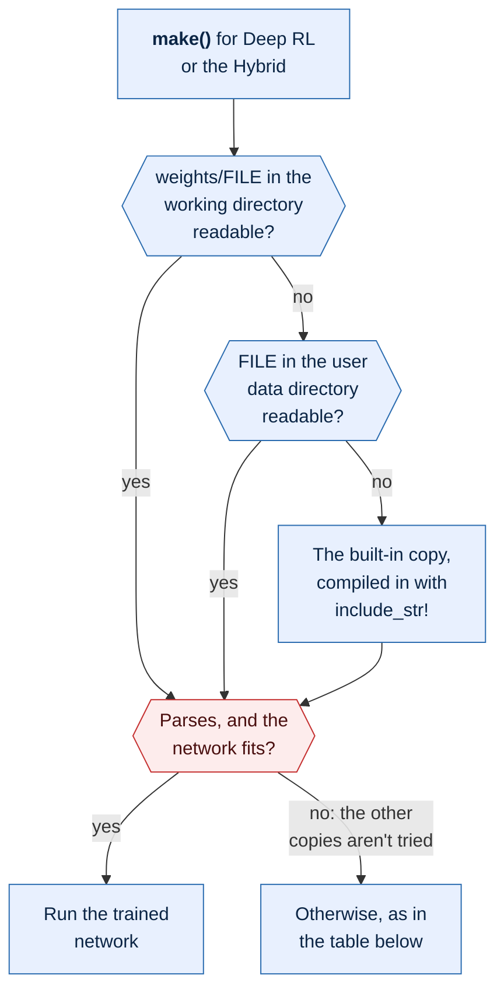

* **Where it looks:** the first *readable* copy wins. `weights/` in the working
  directory is where `train` writes. The user data directory is where the app saves:
  * macOS: `~/Library/Application Support/Intersection Lab/weights/`;
  * Windows: `%APPDATA%\Intersection Lab\weights\`;
  * other systems: `$XDG_DATA_HOME/intersection-lab/weights/`, or
    `~/.local/share/intersection-lab/weights/` when `XDG_DATA_HOME` isn't set.

  The eight shipped files are compiled into the binary (`EMBEDDED`), so an installed app
  or the browser build works anywhere. The browser build can't read files, so it always
  uses these. Deep RL's *Controller brain* panel names the file it loaded, with
  "built-in" in front for a compiled-in copy.
* **What is checked:** the file must parse, and its network must fit.
  `SavedModel::fits` compares the sizes the file declares with the layout's, and
  `Mlp::fits` checks the network itself:
  * at least one layer, each taking as many inputs as the one before gives;
  * every layer at least 1 wide, with weight and bias arrays of exactly the lengths
    its sizes call for;
  * only finite values, and the last layer as wide as the outputs.

  The layout name in the file isn't checked, but the layouts' input counts all differ
  (45, 83, 84 and 85), so a file can't be applied to the wrong layout.
* **What happens when a check fails:** nothing is logged, and the other copies aren't
  tried.

| The file found | Deep RL | Hybrid |
|---|---|---|
| Parses, and its network fits | Runs the network, with learning off | Runs the network |
| Parses, with no network or one that doesn't fit | A fresh network (seed 7) that learns online with ε = 0.2 | The saved base tuning, with no network |
| Doesn't parse | The same fresh network | The planner's default tuning (`DEFAULT_ACTION`: fairness 0.004, no bias, 60 s), so it behaves exactly like `Predictive` |

The panel then says "no pretrained weights found" for Deep RL. For the Hybrid it says
"no network beat the best static tuning", the same as for the shipped static files, or
"running the planner's default tuning".

Saving goes through `save_path`. It writes to `weights/` in the working directory when
that directory exists, which, run from a checkout, overwrites the shipped files.
Otherwise it writes to the user data directory, creating it first, or to `weights/` when
there is no user data directory. `train` creates `weights/` when it saves, and the next
build embeds whatever it wrote.

In 0.5.1 two saves write a Hybrid file that doesn't load. The app's *Save weights*
records the Hybrid's score as NaN, and `train` records an infinite score when no static
tuning passes the pedestrian check. The JSON writer stores either as `null`, which the
reader rejects, and since the other copies aren't tried, that Hybrid then runs the
planner's default tuning.

In the app, each learned controller has a *Keep learning online* box, an ε slider and,
on the desktop, *Save weights*. A loaded Deep RL network starts with learning off and
ε = 0.05, and its updates start once 1,000 transitions are stored. Deep RL also has
*Reload pretrained*, which rebuilds the controller through `make`, so it loads whichever
copy the search finds first: after a save, the saved one. In the browser, learning and
*Reload pretrained* work in memory, and *Save weights* is hidden.

Weights files can be damaged or edited by hand, so their loading is tested and fuzzed:

* `tests/weights_files.rs` checks that every shipped file loads, that seven kinds of
  misshapen network are rejected (one with a weight of 10³⁹, which is infinite as an
  `f32`), that a Hybrid whose network doesn't fit keeps its base tuning and that
  networks whose outputs overflow don't crash anything.
* The `weights` fuzz target reads each input as both kinds of file for the
  T-intersection. A file that is accepted gets a training step if it has a network,
  then 20 s of simulation. The CI job "Fuzz (weights)" runs it for 60 s, starting from
  the three files in `fuzz/seeds/weights/`.

### 8.8 Hardware, design choices and limitations

The networks run on the CPU. They do not use a GPU, Apple's Neural Engine, any other
neural accelerator or a linear-algebra library:

* `nn.rs` is plain Rust loops over `Vec<f32>`.
* The GPU in the app is used only by egui to draw the screen.
* The release build doesn't target a specific CPU, so the compiler can only use the
  baseline vector instructions (SSE2 on x86-64, NEON on ARM64). The forward pass sums
  each dot product in order, and Rust does not reorder floating-point additions, so
  those sums stay scalar. The element-wise loops in backprop and Adam may be
  vectorized.

This is deliberate, because an accelerator would not speed anything up here:

* **The work is tiny.**
  * One decision is a single forward pass of about 12,000 multiply-adds, made at most
    every 2 s of simulated time, which takes microseconds.
  * One training step (64 samples, three forward passes and a backward pass each) is
    about 4 million multiply-adds, a few milliseconds on one core.
  * A `Dqn` holds five arrays the size of its network (online, target, Adam's two
    moments and the gradients): about 340 KB for the Hybrid's arterial network. Its
    replay buffer is larger, about 50 MB when full on the arterial.
  * Copying data to a GPU and launching kernels would take longer than the math.
* **The rest of the work is the simulation.** Vehicle motion, right of way and sensors
  run in 0.1 s steps as branchy CPU code that a GPU would not help. Training gets its
  speed by running each agent on its own core instead.
* **Portability.** The same code runs in the browser build (WebAssembly), on every
  desktop platform and in CI, with no drivers or GPU runtime.
* **Reproducibility.** The code has a fixed order of operations and its own seeded
  `Rng`, so the same seed and arguments give the same network. GPU libraries often
  don't guarantee that.

To use an accelerator in the future, the right first step would be to batch many
simulations so that one forward pass serves hundreds of intersections. Accelerating the
current single-sample calls would not help.

Why the networks are built this way:

* **A small MLP:**
  * the input is a fixed-length vector of engineered features, not an image or a
    sequence, so convolutional or recurrent layers would add nothing;
  * the arrival predictions already carry the short-term future that a recurrent
    network would otherwise have to learn;
  * one hidden layer of 128 is enough to learn interactions such as "a long queue
    matters only if its stage isn't running", and it trained to lower delay than two
    or three layers on every layout (§8.6);
  * 800 episodes train in 5 to 19 minutes per layout and controller on one core.
* **One network per layout:** the input and output sizes depend on the layout's
  movements and stages, so each layout gets its own network.
  * The cost is that nothing learned on one layout transfers to another.
  * The benefit is a simple network and a simple file format.
* **Engineered features from the sensors only:** the network sees the same
  information as the other controllers, so comparisons between them are fair. The
  sensor failure studies also apply to it unchanged.
* **The action is "which stage next":** this matches how every adaptive controller
  talks to `SignalState`. All safety timing stays outside the network, and the shield
  adds the same limits a deployed system would.
* **The Hybrid puts learning where it's low-risk:** the planner keeps its guarantees (a
  feasible schedule, clearance, maximum green), and the network only adjusts its
  settings. Each network also had to beat the best static tuning to be shipped.
* **No machine-learning library:**
  * backprop for an MLP is about 30 lines;
  * writing it in-house keeps the dependency list short, builds for WebAssembly
    unchanged, stays deterministic and lets anyone read every step of the learning.

Limitations:

* **Deep RL and pedestrians.** Pedestrians are protected by a fixed 40 s rule in the
  shield, not learned. On the arterial, Deep RL's pedestrian waits are still about 5 s
  longer than predictive control's.
* **Simulated training data only.** Both controllers learn from the simulator alone.
* **Single-intersection training.** In a corridor, each signal runs its own copy of the
  layout's network. Training included platoons from a simulated upstream signal, but
  never a real neighbor's releases or spillback. In the three-signal arterial corridor
  with the upstream link on, the retrained Hybrid did 1.1 s worse than 0.3.0's (18.3 s
  against 17.2 s).
* **No refinements beyond Double DQN.** The code has no prioritized replay, multi-step
  returns or dueling heads. Deep RL trails the best controller, the Hybrid, by about
  4.5 s on the multi-lane layouts and trails fixed-time and actuated control on the town
  layout (29.0 s of person delay), though it has the lowest delay on the T-intersection.

---

## 9. The app: `src/gui/`

The app is an eframe and egui program. The same code runs as a desktop app and,
compiled to WebAssembly, in a browser (§3). It drives the simulation core but decides
nothing itself: every vehicle, signal and measurement it shows comes from `sim` and
`control`.

### 9.1 Files

| File | Role |
|---|---|
| `gui/mod.rs` | `App`: all UI state. It holds the main `World`, an optional comparison twin `World`, the focused intersection, the camera, overlays and tools, the selected vehicle, the benchmark state and the cooperative crossing's settings. It draws the top bar; the left panel (scenario, demand, then sensors, operations and the learning panels or the intersection manager's settings, then view); the right panel (measurements, charts, breakdowns, the manager panel and safety monitors, the controller brain, the selected vehicle and benchmarks); the bottom panel; the canvas, where clicks pan, zoom, select and spawn; the legend; and the About and results windows. `with_env` applies the `TS_*` settings of scripted screenshots (Appendix A) |
| `gui/render.rs` | Drawing. `Scene` is a mesh of the static scene, built once per layout in world coordinates: terrain, roads, markings, buildings and trees, and on the cooperative crossing its slip lanes and underpass stairs (`build_coop_roads`). Each frame, `paint_dynamic` draws the moving parts: the sensors overlay, paths, signals (or, on the cooperative crossing, the admission lines of `paint_admission`), vehicles colored by `ColorBy`, reservation dots, pedestrians, the selected vehicle and conflict points or reservation zones. `paint_detections` draws the detection markers, `Camera` maps world to screen and `hud` draws the status overlay |
| `gui/charts.rs` | Small hand-painted charts: `line_chart`, `hbars` (also used for the brain's bars), `histogram`, `sparkline`, the signal `timeline` (from `SignalState.history`) and the cooperative crossing's `crossing_timeline` and `pet_histogram` |
| `gui/bench.rs` | The runs behind *Compare controllers*, *Sensor study* and *Compare schedules*: each strategy on three seeds, with a 300 s warm-up and 20 measured minutes, through `lib::scenario`. On the desktop each strategy runs on its own thread and reports over an `mpsc` channel. In the browser a queue runs 50-step chunks for 12 ms of each frame |
| `gui/shot.rs` | A minimal PNG encoder (CRC32, stored zlib blocks) and `request`, which asks eframe for a screenshot, writes it and exits. Used for the documentation's images and for visual checks |

### 9.2 The frame loop

eframe calls `App::ui` for every frame:

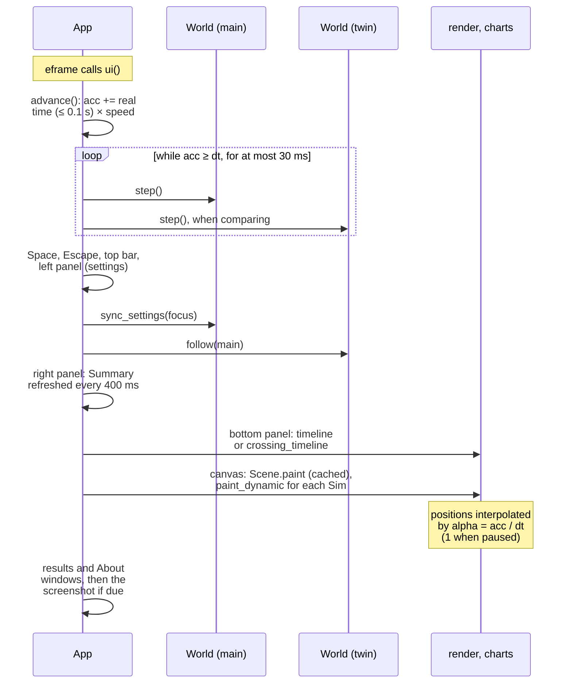

* **Real time is capped.** A frame adds at most 0.1 s of real time, so after a stall
  (a dragged window, a sleeping laptop) the simulation doesn't try to catch up.
* **The 30 ms budget** stops a high speed setting from freezing the window: when the
  simulation can't keep up, it runs slower than requested.
* **Interpolation:** vehicles and pedestrians are drawn between their last two
  positions, by the fraction of a step waiting in the accumulator, so motion stays
  smooth at any speed.

The app changes the simulation in only these ways:

* **Settings:** the left panel edits public fields of the focused `Sim`: demand,
  sensors, preemption, right turn on red, the leading pedestrian interval, the
  left-turn mode and the max-wait guard. `World::sync_settings` copies them to the
  other intersections of a corridor, and `World::follow` to the twin (§6.10). An edit
  to demand also rebuilds every fixed-time controller, so its Webster plan follows.
* **Controllers:** `set_controller` swaps the focused intersection's controller, or
  side B's on every twin intersection. `set_coordination` runs the green wave.
* **The cooperative crossing:** `set_scheduling`, `set_gap_policy` and the maximum cycle
  and batch join window, all live.
* **Rebuilds:** a new `World` when the layout, control mode or corridor size changes,
  and on *Reset*, *Restart*, *Compare side by side* and a change of side B's control
  mode.
* **Traffic by hand:** `spawn_manual` and `spawn_ped`, for clicks and the
  **+ N / + E / + S / + W** buttons.
* **Learning:** the `as_rl` and `as_hybrid` hooks, for the learning toggles and
  *Save weights* (§8.7).

Everything else only reads the simulation.

### 9.3 The comparison twin

When *Compare side by side* is on, `rebuild_twin` builds a second `World` with the
same layout, corridor size, demand, seed and settings, but its own control strategy:
a control mode and controller, or on the cooperative crossing a scheduling and gap
policy. Because arrivals depend only on the seed (§6.9), both sides receive identical
arrivals, and hand-spawned vehicles and pedestrians are added to both.

* Turning the comparison on or off restarts both worlds from time zero, and so does
  changing side B's control mode.
* Changing B's controller, scheduling or gap policy is live, like A's.
* The canvas draws both worlds with the same camera, A on the left. Only A's
  vehicles can be selected.
* The right panel adds a table of both `Summary`s. Every other panel describes A.

### 9.4 A tour of the window

This section goes through every part of the window: what it shows, how to read it and
which code produces it. The screenshots come from the desktop app of version 0.5.1 in
its default 1600 × 1000 window (the smallest it allows is 1100 × 700). They were taken
with the scripted-screenshot settings of Appendix A, two simulated minutes into the
default scenario unless a caption says otherwise. The browser version looks the same,
without the *Save weights* buttons and training commands of the learning panels.

#### The window at a glance

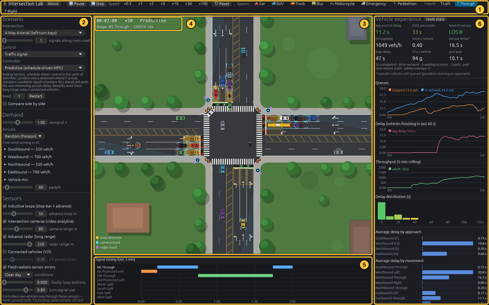

| # | Region | What it is for | Code |
|---|---|---|---|
| 1 | Top bar | Run controls, speed and adding traffic by hand | `App::top_bar` |
| 2 | Left panel | Every setting: scenario, demand, sensors, operations, learning and view | `App::left_panel` |
| 3 | Canvas | The simulated world, seen from above, with the legend at its bottom left | `App::canvas`, `App::legend`, `render.rs` |
| 4 | Status overlay | Clock, speed, strategy and the current stage and phase | `render::hud` |
| 5 | Bottom panel | Signal timing for the last 3 minutes and short notices | `App::bottom_panel`, `charts::timeline` |
| 6 | Right panel | Measurements, charts, the controller's reasoning, the selected vehicle and benchmarks | `App::right_panel` |

The layout follows the data flow:

* **Left panel:** inputs. Each control writes a setting of the focused `Sim`, or of
  the app, such as the overlays.
* **Canvas and bottom panel:** the world as it runs.
* **Right panel:** outputs. It reads a `Summary` refreshed every 400 ms, the statistics'
  time series and delay histogram, the controller's own explanation from `brain()`,
  the selected vehicle and, where they apply, the corridor's and the twin's summaries
  and the intersection manager's state. It changes nothing in the simulation.

egui is an immediate-mode toolkit: the whole window is rebuilt from `App`'s state every
frame. The widgets hold no state of their own, so the window always matches the
simulation. The side panels can be resized by dragging their inner edge, and they
scroll when their content is taller than the window.

Every control works from the keyboard. Tab and Shift+Tab move through the controls;
Enter or Space activates one, and opens a dropdown, whose list the arrow keys move
through. Space pauses and resumes the simulation when no control has keyboard focus.
Escape closes an open dropdown, then the About window, then the results window. In the
desktop app, dropdowns and number fields are named by their labels for screen readers.
The smallest text is 11 pixels. Panning, zooming, selecting a vehicle, placing a
pedestrian and the charts' hover readouts need a pointer. `ACCESSIBILITY.md` gives the
details.

#### 1. Top bar

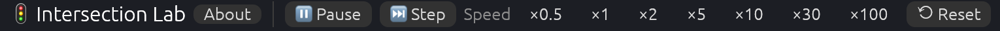


| Control | What it does |
|---|---|
| **About** | Opens the About window: version, license and third-party notices |
| **Pause / Run** | Stops or resumes the simulation |
| **Step** | Advances exactly 1 simulated second, ten 0.1 s steps, in both worlds. Useful while paused |
| **Speed ×0.5 to ×100** | Simulated seconds per real second. A slow machine runs high speeds slower than requested (§9.2) |
| **Reset** | Rebuilds the world from time zero, keeping the settings and demand |
| **Spawn: Car … Emergency** | Picks a vehicle class and turns on the spawn tool: click an approach road on the canvas, or use the **+ N / + E / + S / + W** buttons that appear at the end of the bar, one per approach. The vehicle enters 260 m upstream, and a notice says where it went. An emergency vehicle triggers preemption when that is on, and on the cooperative crossing it is served first |
| **Pedestrian** | Spawn tool for pedestrians: click near a crosswalk corner. Disabled on the layouts without crosswalks, the roundabout and the cooperative crossing |
| **Intent: Left / Through / Right** | The movement a hand-spawned vehicle will make. A movement the approach doesn't have is refused with a notice |

The bar wraps onto a second line when the window is too narrow for it, as at the
default size, where *Right* starts the second line. Hand-spawned vehicles are added to
both sides of a comparison, so the arrivals stay identical. They have a faint white
ring on the canvas. Clicking the chosen spawn button again returns to the select tool.

#### 2. Left panel: settings

**Scenario**

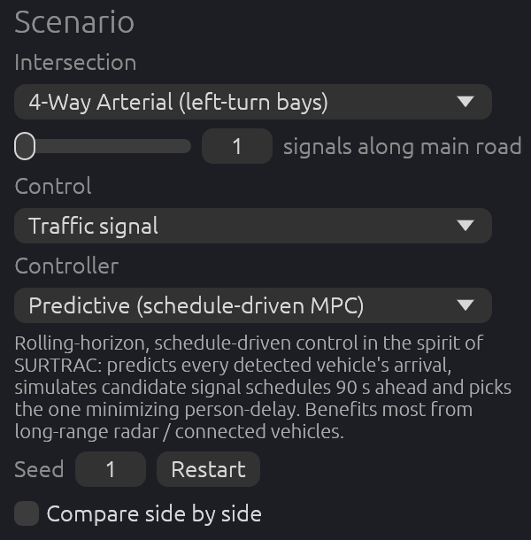

* **Intersection:** one of the six layouts shown in §1. Changing it rebuilds the world
  with the new layout's default demand.
* **Signals along main road** (1 to 5, not on the cooperative crossing): more than one
  builds a corridor of intersections 420 m apart on the east–west road (§6.10).
* **Fixed-time green wave** appears with a corridor. It runs `set_coordination`
  (§6.10), which makes every signal of the corridor fixed-time, in both worlds when
  comparing, with a common cycle and offsets that maximize the two-way green band.
  Turning it off gives each signal back its own Webster plan; they stay fixed-time.

  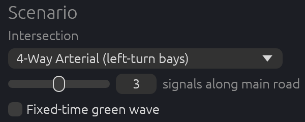

* **Control:** the control modes the layout allows (§6.1): *Traffic signal*, *All-way
  stop*, *Two-way stop (minor street)*, *Yield (roundabout)* or *Intersection manager
  (no signal)*.
* **Controller** (signals only): one of six strategies (§7.3), with a short description
  below the list. Changing it swaps the controller live: traffic keeps moving, only the
  decision-maker changes and the bottom panel confirms the switch. In a corridor it
  changes only the focused intersection.
* **Seed** (1 to 99,999) fixes every random arrival: the same seed gives the same
  traffic. *Restart* rebuilds the world from time zero, like *Reset*.
* **Compare side by side:** see [Comparing two strategies](#comparing-two-strategies).

**Demand**

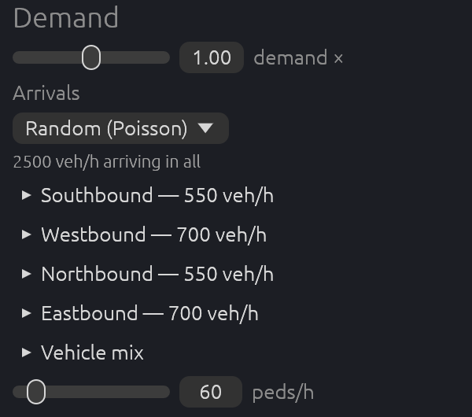

* **Demand ×** scales every flow at once, from 0 to 2.
* **Arrivals** sets the pattern (§6.6): *Random (Poisson)*, *Platoons (upstream
  signal)*, *Rush-hour peak* or *Random surges*. The line below gives the total flow.
* **Each approach**, for example *Southbound — 550 veh/h*, expands to a flow slider
  (up to 1,600 veh/h, or 6,000 on the cooperative crossing) and a share for each of its
  movements.
* **Vehicle mix** sets the relative share of each vehicle class.
* **peds/h** (0 to 600) is the pedestrian demand over all crosswalks. It appears only
  where there are crosswalks.

These settings also serve as the intersection's design volumes. The fixed-time
controller builds its Webster plan from them, and any change rebuilds it. The other
controllers never read them; sensor processing uses them only to split a shared lane's
count by turn when intent is unknown, and to estimate the traffic on a failed loop
(§6.5).

**Sensors**

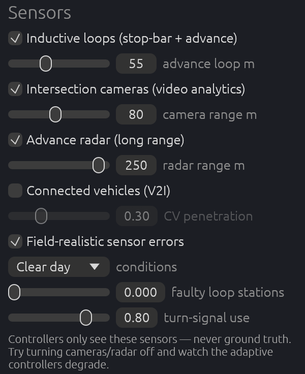

* Each sensor type can be turned on or off and has one parameter (§6.5):
  * inductive loops: the distance to the advance loop, 20 to 120 m;
  * cameras: their range, 20 to 150 m;
  * radar: its range, 80 to 260 m;
  * connected vehicles: the share of vehicles that broadcast, their penetration.
* **Upstream signal shares its outflow** appears only in a corridor: each signal is
  then told which vehicles its upstream neighbor has just released toward it.
* **Field-realistic sensor errors**, on by default, makes the sensors fail the way
  field equipment does: cameras miss vehicles in bad weather, at night, at long range
  or behind trucks, and read intent only from turn signals; loops fail and miss
  motorcycles; radar and connected-vehicle data are noisy. It enables three more
  settings:
  * **conditions:** Clear day, Night, Heavy rain, Fog or Snow;
  * **faulty loop stations:** the share of loops stuck on or off, up to half;
  * **turn-signal use:** drivers who don't signal look like through traffic to a
    camera.

The note at the bottom states the program's central rule (§2.2): controllers see only
these sensors, never the simulation's true state (§2.2 gives the one exception). On the
cooperative crossing, which has no roadside sensors, the intersection manager's settings
replace this section and the next.

**Operations**

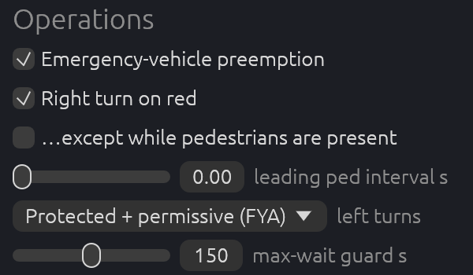

* **Emergency-vehicle preemption:** an approaching emergency vehicle gets a green
  (§7.2).
* **Right turn on red**, optionally **except while pedestrians are present**. That
  option models a blank-out NO TURN ON RED sign that lights while someone is waiting at
  or using a crosswalk the turn crosses.
* **Leading ped interval** (0 to 7 s): WALK starts this long before turning traffic
  that crosses it gets a green.
* **Left turns** (signals only), for lefts with their own lane:
  * *Protected + permissive (FYA)*: a green arrow, then a flashing yellow arrow during
    which lefts yield;
  * *Protected only*;
  * *Auto (volume cross-product)*: each left switches to protected-only when its volume
    times the opposing volume is high.

  In the other two modes a line lists the lefts that are protected-only at the moment.
* **Max-wait guard** (0 to 300 s, 150 by default): an adaptive controller must serve
  any movement that has waited longer than this (§7.2). 0 turns the guard off.

**Learning panels** (only when Deep RL or the Hybrid is the controller; the app titles
them *AI (Deep RL)* and *AI (RL-tuned predictive)*)

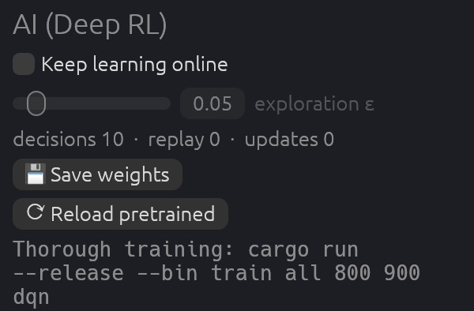 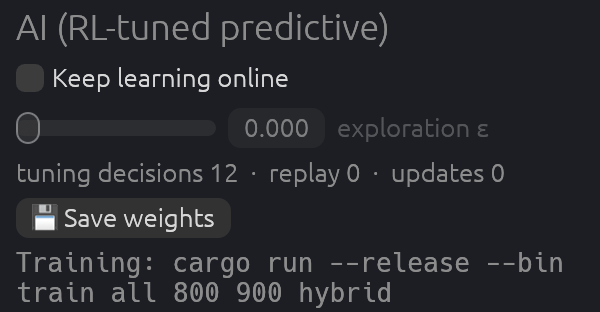

* **Keep learning online:** the network keeps training on the traffic it controls,
  exploring at the rate **ε**. Deep RL starts at 0.05, the Hybrid at 0.
* **Counters:** decisions so far (the Hybrid makes one every 10 s), transitions in the
  replay memory and gradient updates.
* **TD loss:** while Deep RL learns, a sparkline shows its recent loss.
* **Reload pretrained** (Deep RL only) rebuilds the controller from the first saved
  network the search finds (§8.7).
* **On the desktop**, *Save weights* writes the current network, and a line gives the
  training command (§8.5).

**View**

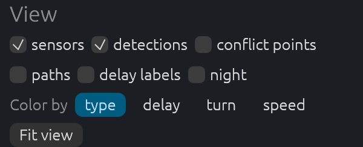

* **Overlays:** *sensors* (loops, cameras and radar), *detections* (what the sensors
  see right now), *conflict points*, *paths*, *delay labels* and *night*. The first two
  are on by default.
* **Color by:** vehicles are colored by *type*, *delay*, *turn* or *speed*.
* **Fit view** re-centers and re-scales the canvas.

The canvas section below shows each overlay.

#### 3. Canvas

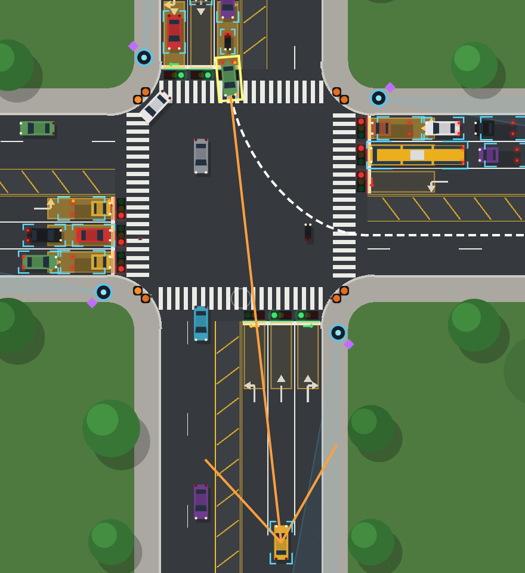

**Using the canvas**

* drag to pan, with the select tool;
* scroll or pinch to zoom, around the pointer, from 0.6 to 40 pixels per meter;
* click a vehicle to select it; clicking one at another intersection of a corridor
  also moves the focus there;
* with a spawn tool, click an approach road, or near a crosswalk corner.

**What is drawn**

* **Roads:** lanes with turn arrows, stop lines, crosswalks and left-turn bays with a
  hatched median before them.
* **Vehicle signal heads:** one at the stop line of every inbound lane.
  * It shows red, yellow or green. Turn-only lanes show arrows, and a permissive left
    shows a flashing yellow arrow.
  * A colored glow along the stop line repeats the lane's indication, so it reads even
    when zoomed out.
* **Pedestrian signals:** small squares at each end of a crosswalk.
  * White is WALK, flashing orange is flashing DON'T WALK and solid orange is DON'T
    WALK.
  * A faint ring in the middle of a crosswalk means a pedestrian has pushed the button
    and is waiting.
* **Stop signs** appear instead of signals under stop control.
* **Vehicles** are drawn to scale with brake lights and turn signals, and headlights
  at night. Below 2.2 pixels per meter they are drawn as plain shapes, without lights,
  turn signals or the hand-spawn ring. Colored by type, buses are yellow, trucks light
  gray and emergency vehicles white; cars, SUVs and motorcycles get assorted colors.

**The *sensors* overlay:**

* **Yellow rectangles at the stop bar** are presence loops. They brighten while a
  vehicle is on them. A red cross means diagnostics have flagged the loop as faulty,
  and the lane is on recall.
* **Thin yellow bars upstream** are advance loops. They flash as a vehicle crosses.
* **A blue ring on a pole, with a faint blue wedge,** is a camera and its field of view.
  The wedge shrinks in poor visibility.
* **A purple diamond** is a radar unit. A dashed purple tick marks its range, and a dot
  sweeps along the approach.

**The *detections* overlay** marks each vehicle the controller knows about, once, by
the best source that sees it:

* **cyan corner brackets:** a camera track;
* **green arcs:** a connected-vehicle message;
* **a purple ring:** a radar track.

Loops report per lane, not per vehicle, so they add no marker. A vehicle without a
marker is one no camera, radar or message reports at that moment.

**A selected vehicle** has a yellow outline and a dashed white line along the rest of
its route. If it is yielding, an orange arrow points to the vehicle it is waiting for.
In the picture, car #26 is turning left from the southbound approach and waits for
oncoming vehicle #83. It has pulled past the stop line, where no sensor looks, so it
has no marker. The right panel shows the same car (see
[Selected vehicle](#6-right-panel-measurements)).


**Analysis overlays** (the same moment, zoomed further, with *conflict points*, *paths*
and *delay labels* on and vehicles colored by delay):

* **Conflict points:**
  * a yellow ring is a crossing between two paths;
  * a blue ring is a merge;
  * a red ring is held by a vehicle that has committed to it (§6.1, right of way).
* **Paths:** faint blue lines through the box, one per lane-to-lane connection.
* **Delay labels:** each vehicle's delay so far, in seconds, shown above 5 pixels per
  meter. A yielding vehicle also gets an orange dot at its front.
* **Color by delay:** green for no delay, through yellow at 45 s, to red at 90 s or
  more. *Turn* colors lefts blue, throughs gray and rights orange. *Speed* runs from
  red (stopped) to green (at the desired speed).

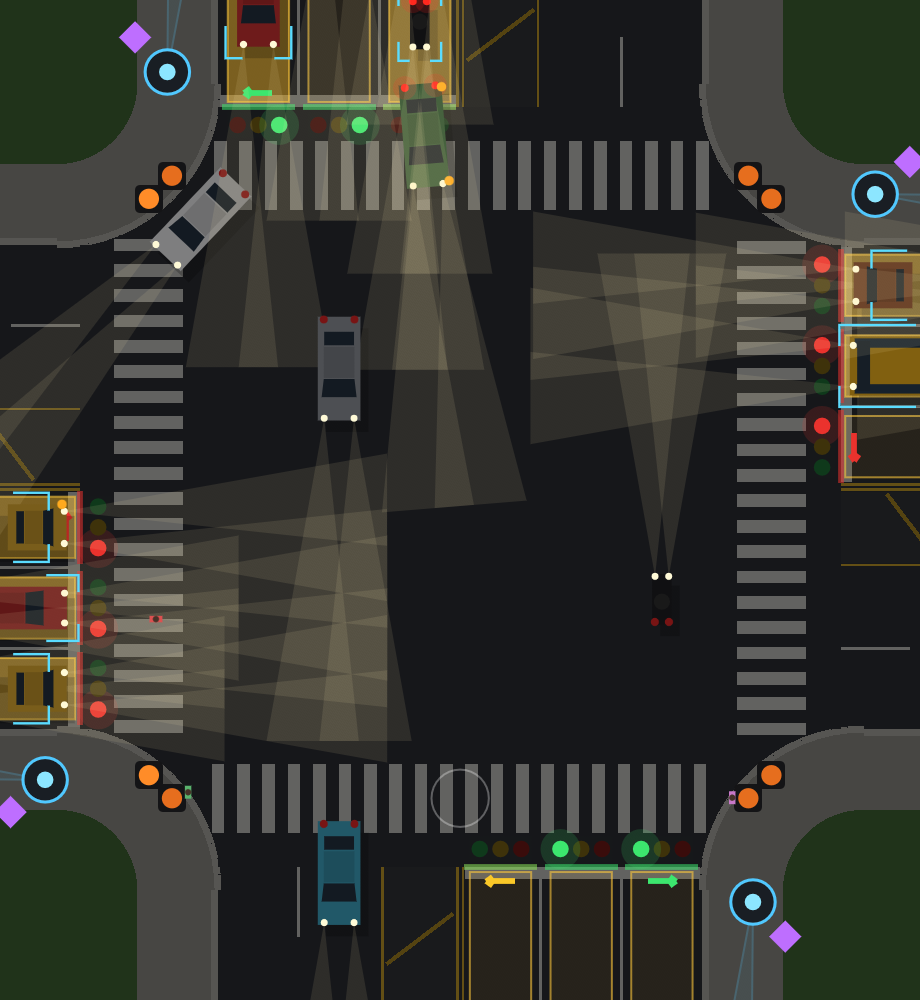

*Night* darkens the scene and turns on headlights. It is only a view setting. Darkness
that affects the sensors is the *Night* condition under *Sensors*.

#### 4. Status overlay

The text at the top left of the canvas (region 4 in the overview) has up to two lines:

* **First line:** the simulated clock, the speed, *paused* when paused and the strategy:
  the controller's short name, the control mode or, on the cooperative crossing,
  *Intersection manager* (batches) or *First come, first served*, followed by the gap
  policy.
* **Second line, for signals:** the current stage and its phase (*GREEN* with the
  seconds of green so far, *YELLOW* or *ALL-RED*), with *EMERGENCY PREEMPTION* while a
  preemption runs. The cooperative crossing has its own second line (see [The
  cooperative crossing](#the-cooperative-crossing)).

In a comparison each half has its own overlay, labeled *A ·* or *B ·*. In a corridor
it describes the focused intersection.

#### 5. Bottom panel: signal timing

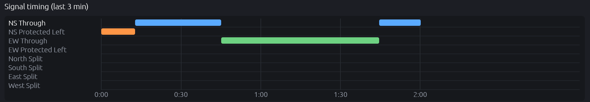

The chart spans 3 minutes, the last three once the run is longer:

* there is one row per stage, and the current stage's name is white;
* a bar runs from the start of a stage's green to the start of the next stage's green,
  so it includes the stage's yellow and all-red;
* the colors only tell rows apart;
* the time axis has a tick every 30 s.

In this window the predictive controller has used only three of its eight stages.
With flashing yellow arrows, lefts can also turn during the through stages by yielding
to oncoming traffic. §6.2 explains the split stages.

Short notices appear to the right of the heading for 5 s: a live controller switch,
where a hand-spawned vehicle went or the result of saving weights. Without a signal the
chart says so, and the cooperative crossing has a chart of its own.

#### 6. Right panel: measurements

**Vehicle experience** (the key numbers)

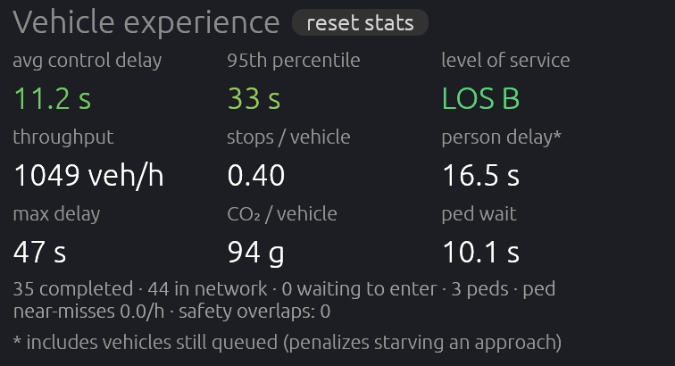

| Number | Meaning |
|---|---|
| avg control delay | Mean delay of vehicles that have left, compared with free-flow travel (HCM control delay). Colored green to red |
| 95th percentile | The delay that 95% of vehicles stayed under |
| level of service | HCM grade A to F from the average delay. Signals: 10, 20, 35, 55 and 80 s. Stop control, roundabouts and the cooperative crossing: 10, 15, 25, 35 and 50 s |
| throughput | Vehicles per hour leaving the intersection |
| stops / vehicle | Mean number of times a vehicle came to a stop |
| person delay* | Delay per person, each vehicle weighted by its class's occupancy (§6.7). It **includes vehicles still queued**, so a controller can't look good by starving one approach. Benchmarks compare strategies by this number |
| max delay | The longest delay of any vehicle that has left |
| CO₂ / vehicle | CO₂ per vehicle in grams, estimated from fuel use |
| ped wait | Mean pedestrian wait before crossing |

The small line below the table gives:

* vehicles completed;
* vehicles in the network;
* vehicles waiting to enter because the entry is full;
* pedestrians present;
* pedestrian near misses per hour (a vehicle passing within about 1.5 s of a walking
  pedestrian's path);
* safety overlaps, which should always be 0.

*reset stats* measures from the current moment, for example after changing a setting.
It resets these numbers, the breakdowns and the comparison table; the charts, the
delay histogram and the intersection manager's counters keep their history.

**Charts**

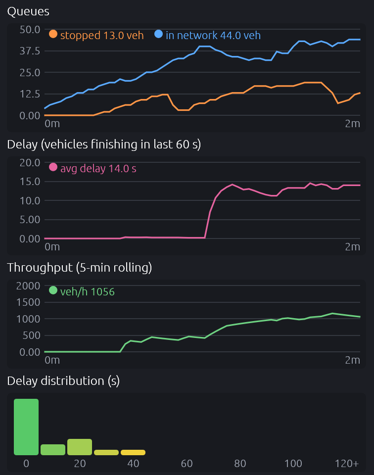

* **Queues:** stopped vehicles (orange) and all vehicles in the network (blue).
* **Delay:** the average delay of vehicles that finished in the last 60 s. It rises and
  falls with congestion.
* **Throughput:** a 5-minute rolling rate in vehicles per hour.
* **Delay distribution:** a histogram in 10 s bins, the last one being 120 s or more.

The time axes are minutes since the start, and hovering over a chart reads out its
values.

**Breakdowns**

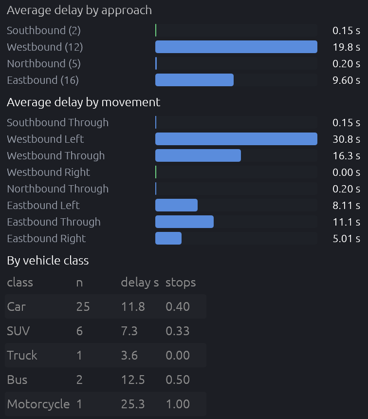

* **Average delay by approach:** the number in parentheses is how many vehicles
  finished on that approach.
* **Average delay by movement.**
* **By vehicle class:** count, delay and stops.

In the app's bar charts green marks the best value, yellow a row the source wants to
highlight (such as a controller's choice) and other bars are blue. Histograms color each
bar by its value instead. In this example, westbound lefts wait longest.

**Controller brain** (signals only)

Every controller explains its current decision through `Controller::brain()` (§7.1). The
panel draws whatever the controller returns: a title, a bar per option and notes. It
knows nothing about any controller's internals, so a new controller gets a panel without
any change to the app.

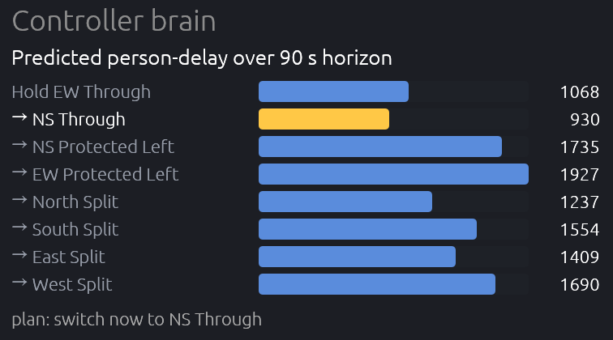

**Predictive:** each bar is the predicted person delay over the next 90 s if the
controller holds the current stage or switches to the stage named. Lower is better,
and yellow is the chosen option. The note gives the plan, for example "hold ~15 s
more, then NS Through". The controller re-plans every second once it may switch, so
during a minimum green, which a pedestrian crossing can lengthen, the panel still
shows the evaluation that started the stage. Here that is the switch from EW Through
to NS Through.

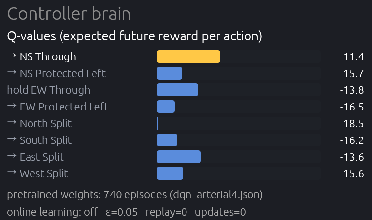

**Deep RL:** each bar is the network's Q-value for an action, the expected future
reward. Rewards are negative delay, so higher, closer to zero, is better.

* Yellow marks the best action the safety shield allows, and *(shielded)* marks the
  actions it has removed (§8.2).
* The notes say where the weights came from, here the shipped file, trained for 740
  episodes (§8.7), and whether online learning is on.

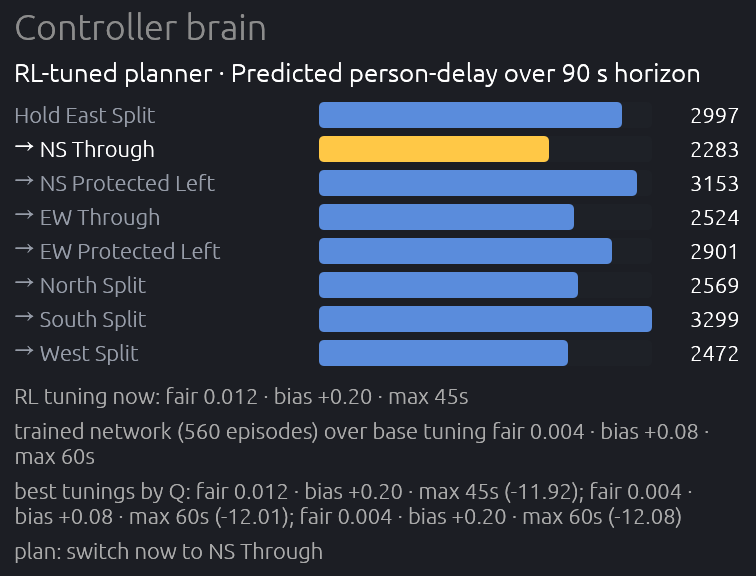

**Hybrid:** the planner's bars, plus notes on the tuning in use:

* the tuning the network chose for the next 10 s;
* the network's training (here 560 episodes) and the layout's best static tuning, which
  the network is measured against;
* the three tunings with the highest Q-values.

On a layout whose shipped file has no network, the notes say that no network beat the
best static tuning, and name the tuning that runs (§8.7).

**Other controllers**

* **Fixed-time:** its cycle and each stage's green time, and its offset when
  coordinated.
* **Actuated:** its status, the time since the last actuation against the passage time
  and the stages with calls.
* **Max-pressure:** each stage's pressure, the queue upstream minus downstream.

**Selected vehicle**

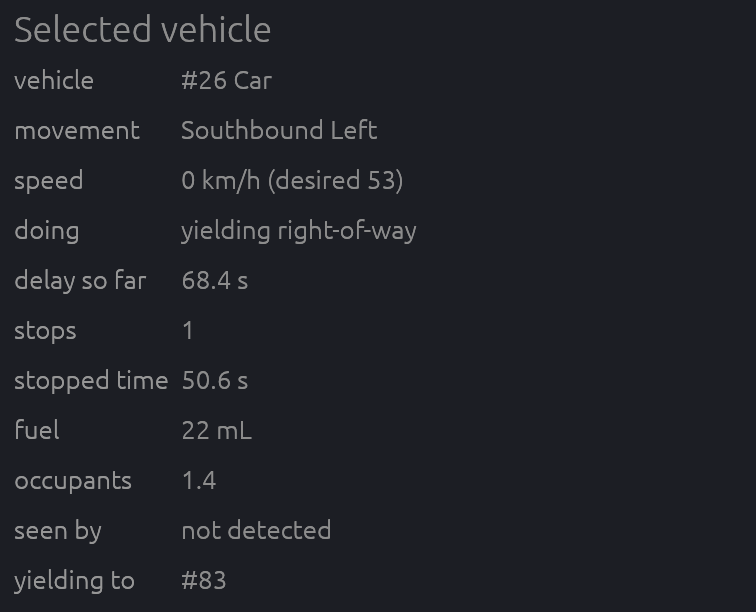

Click a vehicle on the canvas to see:

* its number, class and movement;
* its speed against its desired speed;
* what it is doing, for example *yielding right-of-way*;
* its delay, stops, stopped time and fuel so far;
* its occupants;
* **seen by:** the sensor that reports it right now: camera, radar or *connected (V2I)*,
  the vehicle's own vehicle-to-infrastructure messages. *not detected* means the
  controller can't see it at this moment. Loops never appear here, because they don't
  identify vehicles;
* **yielding to:** the vehicle it is waiting for.

When the vehicle leaves the network the panel says *(left the network)* until another
is selected.

**Benchmark**

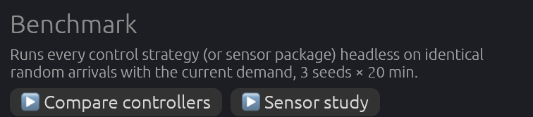

**Compare controllers** runs every strategy the layout allows, headless: all six
controllers and the layout's other control modes. **Sensor study** runs five
controllers (actuated, max-pressure, predictive, Deep RL and the Hybrid) with five
sensor packages each:

* loops only;
* loops and a camera;
* loops, a camera and radar;
* all of those plus 30% connected vehicles;
* 100% connected vehicles alone.

Each run uses three seeds, 500 to 502, with a 300 s warm-up and 20 measured minutes, at
the current demand and sensor settings. The runs are single intersections with the
default operations settings: a corridor and the *Operations* section don't carry over.
On the desktop they run on parallel threads; in the browser, one after another, a slice
in each frame. *Sensor study* needs a signal, so it is disabled on the roundabout. The
results open in a window, with a spinner and "running k/n" until they finish:

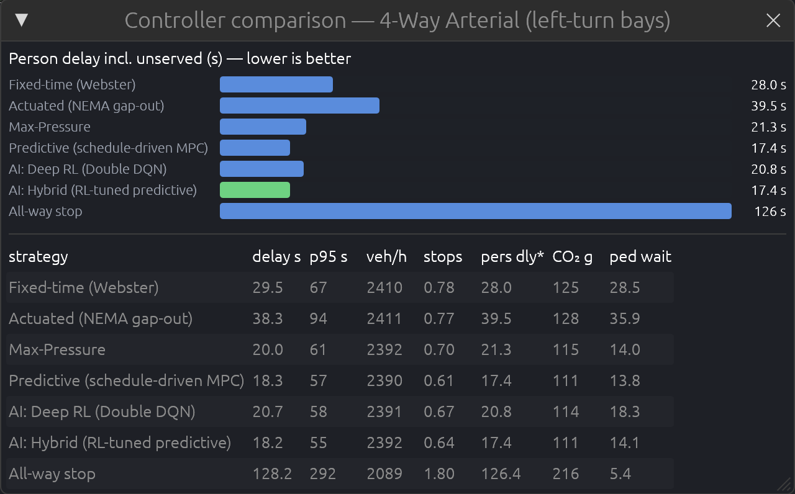

The bar chart shows each strategy's person delay, including unserved vehicles, in the
order of the list rather than ranked, with the best in green. The table gives the other
measures. *Hide results window* and *Show results window* toggle the window, and the
results stay until the next run.

#### Comparing two strategies

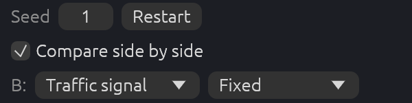

*Compare side by side* adds a **B** row for the second strategy's control mode and
controller. Turning it on restarts both worlds from the same seed (§9.3).

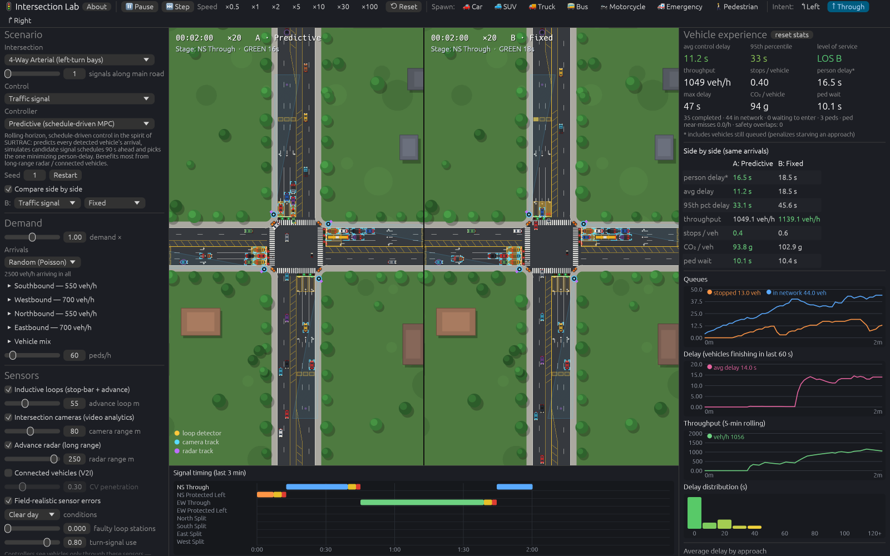

The canvas splits in two:

* A, the main settings, on the left, and B on the right;
* the same camera on both halves;
* separate status overlays, labeled *A · Predictive* and *B · Fixed*.

The arrivals are identical, so any difference comes from the strategy alone. The right
panel adds a table:


A value is green when it beats the other side by more than 3%. Every other panel
(charts, breakdowns, brain, timeline) still describes side A.

#### Corridors

With more than one signal, the canvas fits the whole corridor:


At this zoom vehicles are small; zoom in with the scroll wheel to inspect one
intersection. The panels start on the middle intersection, and the right panel gains
a selector and corridor totals:


* **◀ / ▶** choose the focused intersection, numbered west to east.
* **Main-road trips end to end:** for vehicles that traveled the whole east–west road,
  the number of trips, travel time, stops and delay per trip.
* The numbers below, the charts, the timeline and the brain describe only the focused
  intersection.
* Settings changed in the left panel apply to every intersection, except the
  controller, which changes only the focused one. Side B's controller applies to all
  of B's intersections.

#### The cooperative crossing

The cooperative layout (§6.11) has no signals and no roadside sensors, so several
parts of the window change:


| # | Region | What changes |
|---|---|---|
| 1 | Left panel | *Intersection manager* settings replace *Sensors* and *Operations* |
| 2 | Status overlay | The second line names the phase being served |
| 3 | Legend | The reservation markers |
| 4 | Bottom panel | Stop-line crossings by movement replace the signal timing |
| 5 | Right panel | The manager panel and safety monitors replace the controller brain |

**Intersection manager settings**


* **Scheduling:** *Batches: each movement in turn*, or *First come, first served: one
  at a time*.
* **Safety gap:** *Fail-safe: can stop for a stalled vehicle*, *Mitigated: can slow to
  25 km/h* or *Nominal: latency and actuation (no failures)* (§6.11). The line below
  gives the resulting gap at 40 km/h for a car and for a truck or bus.
* **max cycle** (40 to 200 s) and **batch join window** (0 to 5 s), grayed out under
  first come, first served.

Changes apply live, and a notice confirms a new scheduling or gap policy. Vehicles
keep the trajectories they were already granted.


*View* offers *reservation zones* instead of the sensors, detections and conflict
points, which don't apply here.

**Canvas and status overlay**

The scene adds the 43 m box with a dashed stop line on each approach, the slip lanes for
right turns, guide lines for the double left turns and stairs to the pedestrian
underpasses at the corners. §6.11 shows a close-up:

* **A dot on each vehicle,** drawn from 2.2 pixels per meter: cyan when it has its
  trajectory, amber while it waits for one. Right turns need none and get no dot.
* **Green lines** across the ends of the lanes whose movement is being admitted.
* **Reservation zones,** with that overlay on: red while a vehicle is in the zone,
  amber when one is due within 3 s and faint otherwise.

The status overlay's second line reads, for example, "Serving N–S: N_L + N_T ·
158 vehicles scheduled", or under first come, first served "First come, first
served · 297 vehicles scheduled". "EMERGENCY VEHICLE FIRST" is added while an
emergency vehicle waits for its trajectory.

**Stop-line crossings**


The bottom panel shows the last 2.5 minutes and the next 30 s, which are already
scheduled:

* one row per managed movement, in the manager's ring order, with the movements being
  served in white;
* a dim bar per phase, from its first crossing to its last, blue for throughs and
  orange for lefts;
* a tick for each vehicle crossing its stop line, dimmer for the crossings still to
  come;
* a cyan line at *now*.

**Intersection manager panel**


Under batches the panel names the movements being served and gives:

* vehicles scheduled and zone reservations held;
* the average cycle, and the time lost to switching per cycle;
* phases served and *emergency priority*: how many vehicles were served out of turn for
  an emergency vehicle, counting those ahead of it in its lane;
* a table of the phases in service order, ring by ring, with each movement's measured
  demand and current maximum phase, and *serving* beside the open ones.

Under first come, first served it gives only vehicles scheduled, zone reservations
and emergency priority, with a note on why weaving one vehicle at a time costs
capacity. Either way it ends
with the reminder that right turns use the slip lanes and never enter the box.

**Safety monitors**


These numbers come from `observe` (§6.11), which measures what the vehicles actually
did, independently of the plans:

* **closest crossing (PET):** the shortest post-encroachment time;
* **margin over gap:** the smallest PET minus the gap the policy required, green
  while it isn't negative;
* **zone overlaps**, **entries without slot** (crossings without a reservation) and
  **off trajectory**, green at zero and red otherwise;
* **worst timing error:** the largest difference between planned and actual times.

The histogram covers every crossing within 10 s, in 0.25 s bins, the last one
collecting 5.75 s or more. Bars run from red at 0 s to green at 2 s. It says "no
crossings yet" until there is one.

**The selected vehicle** shows a *reservation* row instead of *seen by*: when the
vehicle will cross its stop line and how fast, that it is still waiting for one, or
that a right turn needs none. Its *doing* row can also read *slowing to meet its
reserved slot*, *waiting for a reservation* or *slowing to the crossing speed*.

**Comparing**


On the cooperative crossing side B is chosen by a scheduling and a gap policy, and
the table compares, for example, batches against first come, first served under the
same fail-safe gaps.

**Compare schedules** replaces *Compare controllers*, and *Sensor study* is hidden. It
runs batches under the three gap policies, and first come, first served under the
fail-safe one, with the current maximum cycle and join window:


#### About


The About window shows:

* the version;
* the copyright and license;
* a link to the repository;
* the full third-party license notices (`THIRD_PARTY_LICENSES.md`, built into the
  program).

The notices run to thousands of lines, so only the visible lines are laid out.

#### How the app's design shows up in the window

* **The sensors-only boundary is visible.** The *sensors* and *detections* overlays
  and the *seen by* row show what a controller can know. A vehicle without a marker is
  one the controller can't see.
* **Controllers explain themselves.** The brain panel draws whatever `brain()` returns,
  so a new controller gets an explanation panel without any change to the app.
* **Fair comparisons by construction.** The twin reuses the app's seed and the
  benchmarks their own three, so every strategy faces the same arrivals.
* **Safety is measured, not assumed.** On the cooperative crossing the monitors
  measure what vehicles did, separately from what the manager planned.
* **The app changes little.** Apart from the settings, clicks that add traffic,
  controller switches and the learning toggles, it only reads the simulation (§9.2).

---

## 10. Entry points, studies and tests

### 10.1 Entry points

| File | Role |
|---|---|
| `src/main.rs` | **Native:** opens a 1600 × 1000 window (at least 1100 × 700) with the embedded icon and runs `gui::App`. Release builds on Windows use the GUI subsystem, so no console window appears. **Browser:** finds `<canvas id="app">` in `web/index.html`, starts `eframe::WebRunner` and replaces the loading message with the outcome |
| `src/lib.rs` | Declares the four modules. `scenario(kind, mode, ctrl, demand, sensors, seed) -> Sim` builds a headless simulation, and `run_scenario(sim, warmup, duration) -> (Summary, collisions)` runs it and summarizes everything after the warm-up. `bench` and the app's benchmarks use them; the browser's benchmark queue steps each `Sim` itself and calls `Stats::summary` the same way |
| `src/bin/bench.rs` | `bench [layout\|all] [minutes] [seeds] [demand-scale] [pattern]` prints a table per layout: every control strategy, averaged over seeds 1,000 and up after a 300 s warm-up, with delay, 95th percentile delay, throughput, stops, person delay including unserved vehicles, pedestrian wait, unserved vehicles and collisions. `bench sensors <layout> [minutes] [seeds]` runs the command-line sensor study: the app's five sensor packages (§9.4) and an ideal version of loops, camera and radar, then weather and faulty loops |
| `src/bin/train.rs` | Trains the Deep RL and Hybrid networks (§8.5) |

### 10.2 Studies

The examples are the studies behind `docs/insights.md` and
`docs/cooperative-intersections.md`, plus the icon renderer. Run one with
`cargo run --release --example <name> -- [arguments]`.

| Example | Study | Arguments |
|---|---|---|
| `cooperative` | Capacity of the cooperative crossing at rising demand: what it serves, the delay and what the safety monitors measured | gap policy (`p2`, `ph`, `p1`), left lanes (2 or 1), fleet (`mix` or `cars`), seconds, seeds, demand levels, arrivals, scheduling (`batches` or `fcfs`) |
| `corridor` | *n* signals along the main road: fixed-time without and with the green wave, the adaptive controllers with the upstream link and the predictive controller without it. Reports end-to-end trips and each intersection's person delay | layout, *n*, minutes, seeds, demand scale |
| `fya` | Left-turn phasing: flashing yellow arrow, protected-only or automatic, across demand levels | seeds |
| `lpi` | The leading pedestrian interval and the blank-out NO TURN ON RED sign: near misses and delay | seeds |
| `preempt` | Emergency vehicles, with and without preemption | none |
| `satflow` | Calibration: saturation flow and start-up lost time of a queued through lane, against the HCM base of 1,900 vehicles per hour per lane | none |
| `sweep` | Every layout × control mode × seed with `check_safety` on, reporting in-box overlaps. Signals run the four controllers that don't learn | seeds, demand scale, options |
| `make_icons` | Renders the application icon at every size the installers need (run by `packaging/icons/build.sh`) | output folder |

### 10.3 Tests

`cargo test` runs four integration test files and the unit tests in `sim/coop.rs`. CI
runs them in release mode on Linux, macOS and Windows (§11).

| File | Tests | What they require |
|---|---:|---|
| `tests/safety.rs` | 4 | Every layout and control combination runs without collisions and serves at least 80% of arrivals at default volumes (65% under two-way stop and under all-way stop on the arterial, which are over capacity); different controllers receive identical arrivals; no gridlock in seeds that used to jam; no collision between a turn finishing late in the yellow and the next stage's traffic |
| `tests/cooperative.rs` | 14 | The cooperative crossing: no signals, sensors or crosswalks; its geometry and phase order; every gap policy safe under heavy demand, bursts, heavy vehicles and live switching; about 18,000 vehicles per hour served at the design demand, about 19,000 oversaturated and less with single left lanes or first come, first served; reproducible runs; light traffic barely delayed; emergency vehicles first; hand-placed vehicles crossing every way. Every run must show no monitor violations |
| `tests/pedestrian_rule.rs` | 4 | Deep RL's shield serves a crosswalk whose pedestrians have waited longer than `PED_MAX_WAIT`, longest wait first, and leaves shorter waits to the controller; the reward counts waiting pedestrians |
| `tests/weights_files.rs` | 4 | The shipped weights load, misshapen networks are rejected, a Hybrid without a fitting network keeps its base tuning and networks that overflow don't crash (§8.7) |
| `src/sim/coop.rs` | 4 | Approach profiles arrive on time and at speed, a short run-up enters slower but on time, the gap policies give the gaps in §6.11 and the following law holds its time gap |

The `weights` fuzz target (`fuzz/`, a workspace of its own) feeds arbitrary bytes to
both weights loaders. A network they accept must survive a training step, 20 s of
simulation and `brain()`.

---

## 11. Build, CI and release

Seven GitHub Actions workflows build, check and release the program. Every action is
pinned to a commit, checkouts keep no credentials and workflows have read-only
permissions unless a job needs more.

```mermaid
flowchart TB
    PR["<b>Pull request</b>"]
    CI["<b>Checks</b><br/>CI, CodeQL and DCO;<br/>10 are required"]
    FZ["Fuzz (weights), 60 s:<br/>reported, not required"]
    M["<b>Merge to main</b><br/>branch up to date"]
    PG["<b>Pages</b>: the browser<br/>build, deployed"]
    SC["<b>Scorecard</b><br/>also weekly"]
    T["<b>Tag v<i>x.y.z</i></b>"]
    R["<b>Release</b>: check the<br/>version and licenses;<br/>build, sign and package<br/>for macOS, Windows and<br/>Linux; draft release"]
    P["<b>Publish the release</b><br/>by hand"]
    C["<b>publish-crate</b><br/>cargo publish to<br/>crates.io"]
    PR --> CI --> M --> T --> R --> P --> C
    PR -.-> FZ
    M --> PG
    M --> SC
    classDef ui fill:#fff3e0,stroke:#c05621,color:#3b1d06
    classDef data fill:#f1f3f5,stroke:#5f6b7a,color:#1f2933
    classDef safe fill:#fdecec,stroke:#c53030,color:#4a0f0f
    class PR,M,T,P ui
    class CI,FZ safe
    class PG,SC,R,C data
```

The 10 checks that must pass before anything merges to `main`, with the branch up to
date:

| Check | Workflow | What it does |
|---|---|---|
| Test (ubuntu-22.04), Test (macos-15), Test (windows-latest) | `ci.yml` | `cargo build --locked --release --all-targets`, then `cargo test --locked --release` |
| Web (wasm32) | `ci.yml` | Builds the app for `wasm32-unknown-unknown` |
| Clippy | `ci.yml` | `cargo clippy` with warnings as errors, for the native targets and the browser app |
| Crate package | `ci.yml` | `cargo package --locked`, which builds the crate from the files crates.io would get |
| Licenses and advisories | `ci.yml` | `cargo deny check` (licenses, advisories, bans and sources), and that `THIRD_PARTY_LICENSES.md` is up to date |
| Analyze (rust), Analyze (actions) | `codeql.yml` | CodeQL on the Rust code and on the workflows; also every Monday |
| DCO | `dco.yml` | Every commit is signed off by its author |

* **Fuzz (weights)** in `ci.yml` runs the fuzz target for 60 s from its seeds on the
  nightly toolchain, and uploads any crash. It isn't required.
* **`pages.yml`** builds the browser version with Trunk on every push to `main` and
  deploys it to GitHub Pages.
* **`release.yml`** runs on a `v*` tag, or by hand to build unsigned packages:
  1. it checks that the tag matches the version in `Cargo.toml`, and the licenses and
     attributions;
  2. it builds, signs and packages for every platform (below);
  3. it drafts a GitHub release with the packages, a `SHA256SUMS.txt` and build
     provenance attestations, with notes generated from the merged pull requests.
* **`publish-crate.yml`** runs when the release is published: it checks the tag
  against the version and runs `cargo publish` through crates.io's Trusted Publishing.
* **`scorecard.yml`** runs the OpenSSF Scorecard on every push to `main`, every Monday
  and when branch protection changes.
* **Dependabot** proposes updates to the actions and the Cargo dependencies weekly.

| Platform | Packages | Built by | Signing |
|---|---|---|---|
| macOS | A universal (Apple silicon and Intel) `.dmg` | `packaging/macos/package.sh` | Developer ID, notarized and stapled |
| Windows | `.msi` and `.zip`, for x64 and arm64 | `packaging/windows/package.ps1` and WiX | Azure Artifact Signing, for the `.exe` and the `.msi` |
| Linux | `.deb`, `.rpm` and `.tar.gz`, for x86_64 and aarch64 | `packaging/linux/package.sh`, cargo-deb and cargo-generate-rpm | None |

Signing happens only on tags, in the `release` environment, which holds the
credentials. `packaging/licenses.sh` writes `THIRD_PARTY_LICENSES.md` with cargo-about.
The file includes the app's version, so every release regenerates it, and CI fails
while it is out of date.

---

## 12. Design principles

1. **Ground truth stays in `sim`, and signal decisions use sensors.** Controllers
   receive a `Ctx` of immutable references. They can't change the simulation, and they
   see vehicles only through `SensorView` (§2.2). The one exception is
   `reward_delay`, the true person delay, which only the learning controllers read,
   and only as their training reward. The cooperative crossing's manager, part of
   `sim`, works from what its connected vehicles report about themselves. This rule
   makes the sensor studies fair, and makes it safe to plug in a learned policy.

2. **Safety is enforced where the physics is, not in controllers.**
   * Clearance intervals, minimum greens and pedestrian intervals live in
     `SignalState`.
   * Collision avoidance lives in the vehicles' `decide`.
   * Emergency preemption and the max-wait guard live in `Sim::control_signal`.

   A bad controller can make traffic slow, but it can't make it unsafe. Deep RL's shield
   and the Hybrid's "the planner decides" design are a second layer, so that learned
   policies stay sensible as well as safe. On the cooperative crossing the manager's
   reservations keep vehicles apart, and monitors that measure what vehicles actually
   did check them.

3. **Layouts are data.** A signalized layout is a few lines of `LegDef` and `StageDef`
   in `Network::build`; the roundabout and the cooperative crossing have builders of
   their own. Lanes, connectors, conflict points and zones are all derived.
   Controllers are written against movements and stages, never against a particular
   layout, so all six work on every signalized layout.

4. **Expensive work is precomputed.**
   * Conflict points and zones are computed once per network.
   * `Path` is resampled for O(1) lookups.
   * Free-flow times are cached.
   * Per-step buffers (`arrivals_buf`, `vstat`, the `threats` scratch buffer) are
     reused, not reallocated.
   * The static scene is drawn from a cached mesh.

5. **Determinism is a feature.** With in-house random number streams, hash-based
   sensor noise and a fixed step order, a seed reproduces a run exactly on a given
   platform (§6.9). This is what makes the side-by-side comparisons, the regression
   seeds in the tests and repeatable benchmarks possible.

6. **One measurement path.** Every front end gets its numbers from `Stats::summary`,
   often through `lib::run_scenario`: the app, `bench`, the examples and training
   can't disagree about what "delay" means. A corridor's end-to-end trips come from
   `World::corridor_summary`, and the cooperative crossing's safety numbers from its
   monitors.

7. **The front end is thin.** `gui` holds UI state and draws. It never adds
   simulation behavior: everything the app can do, a headless program can do through
   the same public `Sim` and `World` API.

8. **Platform code is at the edges.** Only `main.rs`, two app files, the weights
   folder lookup and `Cargo.toml` differ between platforms (§3). The simulation,
   controllers and learning code compile unchanged for every target.

---

## 13. Extending the program

### 13.1 Add a signal controller

1. Create `src/control/<name>.rs` with a struct that implements `Controller` (which
   requires `Send`), and declare it with `pub mod <name>;` in `control/mod.rs`. Base its
   decisions on the sensors' view, the signal, the network and the design demand in
   `Ctx`; `reward_delay` is only for a learning reward.
2. Add a `CtrlKind` variant to the enum and to `CtrlKind::ALL`, an array whose length
   changes with it, with its `name`, `short`, `description` and `adaptive` entries, and
   a line in `make()`. An adaptive controller gets the max-wait guard (§7.2).
3. Optionally implement `brain()` so the app can explain its decisions (§9.4).
4. It then appears in the app, *Compare controllers*, `bench` and the safety tests,
   which iterate over `CtrlKind::ALL`. The sensor studies, in `bin/bench.rs` and the
   app's `start_bench`, and the `corridor`, `fya`, `lpi` and `sweep` examples list
   their controllers, so add it there to include it.

### 13.2 Add a layout

1. Add a `LayoutKind` variant with its `name` and `key`, to `LayoutKind::ALL` and to
   `signalized()`.
2. Build its network: for a signal layout, a match arm in `Network::build` with the
   legs, `StageDef`s and `fixed_sequence`; otherwise a builder of its own, and an arm
   in `Scene::build` to draw it.
3. Add its control modes to `ControlMode::options` and its default volumes to
   `DemandConfig::default_for`.
4. To ship trained controllers for a signal layout, run `train <key>`, add the two JSON
   files to `EMBEDDED` in `control/weights.rs` and add the layout to the list in
   `tests/weights_files.rs`.

### 13.3 Add a sensor

1. Add its configuration to `SensorConfig` and its controls to the app's *Sensors*
   section.
2. Model its coverage and errors in `sense()`, including the weather and the
   field-realistic errors, and feed the per-vehicle fusion step, so controllers get it
   automatically through `MoveObs`. A sensor that identifies vehicles also needs a
   `Source`, a marker in `paint_detections` and a name in the selected-vehicle panel.
3. Add it to the sensor studies in `bin/bench.rs` and the app's `start_bench`.

---

## Appendix A. How the screenshots were made

The app's own scripted-screenshot settings made every screenshot in this document, so
they can be made again after the app changes. At startup `App::with_env` reads these
environment variables. They work only in the desktop app, which can read the
environment and write files:

| Variable | Effect |
|---|---|
| `TS_LAYOUT` | The layout, by key: `arterial4` (the default), `majorminor4`, `town4`, `tee`, `roundabout` or `cooperative` |
| `TS_MODE` | The control mode: `allway`, `twoway`, `roundabout` or `cooperative`; anything else is a signal |
| `TS_CTRL` | The controller, by short name, for example `Fixed`, `Predictive`, `DeepRL` or `Hybrid` |
| `TS_POLICY`, `TS_SCHED` | The cooperative crossing's gap policy (`p2`, `ph` or `p1`) and scheduling (`fcfs`) |
| `TS_TWIN` | Turns on the comparison, with side B given by a controller, `allway`, `twoway`, a gap policy or `fcfs` |
| `TS_CORRIDOR`, `TS_WAVE` | The number of signals and the green wave |
| `TS_SPEED`, `TS_ZOOM` | The speed and a zoom factor applied to the fitted view |
| `TS_COLOR`, `TS_NIGHT`, `TS_OVERLAYS` | Color by (`delay`, `turn` or `speed`), night and the overlays to show, comma-separated: `sensors`, `detections`, `conflicts`, `paths`, `labels` |
| `TS_COND`, `TS_LOOP_FAULT` | The weather condition and the share of faulty loops |
| `TS_SELECT` | A vehicle to select, by number |
| `TS_ABOUT`, `TS_BENCH` | Open the About window, or start a benchmark (`controllers` or `sensors`) |
| `TS_SCROLL`, `TS_SCROLL_LEFT` | Hold the right or left panel at a scroll offset in points |
| `TS_SHOT`, `TS_SHOT_AFTER` | Where to write the PNG, and at what simulated time (120 s by default) |

With `TS_SHOT` set, the clock stops at `TS_SHOT_AFTER`, so every capture of the same run
shows the same moment. 600 ms later, once the panels have refreshed, the app asks eframe
for a screenshot, writes it with `shot.rs` and exits. For example, the close-up of the
selected vehicle on the canvas (`selected-canvas`) came from:

```bash
TS_SPEED=20 TS_SHOT_AFTER=120 TS_SELECT=26 TS_SCROLL=700 TS_SHOT=shot.png \
  ./target/release/intersection-lab
```

Every capture used `TS_SPEED=20` and `TS_SHOT_AFTER=120` unless listed otherwise:

| Images | Settings |
|---|---|
| `overview`, `topbar-run`, `topbar-spawn`, `scenario`, `demand`, `timeline`, `kpis`, `charts` | none |
| `sensors`, `operations`, `view` | `TS_SCROLL_LEFT=570` |
| `breakdowns`, `brain-predictive`, `selected-canvas` | `TS_SELECT=26 TS_SCROLL=700` |
| `selected-vehicle`, `benchmark-buttons` | `TS_SELECT=26 TS_SCROLL=1000` |
| `brain-rl`, `brain-hybrid` | `TS_CTRL=DeepRL` or `Hybrid`, `TS_SCROLL=700` |
| `rl-panel`, `hybrid-panel` | `TS_CTRL=DeepRL` or `Hybrid`, `TS_SCROLL_LEFT=560` |
| `overlays-canvas` | `TS_OVERLAYS=conflicts,paths,labels TS_COLOR=delay TS_ZOOM=2.2` |
| `night-canvas` | `TS_NIGHT=1 TS_ZOOM=1.8` |
| `compare`, `compare-left`, `compare-table` | `TS_TWIN=Fixed` |
| `corridor`, `corridor-scenario`, `corridor-kpis` | `TS_CORRIDOR=3 TS_SHOT_AFTER=600` |
| `bench-window` | `TS_BENCH=controllers TS_SPEED=1 TS_SHOT_AFTER=20` |
| `about-window` | `TS_ABOUT=1` |
| `coop`, `coop-manager`, `coop-view`, `coop-crossings` | `TS_LAYOUT=cooperative` |
| `coop-manager-panel`, `coop-safety` | `TS_LAYOUT=cooperative TS_SCROLL=900` |
| `coop-zoom` | `TS_LAYOUT=cooperative TS_OVERLAYS=conflicts,paths TS_ZOOM=2.2` |
| `coop-compare` | `TS_LAYOUT=cooperative TS_TWIN=fcfs` |
| `coop-bench-window` | `TS_LAYOUT=cooperative TS_BENCH=controllers TS_SPEED=1 TS_SHOT_AFTER=150` |
| `layouts` | `TS_LAYOUT` set to each layout's key |

A few things to know when making new ones:

* **Resolution:** on a Retina display a 1600 × 1000 window is captured at 3200 × 2000
  pixels. The crops keep that resolution and are shown at half size, and the
  whole-window images are scaled to 1600 pixels wide.
* **Benchmarks:** nothing waits for one to finish, so give it time with a slow speed
  and a late `TS_SHOT_AFTER`.
* **Scroll offsets** past the end of a panel leave it blank; find the right value by
  trying.
* **Selected vehicles:** vehicle numbers depend on the seed and settings, so find one
  in a trial run.
* **Not scriptable:** an open dropdown, an expanded section, a hand-spawned or
  emergency vehicle, online learning and a paused clock.
* **Hand-made parts:** the numbered callouts on `overview` and `coop` and the grid of
  `layouts` were drawn over the captures afterward. The three SVG figures in §6
  (`arterial-approach`, `demand-patterns`, `coop-zone-timing`) were drawn from the
  dimensions and formulas in the code, not captured.
