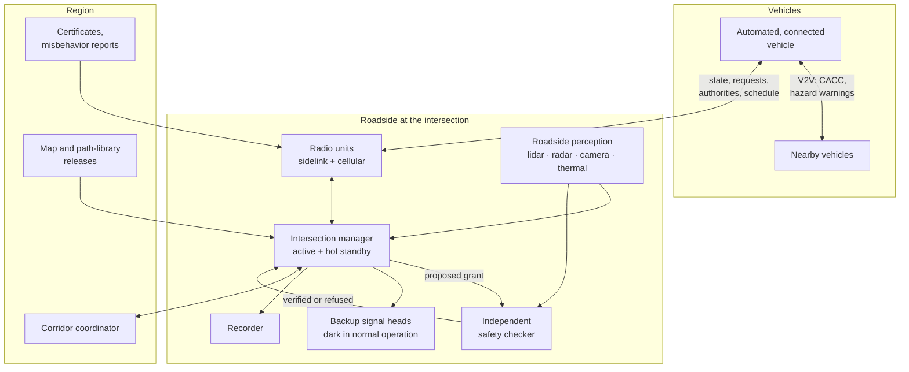
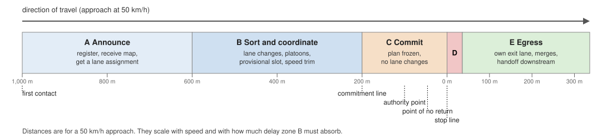
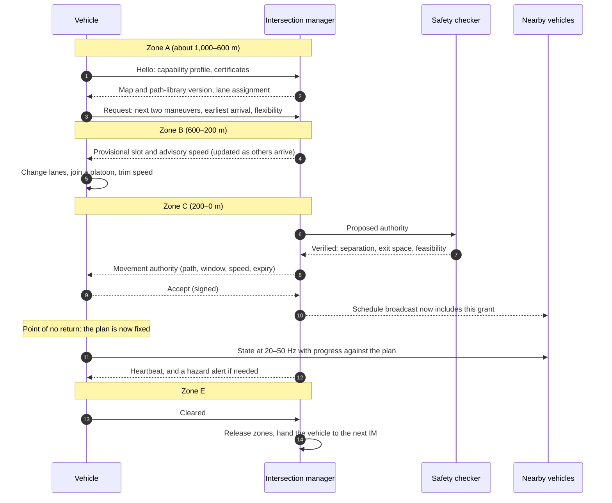
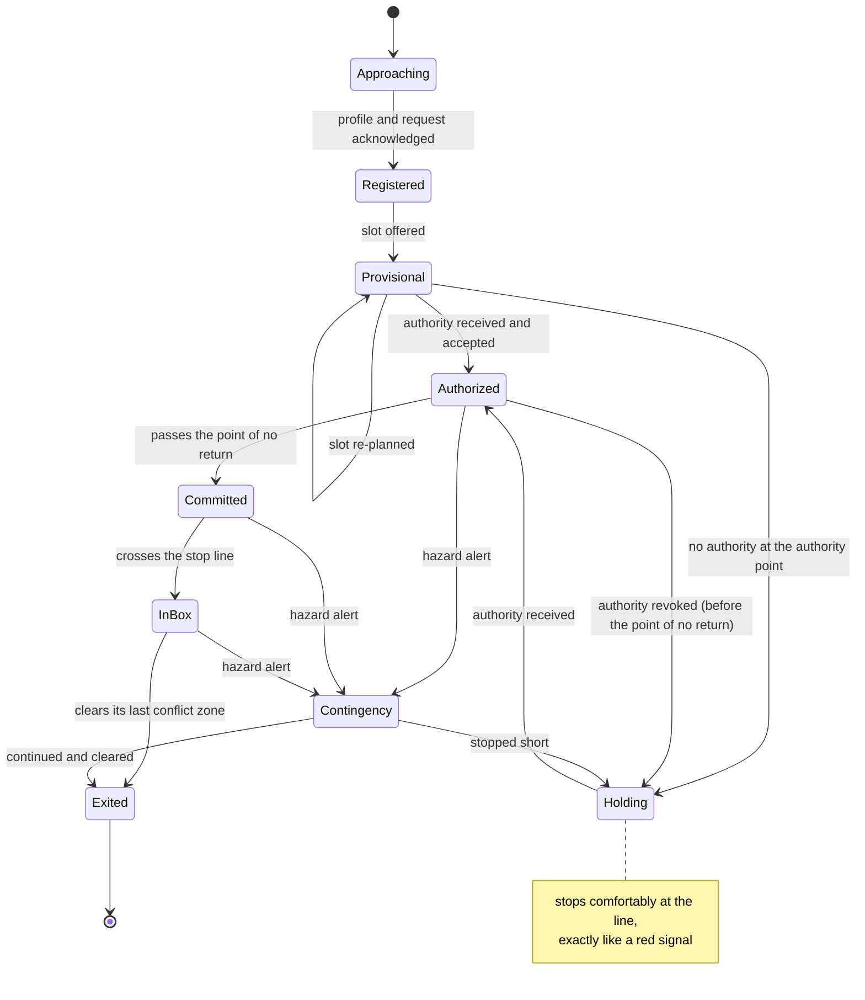
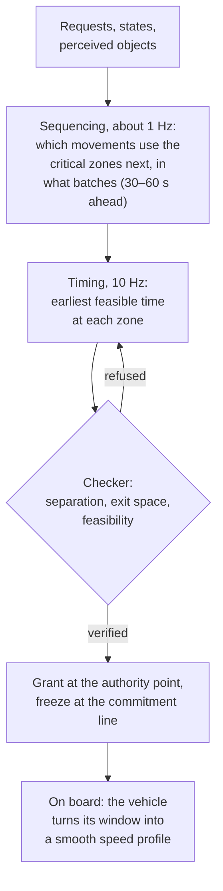
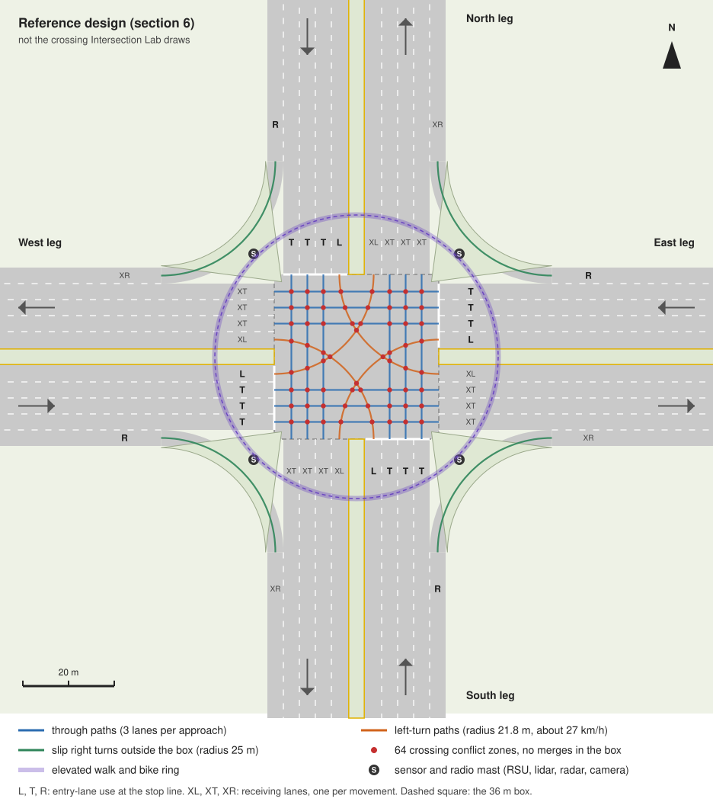
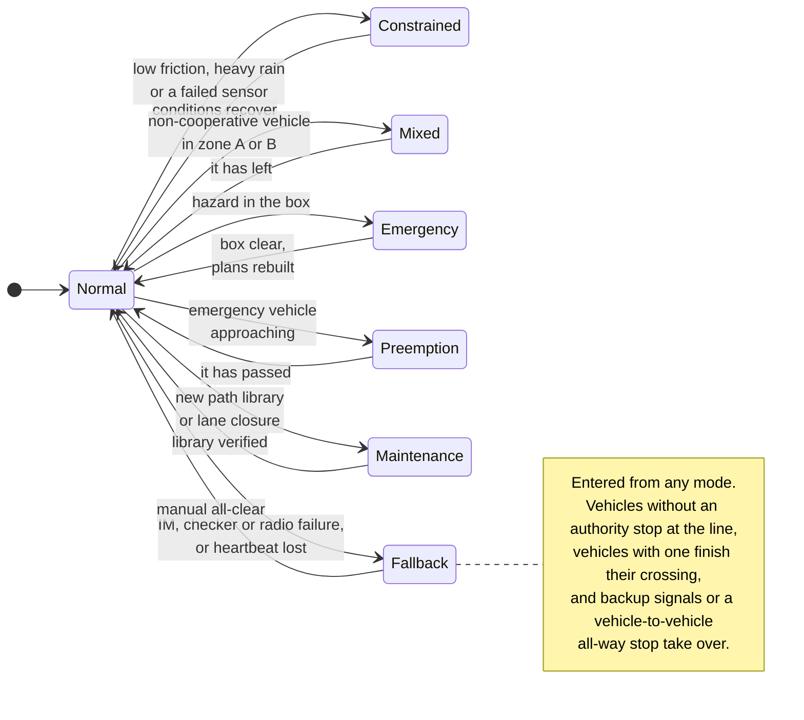
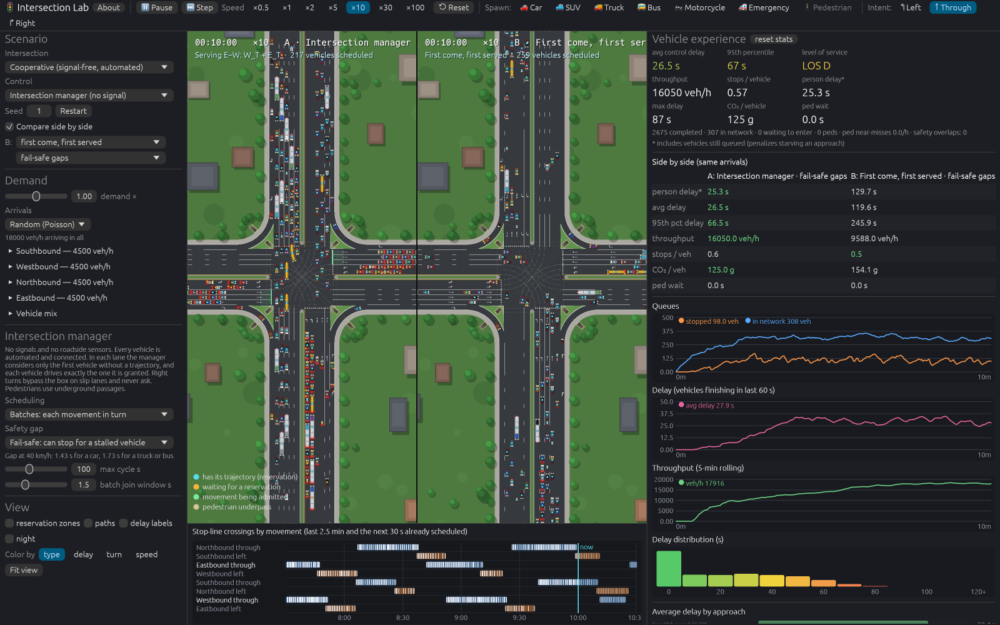

# Cooperative intersections without signals

*Ramifications, a protocol and a reference design*

> **Design notes.** Sections 1 to 11 were written before any of this was built. Figures
> marked *estimate* come from the simple models in Appendix A and the Monte Carlo runs in
> Appendix B: [cim_numbers.py](cooperative-scripts/cim_numbers.py) prints every estimate,
> and [make_figures.py](cooperative-scripts/make_figures.py) draws the two diagrams.
> Intersection Lab has since built the reference design's lanes and paths as its
> signal-free cooperative crossing, with a second left-turn lane on each approach and an
> intersection manager to run it. It doesn't build the rest of the reference design:
> the approach zones A–E and the authority point (sections 3.4, 3.5 and 6.6), the
> elevated walking and cycling ring (section 6.7; pedestrians use underpasses instead)
> and the roadside equipment (section 6.8). Section 12 describes what was built and what
> the simulator measured; figures marked *measured* come from it. November 2026.

## Contents

0. Summary
1. The idea and its vocabulary
2. Physics first: what limits an intersection
3. Architecture
4. What information is shared
5. Scheduling for maximum throughput
6. A reference design: a large, purpose-built cooperative crossing
7. Safety case
8. Security and privacy
9. Mixed traffic and the transition
10. Wider ramifications
11. Open questions
12. The cooperative crossing in Intersection Lab
13. References
* Appendix A: formulas and parameters
* Appendix B: the Monte Carlo test

---

## 0. Summary

The idea: if every vehicle approaching an intersection shared where it is, how fast it is
going, which lane it is in and where it wants to go, then the vehicles (or a roadside
coordinator) could agree on a time for each one to cross. Each vehicle would adjust its
speed far upstream so that it arrives exactly in its slot. Nobody would stop, and the
streams would weave through one another in the box.

What these notes conclude:

* **Measured since (section 12).** Built in Intersection Lab with two left-turn lanes per
  approach, the crossing carries 18,000 veh/h at 29 s average delay under the stop-safe
  rule below, and saturates near 19,000 veh/h. Weaving vehicles through one at a time,
  first come, first served, saturates near 10,000 veh/h on the same crossing.
* **It can work, but the safety rule decides almost everything.** A conflict zone, where
  two paths cross, can hold one vehicle at a time. How soon the next conflicting vehicle
  may follow depends on which failures the design must survive. With no failure margin,
  vehicles can cross a zone 0.2 s apart, and weaving them through one at a time (the
  "zipper") is the most efficient way to run the box. If the design must also survive a
  vehicle stopping dead in the box, the gap grows to about 1.4 s at 40 km/h. Weaving one
  at a time then carries no more than a signal does: about 1,700 veh/h through a crossing
  zone.
* **At high demand, batching beats the zipper.** Sending short platoons of 4–8 vehicles
  through each zone in turn recovers most of the capacity: 2,800–3,100 veh/h through a
  zone against about 1,700 for a signal. The best high-demand schedule looks like a very
  fast signal, with micro-cycles of 10–30 s and vehicles that arrive at speed instead of
  starting from a stop. The best-known slot-based study found the same: its doubling of
  capacity came from batching, and serving vehicles one at a time gained little capacity
  over signals [3]. On the whole crossing the zipper does worse still (*measured*): about
  10,000 veh/h against 19,000 for batches, because each vehicle must find a gap in up to
  ten crossing lanes at once (section 2.4).
* **Crossing speed has an optimum.** When the gap must cover a sudden stop, the
  capacity-optimal crossing speed is v\* = √(2a(L + W)): about 35–40 km/h on wet or dry
  pavement. Faster crossings occupy a zone for less time but need longer stopping gaps.
  That speed sits below the roughly 50 km/h that Safe System design treats as the limit
  for survivable side impacts. On snow it falls to about 20 km/h, and capacity per zone
  falls by about a third.
* **"No slowdown at all" is not achievable in general; "no stops" is.** Turning vehicles
  must slow for comfortable cornering (about 27 km/h on the reference design's 21.75 m
  left-turn radius), and through vehicles slow to the box speed. Beyond that, a 300 m
  coordination zone in which nobody drops below 20 km/h absorbs up to 26 s of delay. In
  a Monte Carlo test of two crossing lanes, that was enough for every vehicle up to
  2,400 veh/h through a zone, and for 95% at 3,200 veh/h, close to the zone's limit. At
  moderate demand, half to two-thirds of vehicles needed no adjustment at all.
* **Most of the capacity gain comes from automation, not from removing the signal.** Take
  a large four-leg crossing with one left lane, three through lanes and a slip right turn
  per approach. A conventional signal carries about 7,300–7,700 veh/h. An *AV-aware*
  signal, whose automated vehicles arrive at speed on green and discharge at short
  cooperative-cruise gaps, carries about 12,000–14,000. A signal-free cooperative box
  carries about 16,000–18,000. These are *estimated* capacity bounds before scheduling
  losses, for a fleet that is entirely automated and connected. Intersection Lab's
  manager, which keeps a signal's ring-and-barrier order, *measured* about 13,500 with
  one left lane per approach and 19,000 with two. The box's extra ~30% over
  the AV-aware signal comes from finer-grained concurrency. Its other large advantage is
  low delay at light and moderate demand.
* **The intersection is not the system.** Doubling a node's capacity moves the bottleneck
  to its exits and the next intersection. At city-block spacing the coordination zones of
  neighboring intersections overlap, so cooperative intersections have to be planned as a
  corridor or a network. Induced demand will absorb some of the gain.
* **Borrow the safety architecture from railways and air traffic control.** Stopping is
  the default. A vehicle receives a *movement authority* only when its path through the
  box and room in its exit lane are reserved for it. Once past the point of no return,
  its plan is self-contained, so a radio or coordinator failure is safe. A deliberately
  simple, independent checker verifies every grant, and the whole schedule is broadcast
  so that every vehicle can check it too.
* **Pedestrians and cyclists cannot be scheduled into sub-second slots.** A high-capacity
  cooperative box needs grade-separated walking and cycling, or crossing windows that act
  like signal phases and cost capacity. This is the concept's largest urban-design cost.
  In walkable districts it may outweigh the benefits.
* **The transition is the hard part.** The full benefit needs essentially every vehicle in
  the zone to be automated and connected. Until then the path runs through connected
  signals, AV-aware signals, hybrid control, and cooperative boxes on dedicated
  facilities.
* **Security, privacy, law and liability all change.** Reservations can be spoofed or
  hoarded. Priority claims must be cryptographically authorized. Trajectory data is
  personal data. Right of way has to be redefined as holding a valid authority, and every
  grant must be recorded.

---

## 1. The idea and its vocabulary

### 1.1 What is being proposed

Today an intersection shares its conflict area by time. A signal gives each group of
compatible movements the whole box for tens of seconds at a time, and everyone else
waits. Connected, automated vehicles make a much finer division possible. Each vehicle
announces where it is, how fast it is going and which way it will leave. A coordinator,
or the vehicles among themselves, assigns each one a time to cross. Each vehicle then
adjusts its speed hundreds of meters upstream so that it arrives exactly at that time.
Vehicles from conflicting directions pass through the box in alternation, filling the
gaps between one another.

Three families of design have been proposed:

* **Reservation-based, centralized.** An *intersection manager* (IM) at the roadside
  accepts requests and grants reservations of space and time in the box. This is the
  autonomous intersection management (AIM) model of Dresner and Stone [1], which divides
  the box into a grid of tiles and serves requests first come, first served.
* **Slot-based and batch-based, centralized.** The IM assigns vehicles to slots and, at
  high demand, sends them through in groups. This is the "Light Traffic" model of Tachet
  and colleagues [3, 28].
* **Distributed.** Vehicles negotiate among themselves with no roadside equipment, for
  example by electing a leader that acts as a "virtual traffic light" [9].

### 1.2 Vocabulary

| Term | Meaning in these notes |
|---|---|
| Cooperation classes | SAE J3216 [19] defines four classes of cooperative driving automation: **A**, status-sharing ("here I am"); **B**, intent-sharing ("this is what I will do"); **C**, agreement-seeking ("let us agree"); **D**, prescriptive ("you shall"). The concept needs class C on the approach, and the final grant is class D |
| Intersection manager (IM) | The roadside system that sequences vehicles and grants movement authorities |
| Box | The area shared by crossing paths, between the stop lines |
| Conflict zone | The stretch of two paths where vehicles on them could touch. Intersection Lab already computes these (`Conflict` and `zone_along` in `network.rs`) |
| Occupancy | The time a vehicle's body is inside a conflict zone |
| Gap, or post-encroachment time (PET) | The time from one vehicle leaving a conflict zone to the next conflicting vehicle entering it |
| Movement authority | A signed grant: a path through the box, a time window and speed for entering it, room in the exit lane, and an expiry. The term comes from railway signaling |
| Point of no return (PNR) | The last point at which a vehicle can still stop comfortably before the stop line. Intersection Lab's vehicles *commit* to a conflict at the equivalent point |
| Batch, or platoon | Consecutive vehicles from one lane passing a zone at car-following gaps |
| Micro-cycle | One round of batches through a set of mutually conflicting movements; 10–30 s here |
| CACC | Cooperative adaptive cruise control: car following that uses the leader's broadcast acceleration, which allows short, stable gaps |
| AV-aware signal | A conventional signal whose automated, connected vehicles time their arrival to the green and discharge as CACC platoons |

### 1.3 Prior work, and two older industries that solved this problem

**Prior work.** Reservation-based AIM showed in simulation that a reservation manager
could cut delay far below that of signals [1, 2], and a traffic microsimulation reached
a similar conclusion [5]. Other studies reported even larger gains, such as 99% less
stopped delay than actuated control [14]. Later work found the limits. First come, first
served (FCFS) reservation can do *worse* than signals in realistic networks [4] and at
asymmetric intersections such as a local road crossing an arterial [15]. The slot-based
study found that serving vehicles one at a time gained little capacity over fixed-cycle
signals, while batching doubled it [3]. Platooned discharge alone can double or triple the
saturation flow of an ordinary signal [16]. Mixed traffic has been handled by letting
autonomous vehicles use reservations during a conventional signal's red ("FCFS-Light"
[2]), and by a fourth signal indication, the *white phase*, during which human drivers
simply follow the vehicle ahead while automated vehicles coordinate [10]. Auctions for
priority have also been proposed [6]. Two surveys cover the field [7, 8].

Many of the published gains come from idealized models: perfect communication, no
failures, and gaps sized to occupancy alone. Section 2 shows why that last assumption
matters more than any other.

**Air traffic control.** Arrival managers meter aircraft onto a runway by giving each one
a time over a fix, and aircraft absorb the delay with small speed changes far out rather
than by holding near the airport. A runway is a single conflict zone, and its separation
minima are set by what happens when something goes wrong, not by occupancy alone. The
coordination zone in section 3.5 is the road equivalent of time-based metering.

**Railway signaling.** An interlocking will not clear a route until every switch and
crossing on it is locked and the safety overlap beyond the signal is clear, and a train
may never pass the end of its movement authority. If anything fails, signals return to
danger and trains stop. These are exactly the properties a cooperative intersection needs
(section 3.4). Railways also learned to keep the safety-critical logic small, independent
of the rest, and formally verified.

**Intersection Lab's own right-of-way model.** The simulator already runs without a
central planner. Vehicles commit to a conflict once they can no longer stop comfortably,
and a commitment grants priority but not room: a committed vehicle still stops for
anyone stalled in the zone. A cooperative intersection would put a planner on top of
those rules, not replace them (section 12).

---

## 2. Physics first: what limits an intersection

This section uses one conflict zone and simple kinematics to show where capacity comes
from. Parameters follow Intersection Lab where it has them: a 4.5 m car, 3.5 m lanes, a
50 km/h (13.9 m/s) arterial speed limit and 2.6 m/s² of lateral acceleration in turns.
The other assumptions:

* 0.3 s from a failure to full braking (detection, radio and brake actuation);
* ±0.1 s timing tolerance per vehicle;
* 0.6 s CACC gaps within a lane;
* 6 m/s² of emergency braking (wet pavement).

Appendix A lists the formulas.

### 2.1 A conflict zone is a serial resource

Where two paths cross, only one body at a time can be in the conflict zone. A vehicle of
length L crossing a zone of length W (about one lane width for a right-angle crossing) at
speed v occupies it for τ = (L + W)/v. For a car at 40 km/h that is 0.72 s. Every claim
about intersection capacity reduces to two questions:

* how tightly occupancies can be packed in each zone;
* how many zones can be in use at once.

### 2.2 How close may the next conflicting vehicle be?

The time between one vehicle leaving a zone and the next conflicting vehicle entering it
is the post-encroachment time (PET). Communication cannot shrink it below what physics
requires, and what physics requires depends on which failures the design must survive.
At 40 km/h with 6 m/s² of braking (*estimate*; veh/h through one zone, both streams
together):

| Policy | Designed to survive | Gap (PET) | One at a time | Batches of 4 | Batches of 8 |
|---|---|---|---|---|---|
| **P0** occupancy only | timing error only | 0.20 s (2 m) | 3,910 | 3,658 | 3,619 |
| **P1** brake-safe | the first vehicle brakes as hard as it can; the next brakes too | 0.50 s (6 m) | 2,949 | 3,399 | 3,487 |
| **PH** harm-limited | the first vehicle stops dead; the next hits it at 25 km/h or less | 1.06 s (12 m) | 2,018 | 3,000 | 3,265 |
| **P2** stop-safe | the first vehicle stops dead; the next stops short of it | 1.43 s (16 m) | 1,678 | 2,790 | 3,136 |

For comparison, one lane of automated vehicles following at 0.6 s gaps carries
3,581 veh/h at 40 km/h. The crossing point of two lanes at a well-timed two-phase signal
passes 1,650–1,770 veh/h (60–120 s cycle, 4 s lost per phase, 1,900 veh/h per lane).

* **P1** relies on the first vehicle taking time to stop. It slides on through the zone
  while the second vehicle brakes, so the second needs only its reaction time. That holds
  only if the second vehicle brakes at least as well as the first: a truck crossing
  behind a car needs extra time. This is the reasoning of Responsibility-Sensitive Safety
  [12], applied to crossing traffic.
* **P2** covers a vehicle that stops instantly inside the box, which essentially only
  happens after a collision. P2 is the rule that keeps one crash in the box from becoming
  two or three.
* **PH** is a Safe System compromise. It accepts a secondary impact, but only at a speed
  people survive.
* **P0** is what many simulation studies assume without saying so.

These gaps also change what counts as a near miss. Surrogate-safety studies usually treat
a PET under about 1–1.5 s as a serious conflict, and Intersection Lab logs a pedestrian
near miss when a vehicle passes within about 1.5 s. Under P0 or P1 a cooperative
intersection would produce such "conflicts" thousands of times an hour by design, so its
safety has to be judged by new measures (section 7.5).

**Recommendation:** design conflict zones to P2, and quantify PH and P1 as sensitivities.
Within a lane, ordinary car-following rules apply, because a follower must survive its
leader braking, not its leader vanishing. That is why platoons stay efficient under P2.
The rest of these notes assume P2 unless they say otherwise.

### 2.3 There is a capacity-optimal crossing speed

Under P2, each conflicting vehicle ties a zone up for
S(v) = (L + W)/v + 2δ + tᵣ + v/2a. The first term falls with speed and the last grows
with it, so S is smallest at **v\* = √(2a(L + W))**. Through one zone, one vehicle at a
time (*estimate*):

| Braking available | Typical surface | v\* | Capacity at v\* |
|---|---|---|---|
| 8 m/s² | dry | 41 km/h | 1,881 veh/h |
| 6 m/s² | wet | 35 km/h | 1,688 veh/h |
| 4 m/s² | poor | 29 km/h | 1,440 veh/h |
| 2 m/s² | snow | 20 km/h | 1,082 veh/h |

Consequences:

* **The box speed is a control variable, not a constant.** It should follow road friction,
  which vehicles can estimate from wheel slip and share.
* **Faster is not better.** A stop-safe zone carries less at 60 km/h than at 30 km/h. The
  curve is flat near the optimum: a fixed 40 km/h is within 1% of the best on both wet
  and dry pavement.
* **The optimum happens to be survivable.** Safe System guidance commonly treats about
  50 km/h as the most at which a side impact is survivable, and about 30 km/h wherever
  pedestrians can be struck. The capacity-optimal speed falls between the two.
* **Long vehicles shift the optimum and cost more.** Intersection Lab's 16.5 m truck has a
  higher optimal speed than a car, but each one ties a zone up for about 1.5–2 car slots,
  depending on how it is batched. This is the cooperative version of counting a heavy
  vehicle as several passenger cars.

### 2.4 Interleaving versus batching

P2's long gap is paid only when a zone switches between conflicting streams. Followers in
the same lane need only their car-following gap. So a zone carries more if each stream
sends a short platoon at a time. Under P2 at 40 km/h on wet pavement (*estimate*):

| Vehicles per batch | Through the zone (veh/h) | Time lost to switching | Micro-cycle |
|---|---|---|---|
| 1 | 1,678 | 53% | 4.3 s |
| 2 | 2,285 | 36% | 6.3 s |
| 4 | 2,790 | 22% | 10.3 s |
| 8 | 3,136 | 12% | 18.4 s |
| 12 | 3,271 | 9% | 26.4 s |
| unlimited | 3,581 | 0% | — |

So the picture of cars zipping through one another one at a time is the right picture in
two cases: at light demand, where it minimizes delay, and under P0 or P1, where switching
is nearly free. Under P2 at high demand it is the *least* efficient way to run the box.
The schedule that maximizes throughput looks like a signal with a very short cycle. Each
switch costs about 1.1 s more than one more following vehicle would, against 4–5 s of
lost time per phase at a signal, and vehicles arrive at speed instead of starting from a
stop.

Signal timing's rule for the shortest workable cycle carries over. Suppose n mutually
conflicting groups take turns, each switch loses ℓ seconds, and the groups' flows need a
fraction Y of the zone's time. Then the micro-cycle must be at least
C_min = nℓ / (1 − Y). For three groups with ℓ = 1.15 s and Y = 0.8, that is 17 s.

**Measured on the whole crossing.** Intersection Lab's manager can schedule either way
(section 12). On the reference crossing with two left-turn lanes per approach, under P2,
with the default vehicle mix and the same arrivals for both (3 seeds × 20 min,
*measured*):

| Demand (veh/h) | First come, first served: average delay | Batches: average delay |
|---|---|---|
| 2,000 | 0.4 s | 0.6 s |
| 4,000 | 1.2 s | 1.8 s |
| 6,000 | 3.1 s | 3.0 s |
| 8,000 | 7.4 s | 5.1 s |
| 10,000 | 21.8 s | 7.7 s |
| 12,000 | 102 s, queue growing | 12.5 s |
| 14,000 | 186 s, queue growing | 17.0 s |
| Capacity | about 10,100 veh/h (12,600 under P1) | about 19,000 veh/h (19,700 under P1) |

The zipper wins only in light traffic, below about 6,000 veh/h, where nobody waits for a
phase. It loses more on
the whole crossing than at the single zone above, for two reasons. Each path crosses ten
other lanes, and a weaving vehicle needs a free window at every one of them, at times its
speed fixes; giving it the first set of windows that fits leaves slivers of time at the
other zones that are too short for anyone else. And a vehicle waiting for its windows
holds up its whole lane, while a batch keeps every lane of a movement streaming together.
Even under P1, where switching is cheap at a single zone, the zipper saturates about a
third below batches.

### 2.5 Turning vehicles must slow down

At Intersection Lab's comfortable lateral acceleration of 2.6 m/s²:

| Turn radius | 10 m | 15 m | 20 m | 25 m | 30 m | 40 m |
|---|---|---|---|---|---|---|
| Speed | 18 km/h | 22 km/h | 26 km/h | 29 km/h | 32 km/h | 37 km/h |

Left turns in the reference design (section 6) have a 21.75 m radius and run at about
27 km/h. Its slip right turns have a 25 m radius and run at about 29 km/h. Larger radii
need a larger box, which lengthens every crossing path and the time each through vehicle
spends near conflicts. "No slowdown at all" is therefore impossible for turning traffic,
short of a grade-separated interchange, which is a different solution altogether.

### 2.6 Where the gain really comes from

Comparing a cooperative box with today's signals mixes two changes: automated driving,
and removing the signal. They should be separated. For the reference geometry (one left
lane, three through lanes and a channelized right turn per approach; traffic 20% left,
65% through, 15% right):

| Control | Assumptions | Capacity (*estimate*, veh/h) |
|---|---|---|
| Conventional signal | human drivers at 1,900 veh/h per lane; dual-ring phasing; 16 s lost per cycle; 90–120 s cycle | 7,300–7,700 |
| AV-aware signal | every vehicle automated and connected; 0.6 s CACC gaps; arrival at speed on green; 2 s lost per phase; 30–60 s cycle | 12,000–14,200 |
| Cooperative box | the same vehicles; P2 at 40 km/h; zones scheduled individually; 15–30 s micro-cycles | 15,900–18,300 |
| Pairwise zone bound | ignores that a turning vehicle must find gaps in several streams at once | about 24,000 (not reachable) |

Reading down the table, the gain over today's signal splits roughly three ways:

* **Automated following roughly doubles lane capacity.** CACC takes a lane from about
  1,900 to 3,600–3,900 veh/h. In field tests drivers chose CACC gaps of 0.6–1.1 s, and
  modeling put a freeway lane at about 3,970 veh/h with every vehicle on CACC, against
  about 2,000 driven by hand [11].
* **Arriving at speed removes start-up lost time.** That is about 2 s per phase today
  (2.2 s in Intersection Lab's calibrated discharge, against the HCM's 2.0 s [25]).
* **Finer concurrency adds about another 30%.** In the reference geometry no four
  movements all conflict with one another. The largest such sets are triples, such as
  northbound through, westbound through and southbound left. A dual-ring signal
  effectively serves four groups in turn. The cooperative box can, for example, run the
  northbound left alongside the westbound through, because each has its own receiving
  lane.

A connected signal can capture the first two; only the third needs the signal to go.
**Most of the capacity gain comes from automation.** What the signal-free box adds is the
concurrency, plus much lower delay at light and moderate demand, where vehicles cross
without waiting for a phase.

These are bounds. Real schedules lose capacity to random arrivals, mixed vehicle sizes,
and the coupling between successive zones along one path. Simulation (section 12) is how
to find out how much. Intersection Lab's answer for its manager is about 13,500 veh/h
with this geometry (*measured*), largely because the manager keeps a signal's
ring-and-barrier order, which serializes four movement groups where this bound assumes
three. A second left-turn lane per approach brings it to about 19,000.

### 2.7 How much speed change is needed?

A vehicle that must arrive later slows down early and gently. How much delay a stretch of
road can absorb depends on its length and on the lowest speed considered acceptable.
Approaching at 50 km/h, arriving at the box at 40 km/h, with 1.5 m/s² of acceleration
and braking (*estimate*):

| Lowest speed | 150 m | 300 m | 500 m | 800 m |
|---|---|---|---|---|
| 30 km/h | 5.5 s | 12.8 s | 22.5 s | 37.1 s |
| 20 km/h | 9.9 s | 25.9 s | 47.2 s | 79.2 s |
| 10 km/h | 19.7 s | 62.5 s | 120 s | 205 s |

Slowing down also stores vehicles. With 0.6 s gaps, a 300 m lane holds about 23 cars at
50 km/h, 32 at 30 km/h and 38 at 20 km/h. That "moving queue" of 8–15 extra vehicles per
lane is the buffer that replaces a standing queue.

How much delay is needed depends on demand. A Monte Carlo test of two crossing lanes
sharing one zone, under P2 at 40 km/h with balanced flows (Appendix B):

| Through the zone (veh/h) | Scheduler | Mean delay | 95th percentile | No adjustment needed | Absorbed in 300 m, never below 20 km/h |
|---|---|---|---|---|---|
| 1,200 | first come, first served | 0.8 s | 3.3 s | 54% | 100% |
| 1,200 | batching | 0.6 s | 3.1 s | 64% | 100% |
| 1,800 | first come, first served | 3.5 s | 10.6 s | 19% | 100% |
| 1,800 | batching | 1.3 s | 5.3 s | 47% | 100% |
| 2,400 | first come, first served | queue grows without limit | | | |
| 2,400 | batching | 2.6 s | 8.8 s | 31% | 100% |
| 3,000 | batching | 6.4 s | 17.6 s | 16% | 99.6% |
| 3,200 | batching | 9.8 s | 25.4 s | 10% | 95% (99.9% in 500 m) |

Three things stand out:

* At moderate demand, half to two-thirds of vehicles pass with no adjustment at all, and
  the rest need only a gentle trim.
* Under P2, first come, first served saturates at about 2,300 veh/h through a zone, while
  batching runs stably to at least 3,200.
* Near capacity almost every vehicle slows, some a lot, and the coordination zone has to
  be 500 m or longer. That is longer than many city blocks (section 2.8).

With a 70/30 split between the two lanes the results are similar, with a somewhat longer
tail.

### 2.8 Exits, spillback and the network

* **Never admit a vehicle without room to leave.** A vehicle stopped in the box blocks
  every path that crosses it. A cooperative box must reserve exit-lane space as part of
  every authority, just as Intersection Lab's vehicles refuse to enter the box without
  room to clear it.
* **Capacity moves the bottleneck.** At 17,000 veh/h, the reference design sends about
  4,300 veh/h into each exit leg. Unless the road beyond, and the next intersection, can
  take that, the queue simply moves downstream.
* **Coordination zones overlap at urban spacing.** Intersection Lab's corridors space
  signals 420 m apart. A 300–500 m coordination zone then starts inside the upstream
  intersection's exit, so a vehicle's departure slot from one box fixes its arrival at the
  next, and the corridor becomes one scheduling problem. The lab's corridor experiments
  point the same way: telling each signal what its upstream neighbor had released made
  little or no difference, and on the major/minor road it made delay worse. The
  conclusion was that real gains need coordinated plans, not more lookahead.
* **Induced demand and network paradoxes.** Cheaper, faster trips attract more trips. In a
  network, making one node more efficient can make the whole network worse (Braess's
  paradox), and reservation control has been shown to do this in realistic networks [4].

---

## 3. Architecture

### 3.1 Roles

| Role | Runs on | Responsibilities | Must never |
|---|---|---|---|
| Vehicle | on board | announce itself; request a movement; plan and follow its own trajectory to meet its authority; keep sensing; brake for anything in its path | enter the box without a valid authority |
| Intersection manager (IM) | roadside computer, with a hot standby | assign lanes; sequence and time movements; issue, amend and revoke authorities; monitor conformance; manage modes | send a grant the checker has not verified |
| Safety checker | a separate roadside computer, with independently written software | verify every proposed authority against all others: zone separation, exit space, kinematic feasibility, expiry | optimize anything; it only says yes or no |
| Roadside perception | sensors on masts | track every road user, connected or not; detect intruders, stalled vehicles and debris; estimate friction | |
| Corridor coordinator | regional server | align slot patterns between neighboring IMs; meter inflow; advise routes | |
| Back-office services | central servers | certificates and revocation; map and path-library releases; incident records; statistics | see live identities |
| Non-cooperative road users | | pedestrians, cyclists, animals, legacy vehicles, debris | (the design must assume they will be where they should not be) |

### 3.2 Centralized or distributed?

| | Distributed (vehicles only) | Centralized IM |
|---|---|---|
| Infrastructure | none | roadside computers, radios and sensors |
| Single point of failure | none | yes, mitigated by a standby and a safe fallback |
| Agreement under message loss | hard: vehicles must agree among themselves over lossy links | simple: one authority decides, and each side's default is safe (section 3.4) |
| Sees road users that do not communicate | only what vehicles' own sensors see | roadside sensors see everyone |
| Verification and certification | hard: behavior emerges from many interacting agents | easier: one deterministic scheduler and one checker |
| Optimization | local | natural, including corridor coordination |

**Recommendation:** a centralized IM with a hot standby, an independent checker, and
vehicles that verify the broadcast schedule. A distributed protocol is worth keeping as a
degraded mode, for example a vehicle-to-vehicle all-way stop at low speed when the IM is
down.

### 3.3 Who plans the trajectory?

The vehicle does. The IM decides *when* and *where*: the path, the time window and speed
at the stop line, and what must hold inside the box. The vehicle decides *how*. It knows
its powertrain, load, tires and passengers, and turns the authority into a smooth speed
profile. In J3216 terms this is agreement-seeking (class C) on the approach and
prescriptive (class D) for the box itself. It keeps the IM's model of vehicles simple,
and it leaves each vehicle's safety functions in charge of its own motion.

### 3.4 The core invariant: movement authority and the point of no return

> At every moment, every vehicle either holds a verified movement authority covering its
> whole path through the box and room in its exit lane, or can stop comfortably before
> the stop line using only its own sensors.

Everything else follows from this:

* **Lost messages before the point of no return are safe.** A vehicle that has not
  received its authority by the *authority point* starts a comfortable stop at the line.
  Traffic slows, and nobody is hurt.
* **Lost messages after the point of no return are safe.** An authority is
  self-contained: it says everything the vehicle needs to cross. A vehicle that loses its
  radio inside the box finishes its plan, and every other plan already accounts for it.
* **IM failure is the same case.** Vehicles without an authority stop, vehicles with one
  finish, and the intersection drops into a fallback mode (section 7.3).
* **Revocation is possible only before the point of no return.** After it, the IM can only
  warn of a hazard, and the vehicle's own safety functions take over.
* **There is no agreement problem to solve.** Agreeing over a lossy link is the classic
  "two generals" problem, which no protocol solves in bounded time. Here it doesn't need
  solving, because each side's default is safe. The IM treats the zones as reserved from
  the moment it sends a grant until the grant expires, whether or not the vehicle
  acknowledges it. The vehicle treats itself as authorized only once it holds the signed
  grant. Neither side needs to know whether its last message arrived.

An authority contains:

* the path through the box and the exit lane;
* the entry time window at the stop line (say, 12:04:31.40 ± 0.10 s) and the entry speed
  range;
* any constraint inside the box (normally: hold speed along the path);
* the exit-lane space reserved, and until when;
* a contingency instruction: what to do on a box-hazard alert (section 3.6);
* an expiry time, and the map and path-library version it refers to;
* the IM's and the checker's signatures.

### 3.5 Zones along each approach

> *Not built in Intersection Lab.* Its manager has no approach zones, commitment line or
> authority point (section 3.4). In each lane it considers only the first vehicle
> without a trajectory and may grant it one anywhere on the approach. A vehicle without
> one follows the vehicle ahead and, if it must, waits far enough before the stop line
> to reach the crossing speed by the time it crosses (section 12.1).

| Zone | Before the stop line (50 km/h) | What happens | What sets its length |
|---|---|---|---|
| **A** Announce | about 1,000–600 m | first contact; certificates; map and path library; lane assignment from the next two maneuvers | room for up to three lane changes before zone C |
| **B** Sort and coordinate | 600–200 m | lane changes; platoons form by destination; provisional slot; speed trimming absorbs most of the delay | 300–500 m absorbs 26–47 s without dropping below 20 km/h (section 2.7) |
| **C** Commit | 200–0 m | the sequence freezes at the commitment line; the authority must be held by the authority point, about 100 m out; no lane changes; only fine timing trims | a comfortable stop from 50 km/h needs about 46 m with a 0.5 s reaction, plus time for retries |
| **D** Box | 36 m across | follow the path at the granted speed | geometry |
| **E** Egress | 0–300 m | each movement has its own receiving lane; zipper merges at matched speed; handoff to the next IM | merges belong where speeds match, not in the box |

First contact at 1 km is beyond the reliable reach of a single roadside radio. It can
come through the cellular network or through the upstream intersection's radios. In a
corridor, the upstream IM can do much of zone A and B's work for its neighbor.

### 3.6 Contingency plans

Each authority carries a precomputed reaction to a box-hazard alert, and the checker
verifies the *set* of contingency plans as well as the set of normal plans. If everyone
executes their contingency at once, nobody collides. Typically, vehicles not yet in the
box stop short, and vehicles in the box continue and clear, unless the hazard is on their
own path, in which case they brake. This is what the P2 gaps pay for.

### 3.7 Time, position and the map

* **Time.** Plans are written in absolute time. GNSS time is far more precise than the
  plans need, and the roadside can also distribute time so that vehicles hold it through
  GNSS outages. Timing tolerance is dominated by how well vehicles track a speed profile
  (±0.1 s assumed here), not by clocks.
* **Position.** Lane-level paths need about ±0.2–0.3 m. That takes GNSS with corrections,
  which the roadside can broadcast, fused with map matching and onboard sensors. Urban
  canyons, with their reflected satellite signals, are the hard case. Roadside sensors
  measure every vehicle's position independently, which also checks what each vehicle
  reports.
* **Map and path library.** Every lane, path through the box, conflict zone, stop line and
  commitment line is published as a signed, versioned library, and every authority names
  its version. A vehicle holding a different version is treated as non-cooperative until
  it updates. Road work produces a new version that is published before the change, not
  after it.

---

## 4. What information is shared

### 4.1 Principles

* **Share the minimum the decision needs.** That means the next two maneuvers, not the
  trip's destination.
* **Everything is signed, and nothing is trusted on its own.** Messages carry IEEE 1609.2
  signatures [18] from short-lived pseudonym certificates [17]. Roadside sensors
  cross-check what vehicles say about themselves.
* **Pseudonymous, not anonymous.** An identifier stays stable for one crossing (a minute
  or two) and then changes.
* **Versioned.** Every message refers to a map version and a time base.
* **Self-contained after commitment.** Nothing a vehicle needs once it is past the point of
  no return depends on a message it has not yet received.
* **Existing standards first.** SAE J2735 [20] already defines the Basic Safety Message
  (BSM), MAP, Signal Phase and Timing (SPaT), signal request and status messages, and a
  personal safety message for pedestrians. SAE J3186 defines maneuver sharing and
  coordination, and SAE J3224 and ETSI's collective perception service [21] cover sensor
  sharing. A cooperative intersection mostly needs new message *content* (paths, slots,
  authorities), not a new radio.

### 4.2 Every vehicle to everyone: state

Broadcast 10 times a second outside the critical zones (the J2945/1 rate for BSMs on an
uncongested channel), and 20–50 times a second in zone C and the box.

| Item | Why |
|---|---|
| Pseudonymous ID and message counter | link messages through one crossing; detect loss |
| Time stamp (GNSS time, milliseconds) | one time base for every plan |
| Position with its accuracy; lane ID, lateral offset and map version | lane-level tracking |
| Speed, heading, longitudinal and lateral acceleration, yaw rate | prediction |
| Planned acceleration for the next 1–3 s | lets followers react before the motion starts (CACC); shows the IM deviations early |
| Authority ID and progress: distance along the path, time error against the plan | conformance monitoring by the IM and by neighbors |
| Length, width and class | swept path and zone occupancy |
| Brake, ABS, stability-control and traction events | early warning; crowd-sourced friction |
| Status flags: automation engaged, fault, emergency-vehicle mode | mode decisions |

### 4.3 Vehicle to IM: capability profile, once per approach

| Item | Why |
|---|---|
| Class and dimensions, including the swept-path envelope (articulation, off-tracking) | a bus or a semitrailer sweeps a wider path through a turn |
| Mass class and load | braking and acceleration |
| Capability envelope *now*: maximum acceleration at this speed, comfortable deceleration, guaranteed emergency deceleration, maximum lateral acceleration, actuation delay | sets the gaps (section 2.2) and which slots are feasible |
| Tracking class: a certified bound on timing error (say ±0.1 s) and lateral error (±0.2 m) | the δ in every gap; poor trackers get wider slots |
| Cooperation class (J3216) and protocol version | what the vehicle can do |
| Priority permissions, as signed certificate attributes: emergency, transit, police | priority can be presented, never claimed |
| Occupancy, coarse (1, 2–3, 4+, bus), optional | person-delay weighting, if policy wants it |

Capability claims are cheap to make and costly to verify, so they are checked in use. The
IM measures each vehicle's actual tracking error and braking response on the approach,
and assigns its tolerance class from what it sees.

### 4.4 Vehicle to IM: intent and request

| Item | Why |
|---|---|
| Entry leg and current lane | where it is |
| Next maneuver (exit leg), and the one after it | lane assignment, including which exit lane suits the next intersection |
| Earliest possible arrival at the stop line, given the speed limit and its own acceleration | lower bound on its slot |
| Flexibility: preferred and latest acceptable arrival; willingness to reroute | lets the IM trade slots |
| Comfort or cargo constraints (gentle acceleration, medical transport) | which profiles are acceptable |

### 4.5 IM to vehicles

| Message | To | Contents |
|---|---|---|
| Map and path library | broadcast, on change and on request | lanes, paths through the box, conflict zones and their extent along each path, stop, authority and commitment lines, speed limits per path, version hash |
| Lane assignment | one vehicle | entry lane, and the window in which to change into it |
| Provisional slot | one vehicle | target time and speed at the commitment line, and an advisory speed now; changes freely in zone B |
| Movement authority | one vehicle | section 3.4 |
| Amendment or revocation | one vehicle | only before the point of no return |
| Schedule | broadcast, 5–10 times a second | every active authority: pseudonymous ID, path, and window at each zone |
| Heartbeat and mode | broadcast, 10 times a second | normal, constrained, mixed, fallback, emergency, preemption or maintenance |
| Hazard alert | broadcast, at once | box blocked, intruder, debris or low friction, and which paths it affects |
| Perceived objects | broadcast, 10 times a second | every road user the roadside sensors track, especially those that do not communicate |
| Crossing windows | broadcast | when walking and cycling crossings will run, if any are at grade |
| Corrections | broadcast | positioning corrections and time |

Broadcasting the whole schedule is a deliberate safety and security feature. Any vehicle
can check that no granted window overlaps its own or anyone else's. A double booking,
whether from a bug or an attack, is then visible to every vehicle in the area, not only
to the IM.

### 4.6 Vehicle to vehicle

* **CACC:** planned acceleration, platoon membership, position in the platoon and gap,
  10–50 times a second.
* **Maneuver coordination (SAE J3186):** lane-change requests and acknowledgments in
  zones A and B.
* **Hard-braking warnings,** at once.
* **Collective perception:** objects the vehicle's own sensors track, which matters where
  roadside coverage is thin.

### 4.7 IM to IM

* Forecast departures by exit lane and time, which become the next intersection's
  arrival forecast.
* Acceptance: how many vehicles per lane per time window the downstream approach can take.
  This prevents spillback.
* Slot-pattern alignment: a shared time grid and offsets, the cooperative version of a
  green wave.
* Mode changes and incidents.
* Each vehicle's next maneuver, handed over so it does not have to be asked twice.

### 4.8 Pedestrians, cyclists and others

* **Crossing requests:** push buttons and detection, and optionally phones.
* **Displays:** countdowns and audible signals for any crossing at grade. These are traffic
  control devices, and they must work for someone without a phone.
* **Phones:** personal safety messages (J2735's PSM, ETSI's VRU awareness message) are
  useful hints but not a safety mechanism. A pedestrian without a phone must be exactly as
  safe as one with a phone.

### 4.9 What is deliberately not shared

* Persistent identity, owner or registration.
* Trip origin and destination beyond the next two maneuvers.
* Cabin data and camera images. Sensor sharing sends object lists, not pictures.
* Long-term trajectory logs, apart from incident records kept under the rules in
  section 8.2.

### 4.10 Timing, size and radio load

A busy intersection can have several hundred connected vehicles within a kilometer. At 10
messages a second and 350–500 bytes per signed state message, the broadcast load is
roughly:

| Vehicles in range | 350-byte messages | 500-byte messages |
|---|---|---|
| 200 | 5.6 Mbit/s | 8 Mbit/s |
| 500 | 14 Mbit/s | 20 Mbit/s |
| 1,000 | 28 Mbit/s | 40 Mbit/s |

The top of that range is likely more than one 10 MHz V2X channel can carry reliably. The
US now has 30 MHz at 5.895–5.925 GHz for C-V2X, as three 10 MHz channels [23]. So the
design needs:

* congestion control, as in SAE J2945/1, which lowers message rate and power as the
  channel fills;
* rates by zone: full rate only in zones C, D and E, and lower rates in A and B;
* roadside aggregation: the IM broadcasts the schedule and the perceived objects once,
  instead of every vehicle repeating everything;
* the cellular network for zone A and B negotiation, which is not time-critical, leaving
  the sidelink for safety messages.

3GPP's requirements for advanced driving go as low as 3 ms latency at 99.999% reliability
[22]. The design here deliberately does not depend on that. Authorities are issued
seconds ahead, and only hazard alerts are time-critical, which is why section 2.2 budgets
0.3 s from a failure to full braking.

### 4.11 The exchange, end to end

A vehicle's view of the same exchange:

---

## 5. Scheduling for maximum throughput

### 5.1 The problem

For every vehicle, choose when it enters each conflict zone on its path so that:

* conflicting vehicles are separated by the policy gap (section 2.2) at every zone;
* vehicles in the same lane keep their order and their car-following gaps;
* every vehicle's arrival time is reachable from where it is, within its limits;
* exit-lane space exists when it gets there;
* nobody waits longer than a hard bound;

and so that weighted delay is as small as possible. The weights can count persons, as
Intersection Lab's person delay does, and give priority to transit and emergency
vehicles.

In scheduling terms this is a job shop: vehicles are jobs, conflict zones are machines,
and every pair of conflicting vehicles at a zone needs an order. That is NP-hard in
general. Three facts make it tractable here:

* vehicles in a lane keep their order, so only the interleaving *between* lanes is chosen;
* vehicles bunch into platoons that can be scheduled as units;
* the movement conflict graph is small and fixed (section 6.4).

### 5.2 A layered scheduler

1. **Sequencing, about once a second, over a 30–60 s horizon.** Decide which compatible
   sets of movements use the critical zones next, for how long, and in what batches. This
   has the same shape as Intersection Lab's predictive controller, which enumerates "hold
   for *x* s, then switch to stage *j*" schedules over 90 s and keeps the one with the
   least person delay plus a fairness penalty. The difference is that arrival times are
   now partly controllable, so the planner chooses arrivals as well as service order. A
   max-pressure rule [13], which the lab also implements and which is provably
   throughput-optimal for signals, is a simpler alternative for choosing the next set.
2. **Timing, ten times a second.** Given the order, compute each vehicle's earliest
   feasible time at each zone by one pass through the precedence graph (a longest-path
   calculation). This is fast and deterministic.
3. **Check and grant.** The checker verifies each proposed authority, including that the
   vehicle can reach its window from where it is, and the IM sends it as the vehicle
   reaches the authority point. Until then, vehicles steer toward their provisional slots
   using the advisory speeds. Sequences may change freely until the commitment line, and
   are frozen after it.
4. **Trajectories, on board.** Each vehicle turns its window into a speed profile. Without
   speed limits, the profile that minimizes squared acceleration for a fixed arrival time
   and speed is a cubic in time: acceleration changes linearly [8]. With limits, it
   becomes slow down, cruise, speed up.

The optimizer can be as clever as anyone likes, because it cannot make the intersection
unsafe, only slow. This is Intersection Lab's principle that safety is enforced where the
physics is, not in controllers, applied one level up.

### 5.3 Adapting batch size to demand

* **Light demand:** serve each vehicle as it comes, filling gaps (the zipper). Most
  vehicles pass untouched.
* **Moderate demand:** extend a platoon while its followers keep arriving within a short
  slack (1.5 s in Appendix B), up to a cap, and then switch.
* **Heavy demand:** set batch sizes from the micro-cycle rule in section 2.4, choose the
  splits by demand, and lengthen the effective coordination zone by moving zone B's work
  upstream into the corridor.

Switching between these regimes needs hysteresis, so the pattern doesn't flap.

### 5.4 Concurrency

The scheduler's other lever is running many movements at once, and the geometry decides
how many can. The reference design (section 6) gives every movement its own receiving
lane, has no merges in the box, keeps right turns out of it, and arranges the left turns
so that opposite ones never cross. Every movement then conflicts with exactly four others,
and the largest sets of movements that all conflict with one another are triples.

### 5.5 Lane assignment and flexible lanes

* Lanes are assigned in zone A from each vehicle's next two maneuvers, so that the lane it
  leaves in also suits its next intersection.
* A lane's use can change with demand (a second left-turn lane at the peak, say), but only
  for vehicles not yet sorted, and only after every vehicle already in zone B has left the
  lane.
* Balancing load across the three through lanes matters more than usual, because every
  lane's batches must fit the same micro-cycle.

### 5.6 Priority, fairness and starvation

* **Count persons, not vehicles.** A bus carries 25 people in Intersection Lab's vehicle
  mix.
* **Give emergency vehicles a clear corridor.** The IM re-plans every uncommitted vehicle
  around them. That is easier than signal preemption, because nobody has to stop to make
  room. (In Intersection Lab, preemption cuts emergency-vehicle delay from 22.1 s to
  4.0 s.)
* **Bound every wait with a hard rule.** Intersection Lab's experience with Deep RL applies
  directly. Counting waiting pedestrians in the reward did not protect them; a hard 40 s
  rule did. A throughput-maximizing scheduler will starve minor approaches and people on
  foot unless the bound is a constraint rather than a weight.
* **Decide openly whether priority can be bought.** Auctions [6] can raise total value, but
  they price slower or poorer users out of their own street. That is a policy choice, not
  a technical one, and it should be made explicitly.

### 5.7 Admission control and metering

An authority includes exit space. When an exit backs up, the IM stops granting movements
into it and slows the approaches that feed it, well before anyone has to stop. Spillback
becomes gentle metering upstream instead of a blocked box.

### 5.8 Corridors and networks

* **Slot waves.** Neighboring IMs share a time grid and offsets, so platoons released by
  one arrive in the next one's slots. This is the cooperative version of a green wave.
* **Joint planning at short spacing.** With less than about 500 m between intersections,
  coordination zones overlap. Either a corridor coordinator plans across the IMs, or one
  IM manages the whole cluster.
* **Network effects.** Route and departure-time advice can spread demand. The paradox
  results [4] are a reason to evaluate any change at network level, not one intersection
  at a time.

### 5.9 The levers, ranked

| Lever | Effect (*estimate*) | Cost |
|---|---|---|
| CACC gaps within batches | about 2× lane capacity | needs automated, connected vehicles |
| Batching under P2 | 1,700 → 2,800–3,100 veh/h per zone; on the whole crossing, 10,100 → 19,000 veh/h (*measured*) | a little more delay at light demand |
| Concurrency through geometry | about 30% over an AV-aware signal | dedicated receiving lanes; a larger footprint |
| Arriving at speed | removes about 2 s of start-up loss per switch | long coordination zones |
| Box speed near v\* | 4–10% per zone against 50–60 km/h | slightly longer crossing times |
| Small timing tolerance and fast hazard detection | each 0.1 s saved in δ or tᵣ saves 0.1–0.2 s per switch | better actuation; certification |
| Friction awareness | keeps capacity safe in bad weather | sensing and policy |
| Exit-space admission and metering | prevents collapse | discipline |
| Corridor coordination | keeps arrivals shaped before they reach the box | institutional cooperation |

---

## 6. A reference design: a large, purpose-built cooperative crossing

Intersection Lab builds this design's lanes and paths with one change, a second
left-turn lane on each approach, which its measurements showed is needed for the design
demand (section 12). It doesn't build the approach zones (section 6.6), the elevated
ring (section 6.7) or the roadside equipment (section 6.8).

### 6.1 Goals and assumptions

* An arterial crossing an arterial, with 50 km/h approaches and heavy demand from every
  direction.
* Only automated, connected vehicles inside the zones (mixed traffic is section 9).
* P2 gaps at every crossing zone, and 40 km/h through traffic in the box.
* No walking or cycling at grade in the box.
* Every rule in sections 3 and 4.

### 6.2 Plan

The plan shows the reference design, not the crossing Intersection Lab draws. That one
has two left-turn lanes per approach, so its box is 43 m across with 100 crossing
conflict zones, and it has pedestrian underpasses instead of the ring and no roadside
equipment.

### 6.3 Lanes and paths

* **Each approach,** from the median out: one left-turn lane (L), three through lanes
  (T) and a right-turn lane (R) that leaves on a channelized slip lane about 25 m before
  the stop line.
* **Each exit:** a receiving lane per movement. Left turns arrive in XL next to the
  median, through traffic in three XT lanes, and right turns in XR at the curb.
* **One lane, one path.** Every entry lane has exactly one path through the box and one
  receiving lane, so the conflict table is fixed and can be verified once.
* **No merges in the box.** Merging happens downstream in zone E, at matched speeds, where
  it is cheap and forgiving. XL and XR either merge into the through lanes by zipper or
  continue as turn lanes at the next intersection.
* **Dimensions:** 3.5 m lanes (as in Intersection Lab), a 4 m median, and four lanes each
  way through the box, so each leg is 32 m wide there and 39 m wide where the slip lanes
  join. Stop lines sit 2 m back from the crossing road, so the box is 36 m across.

### 6.4 Conflict structure

The box has **64 crossing conflict zones**: 36 between through lanes, 24 between left
turns and through lanes, and 4 between adjacent left turns. There are no merging or
diverging conflicts. For scale, a conventional single-lane four-leg intersection has 32
conflict points (16 crossing, 8 merging, 8 diverging) and a single-lane roundabout has 8
[24]. The reference design has more zones because it has many more lanes, but only one
kind of conflict.

| Movement | Conflicts with |
|---|---|
| Northbound through | eastbound through, westbound through, southbound left, westbound left |
| Southbound through | eastbound through, westbound through, northbound left, eastbound left |
| Eastbound through | northbound through, southbound through, northbound left, westbound left |
| Westbound through | northbound through, southbound through, southbound left, eastbound left |
| Northbound left | southbound through, eastbound through, eastbound left, westbound left |
| Southbound left | northbound through, westbound through, eastbound left, westbound left |
| Eastbound left | southbound through, westbound through, northbound left, southbound left |
| Westbound left | northbound through, eastbound through, northbound left, southbound left |

With a second left-turn lane per approach, as built in Intersection Lab, there are 100
zones: 36 between through lanes, 48 between left turns and through lanes, and 16 between
left turns. Every path then crosses ten other lanes.

Opposite left turns never conflict, and right turns conflict with nothing in the box. The
largest sets of mutually conflicting movements are eight triples, such as {northbound
through, westbound through, southbound left}; no four movements all conflict. A signal's
dual-ring structure effectively serializes four movement groups, while the cooperative
box only has to serialize three. That is the source of the 30% in section 2.6.

### 6.5 Speeds

| Movement | Speed in the box | Why |
|---|---|---|
| Through | 40 km/h, lower when friction is poor | near v\* under P2 (section 2.3) |
| Left | about 27 km/h | 21.75 m radius at 2.6 m/s² |
| Right, on the slip lane | about 29 km/h | 25 m radius, outside the box |

A through vehicle crosses the 36 m box in about 3.2 s. A left turner's 34 m arc takes
about 4.5 s.

### 6.6 Approach zones

The zones are those of section 3.5. Physically, zones C to E must have no driveways or
side access. They need fences or barriers to keep people and animals out, and good
lighting. Intersection Lab doesn't build them: its approaches are 260 m of plain road.

### 6.7 Walking and cycling

* **Preferred: grade separation.** An elevated ring for walking and cycling around the
  box, like the Hovenring, a suspended cycle roundabout over a large intersection near
  Eindhoven, landing on the corner islands with ramps and elevators. It costs money and
  adds climbing and distance. People avoid detours, so fencing is needed as well.
  Intersection Lab doesn't build the ring; its pedestrians use underpasses instead
  (section 12.1).
* **Alternative: crossing windows at grade.** Crossing one leg means 32–39 m of road. Even
  split at the median, each half takes 12–15 s at 1.2 m/s, plus clearance. During a window,
  every movement entering or leaving that leg must stay out of the crosswalk. The IM can
  schedule windows on demand and announce them early, so vehicles absorb them without
  stopping, but each window costs about as much capacity as a signal phase.
* **A hard rule either way.** Anyone who asks to cross gets a window within a fixed time
  (section 5.6).

In a walkable district this is the deciding cost. The design suits intersections of
suburban arterials, freight and port areas, and new towns built around it, not downtown
streets.

### 6.8 Roadside equipment

Intersection Lab builds none of this equipment: its crossing has no roadside sensors,
radio units or backup signal heads, and its manager runs without a standby or a
separate checker (section 12.1).

| Item | Purpose |
|---|---|
| Radio units at every corner (sidelink and cellular) | redundant coverage of zones C to E; zones A and B through upstream units and the cellular network |
| Lidar, radar, cameras and thermal cameras | overlapping coverage of the box and zones C to E, with every road user tracked by at least two kinds of sensor |
| IM, standby IM and a separate checker | different hardware and, ideally, different software teams |
| Backup signal heads, dark in normal use | fallback mode and mixed traffic |
| Friction and weather sensing | sets the box speed and the gaps |
| Recorder | every message, grant, mode change and sensor track, for incident investigation |
| Backup power and redundant network links | the fallback must not depend on the grid |

### 6.9 Capacity

From section 2.6: about 16,000–18,000 veh/h (*estimate*, a bound before scheduling
losses), against about 7,500 for a conventional signal on the same lanes and about
12,000–14,000 for an AV-aware signal. Slip right turns are included. Each exit leg then
receives over 4,000 veh/h, which the roads beyond must be able to carry (section 2.8).

*Measured* in Intersection Lab (section 12): about 13,500 veh/h as drawn here, and about
19,000 with a second left-turn lane per approach, which carries the 18,000 veh/h design
demand at 29 s average delay.

### 6.10 Footprint and cost

The design takes roughly the land of a large suburban intersection with free right turns,
plus corner islands big enough for ramps. The expensive parts are the elevated walking
and cycling ring, the redundant sensing and computing, and the long fenced approaches. At
the volumes in section 6.9, though, the realistic alternative today is a grade-separated
interchange, which costs far more and takes far more land.

---

## 7. Safety case

### 7.1 Hazards

| Hazard | Example cause | Primary defense | Backstop |
|---|---|---|---|
| Two grants overlap at a zone | scheduler bug, race condition, corrupted message | independent checker; every vehicle verifies the broadcast schedule | onboard perception and automatic emergency braking (AEB) |
| A vehicle runs early or late against its plan | wheel slip, actuator fault, software lag | conformance monitoring; tolerance by tracking class; re-plan neighbors | gaps sized to include detection delay |
| A vehicle stops dead in the box | collision, catastrophic mechanical failure | P2 gaps; a moderate box speed | AEB; hazard alert; contingency plans |
| A vehicle leaves its path sideways | steering or localization fault | lateral monitoring; zones widened by the tracking class | brake to a stop; alert |
| Messages lost | interference, jamming, channel congestion | stop by default before the point of no return; self-contained authorities after it | backup signal heads |
| IM fails | crash, power loss, software fault | hot standby; heartbeat; fallback mode | vehicle-to-vehicle all-way stop |
| False data | spoofing, a compromised vehicle, phantom vehicles | signatures; misbehavior detection; roadside cross-checks | rate limits; certificate revocation |
| A road user who does not communicate | pedestrian, animal, legacy vehicle, debris | fencing; grade separation; roadside perception | emergency mode; AEB |
| Low friction | ice, oil, standing water | friction estimates; larger gaps and lower box speed | conservative defaults in winter |
| Map error | road work, stale map | versioned library; roadside checks; maintenance mode | treat the vehicle as non-cooperative |
| Common-cause software failure | the same bug in many vehicles at once | diverse implementations; staged updates; conformance testing | fallback modes |
| Clock error | GNSS outage or spoofing | several time sources; holdover; plausibility checks | widen tolerances; degrade |

### 7.2 Principles

1. **Stopping is the default.** A missing message, an invalid signature or a lost
   heartbeat all lead to a stop before the line.
2. **Authorities are self-contained.** Nothing after the point of no return depends on a
   future message.
3. **The checker is small, independent and verified.** It checks only separation, exit
   space and feasibility. Railways hold their interlockings to the highest safety
   integrity level and increasingly prove them correct formally; the checker deserves the
   same treatment.
4. **No single failure causes a collision.** P2 gaps cover vehicle failures, a standby IM
   covers computer failures, diverse sensors cover perception failures, and each vehicle's
   own emergency braking is the last layer.
5. **Common-cause failure is the new risk.** Every vehicle runs the same protocol, so one
   bug can strike all of them at once. The defenses are diversity (independent
   implementations from different makers), staged software rollouts and conformance
   testing.
6. **Vehicles keep the last word on braking.** An authority never obliges a vehicle to
   drive into something it can see.

### 7.3 Modes

| Mode | What changes |
|---|---|
| Normal | full cooperative operation |
| Constrained | larger gaps, lower box speed, shorter batches if needed |
| Mixed | backup signals run for everyone; automated vehicles arrive on green as an AV-aware signal's traffic would |
| Emergency | vehicles not yet in the box stop short, vehicles in it clear unless the hazard is on their path, and the IM re-plans around the blocked zones |
| Preemption | a clear corridor for the emergency vehicle, made by re-planning, not by stopping everyone |
| Maintenance | a reduced path library; some movements closed or moved |
| Fallback | everyone without an authority stops; backup signals or a vehicle-to-vehicle all-way stop take over |

### 7.4 Verification and certification

* **Vehicles:** ISO 26262 (functional safety), ISO 21448 (safety of the intended
  functionality), UL 4600 (safety cases for autonomous products) and UN Regulations 155
  and 156 (cybersecurity and software updates) [26].
* **Roadside:** IEC 61508 functional safety, with the checker held to an
  interlocking-like integrity level.
* **The protocol:** a conformance test that every vehicle model must pass before it may use
  a cooperative box, repeated after software updates, much like type approval.
* **Evidence:** a formal proof of the checker; scenario-based simulation with fault
  injection; shadow operation, in which the IM computes plans while signals still run the
  intersection; and staged deployment.

### 7.5 New measures of safety

Because a cooperative box produces short post-encroachment times by design, it needs
measures that reflect its own safety argument:

* the margin to the policy gap at every zone passage (actual gap minus required gap);
* exposure to secondary collisions: vehicle-seconds spent within stopping distance of a
  zone that another vehicle occupies;
* the distribution of conformance error, by vehicle class;
* how often a vehicle's own safety functions overrode its authority;
* time from hazard to full stop in fault-injection tests.

---

## 8. Security and privacy

### 8.1 Threats and defenses

| Threat | Example | Defense |
|---|---|---|
| Phantom vehicles (a Sybil attack) | one device claims many identities and books slots | limits on certificates per device; roadside sensors must see a vehicle before it gets an authority; unused reservations count against their holder |
| False priority | a car claims to be an ambulance | priority is a signed permission issued to the agency's vehicles, not a flag a car can set |
| Replay and forgery | old authorities rebroadcast | signatures, time stamps, short expiry, sequence numbers |
| Position or time spoofing | GNSS spoofing moves a vehicle on paper | roadside sensors cross-check position; several time sources; plausibility checks |
| Jamming | radio denial of service | stop by default before the point of no return; self-contained authorities after it; detection and reporting |
| A vehicle that ignores its authority | a fault or malice | conformance monitoring; hazard alerts; P2 gaps; misbehavior reports leading to revocation |
| Overstated capabilities | a vehicle claims better braking or tracking than it has, to win tighter slots | capabilities measured in use; certification; penalties |
| A compromised IM | the manager issues conflicting grants | independent checker; vehicles verify the broadcast schedule; recorder |
| Insider misuse of data | trajectories used for surveillance | pseudonyms; data minimization; retention limits; audits |

### 8.2 Privacy

* **Pseudonyms.** Short-lived pseudonym certificates rotate. The US Security Credential
  Management System was designed so that no single insider can link a vehicle's
  pseudonyms [17].
* **No identity in handoffs.** A handoff between IMs carries the next maneuver, not a
  persistent identity.
* **Retention.** Operational data is kept for minutes. Incident records are kept under a
  legal hold. Everything else is aggregated into statistics.
* **Law enforcement.** Access is a policy question, but the technical design should make
  bulk tracking hard, not easy.

---

## 9. Mixed traffic and the transition

### 9.1 Who does not fit

* **Human drivers.** They cannot hold a slot to ±0.1 s, and they need 1.5–2 s headways.
* **Humans supervising automation.** Nobody can take over in a box where cross traffic
  passes 1.4 s apart. In zones C to E, a vehicle must drive itself completely, with no
  fallback to its driver.
* **Motorcycles.** Narrow and agile, but harder for sensors to track. To take part they
  must be fully automated too.
* **Cyclists, scooter riders and pedestrians.** They need separate facilities
  (section 6.7).
* **Legacy and broken vehicles.** A connected car whose automation has failed is, for this
  purpose, a legacy vehicle.

### 9.2 Penetration

The benefits are strongly nonlinear in the share of vehicles that are automated and
connected. One legacy vehicle in a lane forces the scheduler to treat it as a long,
uncertain occupancy, and puts everything behind it at human headways. Until nearly every
vehicle qualifies, a cooperative box mostly runs as a signal.

### 9.3 A deployment path

| Stage | What changes | Needs | Status |
|---|---|---|---|
| 0 | Signals broadcast SPaT and MAP; cars show time to green or advise a speed to arrive on green | connected signals; some connected cars | available, for example Audi's Traffic Light Information since 2016 |
| 1 | Adaptive signals use connected-vehicle trajectories; transit and emergency vehicles request priority | connected cars | in use in places |
| 2 | AV-aware signals: automated vehicles time their arrival to the green and discharge as CACC platoons | a high share of automated vehicles on that road | near term; most of the capacity gain (section 2.6) |
| 3 | Hybrid: signals for people driving, reservations for automated vehicles in the gaps (FCFS-Light [2]) or a white phase [10] | mixed fleets | research |
| 4 | Cooperative boxes on closed facilities: ports, logistics parks, campuses, automated-only corridors | access control | could be built now |
| 5 | Cooperative boxes on public arterials | near-universal automation, law and standards | long term |

Policy has not pushed radios: the US proposed a vehicle-to-vehicle mandate in 2017 and
withdrew it in 2023 [27], and the 5.9 GHz safety band was cut from 75 MHz to 30 MHz
[23]. Deployment will follow automation more than connectivity.

---

## 10. Wider ramifications

### 10.1 Riding through one

* **Perceived safety.** Cross traffic passing 16 m ahead at 40 km/h will feel like a near
  miss for a long time, even when it is not one. P2's longer gaps help, and so does
  showing riders the plan.
* **Comfort.** Speed trims stay under 1.5 m/s², with gentle changes in acceleration.
* **Explaining waits.** "Why did my car slow down?" deserves an answer. The IM can return a
  reason with every slot, much as Intersection Lab shows a reason for each vehicle's
  decision and a controller "brain" panel.

### 10.2 Streets and places

* **Severance.** A fenced, 39 m-wide, high-volume intersection divides the neighborhoods
  around it.
* **Access.** Detours, ramps and elevators matter for people with disabilities. A design
  that works only for able-bodied walkers fails accessibility law as well as people.
* **Land use.** An intersection like this belongs where an interchange would otherwise be
  built, not on a main street.

### 10.3 Demand

* **Induced demand.** Capacity gains invite more driving, and may be temporary.
* **Network paradoxes.** Improving one node can make a network worse (section 2.8).

### 10.4 Energy and emissions

* **Stops avoided.** A car that does not stop from 50 km/h saves the energy needed to get
  back up to speed: 145 kJ of kinetic energy for a 1,500 kg car, about 14 mL of gasoline
  in Intersection Lab's fuel model. On top of that it saves 0.25 mL for every second it
  would have idled. Electric vehicles recover part of that energy by regenerative
  braking, so they gain less.
* **Wear and noise.** There is less brake wear and brake dust, and smooth flow is quieter.
* **Offsetting effects.** More traffic, if induced, eats into all of this.

### 10.5 Equity

* **Exclusion.** Owners of older vehicles, often people with lower incomes, would be
  excluded from cooperative-only roads or relegated to slower treatment.
* **Markets for priority.** Selling priority turns road space into a premium service.
* **Hidden bias.** First come, first served is not neutral when some vehicles can
  accelerate harder or track more precisely than others and so earn tighter slots.

### 10.6 Law and liability

* **Right of way** is redefined as holding a valid authority. Traffic codes, and manuals of
  traffic control devices such as the MUTCD, need a new kind of device whose instructions
  are legally binding, like a signal's.
* **Liability** must be allocated among the IM's operator, vehicle makers and software
  suppliers. The recorder will decide most cases.
* **Certification** of each vehicle model's participation, like type approval.
* **Enforcement.** A vehicle that repeatedly deviates loses access, the way a driver loses
  a license.

### 10.7 Operations and economics

* **Who runs it.** A public agency or a concessionaire, with service-level targets and
  round-the-clock monitoring.
* **Lifecycles.** Roads last 50 years, while radios change every decade: US policy moved
  from DSRC to C-V2X, and the FCC's 2024 order set a sunset for DSRC [23]. The protocol
  must be versioned and independent of any one radio.
* **Updates.** Software changes must be coordinated across IMs and fleets, and staged.
* **Costs and savings.** Roadside sensing and computing, redundancy, and grade separation
  cost money. Time, energy, and perhaps an interchange that never had to be built are the
  savings.

### 10.8 Weather

Friction controls everything (section 2.3). On snow, capacity per zone falls by about a
third and the box speed to about 20 km/h. Lidar and cameras degrade in snow and fog, and
lane markings disappear, which is one more reason for vehicles to rely on maps and
roadside references rather than paint.

### 10.9 Incidents and special operations

* **A crash in the box:** emergency mode, then routing through the paths that are still
  clear, then recovery.
* **Police control:** a manual mode, operated from an authenticated handheld device.
* **Parades, funerals, construction and oversize loads:** a planned change to the path
  library, or a manually entered reservation.

---

## 11. Open questions

1. Which failure policy will regulators accept: P2, PH, or something explicitly
   risk-based?
2. How much of the capacity bound can a real-time scheduler reach with random arrivals,
   mixed vehicle sizes and the coupling between zones along a path? (Section 12 answers
   this for one ring-and-barrier scheduler.)
3. How long must coordination zones be at urban spacing, and how should neighboring IMs
   share them?
4. What box-speed policy follows friction best, and how quickly can it safely change?
5. Is one left-turn lane and three through lanes per approach the right geometry, or do
   two of each do better for some turning splits? (With 20% left turns, Intersection Lab
   needed two left-turn lanes.)
6. How should pedestrian windows be scheduled to cost the least capacity, and how short
   can the guaranteed wait be?
7. At what share of automated vehicles does hybrid control (stage 3) beat an AV-aware
   signal (stage 2)?
8. How can common-cause software failures be bounded?
9. Can the broadcast schedule protect privacy and still be verifiable by every vehicle?
10. What happens to network-wide travel times when one corridor's intersections double in
    capacity?
11. Can a scheduler without the barrier use the finer concurrency of section 6.4 at full
    demand, and how much would it add over the ring-and-barrier order?

---

## 12. The cooperative crossing in Intersection Lab

Intersection Lab now includes the reference crossing as its last intersection, after the
roundabout: *Cooperative (signal-free, automated)* in the app. This section describes
what was built, what it measured, and how the estimates in sections 2 and 6 held up.
Every figure in it is *measured*.

### 12.1 What was built

* **Layout** (`build_cooperative` in [`src/sim/network.rs`](../src/sim/network.rs)). Each
  approach has two left-turn lanes, three through lanes and a right-turn slip lane on a
  25 m radius around a corner island; lanes are 3.5 m and the median 4 m. Every lane has
  its own path through the box and its own receiving lane, so the box has 100 crossing
  zones and no merges, and right turns never enter it. Pedestrians use underpasses, with
  stairs on the corner islands and plazas, so there are no crosswalks at grade. Default
  demand: 4,500 veh/h per approach, 18,000 in all, 20% turning left and 15% right.
* **Manager** ([`src/sim/coop.rs`](../src/sim/coop.rs)). There are no signals and no
  sensors. In each lane the manager considers only the first vehicle without a slot, and
  right turns, which never enter the box, never ask for one. When it grants a slot, it
  sends a complete trajectory: one acceleration per simulation step until the vehicle
  leaves the map. The manager builds trajectories with the simulator's own integrator, so
  it knows to rounding error when each vehicle will be in each zone, and grants one only
  if it keeps the policy gap to every trajectory already granted. A granted trajectory
  never changes, and the vehicle drives exactly that. Gaps follow section 2.2: P2 by
  default (1.43 s for a car and 1.73 s for a truck or bus at 40 km/h), PH or P1.
* **Two schedules.**
  * *Batches*, the default, serve each movement in turn, in two rings with a barrier
    like an actuated signal but without yellow or all-red. A batch ends when no vehicle
    of the movement can cross within its own headway plus 1.5 s of the batch's latest
    vehicle (gap-out), or at a demand-weighted share of a 100 s maximum cycle (max-out).
    The last phase of a ring may run on while the other ring finishes. Left turns lag
    the through movements: a left turn can follow the opposing through traffic 0.3 s
    after it, while the reverse switch would cost 5.9 s. When a queue is waiting, its
    first vehicle goes after the last conflicting one rather than into an earlier gap, so
    the queue crosses together; a vehicle on its own may still slip into a gap.
  * *First come, first served* takes next whichever vehicle, first in its lane without
    a slot, could cross the stop line soonest, and gives it the earliest set of windows
    that fits: the zipper.
  * Under either, an emergency vehicle and the vehicles ahead of it in its lane are
    scheduled first.
* **Vehicles.** Within a lane they follow with cooperative adaptive cruise control: a
  2 m standstill gap and a 0.42 s time gap for cars, 0.75 s for trucks and buses, which
  brake less hard. They cross at 40 km/h straight ahead and at curve speed on left turns
  (29–31 km/h on the two left lanes). A vehicle with a long wait comes to rest near the
  line and leaves with a flying start.
* **Monitors.** Independently of the plans, the simulator records when each vehicle
  actually enters and leaves each zone: the post-encroachment time (PET) and its margin
  over the policy gap, zones entered while occupied, box entries without a reservation,
  and any step off the granted trajectory.
* **In the app.** Settings for the schedule, the gap policy, the maximum cycle and the
  batch join window, all switchable while traffic runs; a panel with the phases, the
  safety monitors and a PET histogram; and a timeline of batches and stop-line
  crossings. Side by side, B weaves the same arrivals through one at a time under the
  same gaps, and *Compare schedules* benchmarks batches under each policy against the
  zipper.
* **Not built.** The approach zones A–E and the authority point (sections 3.4 and 3.5),
  the elevated walking and cycling ring (section 6.7) and the roadside equipment
  (section 6.8). The crossing has no roadside sensors, radio units or backup signal
  heads, and the manager runs without a standby or a separate checker. A vehicle can get
  its trajectory anywhere on the 260 m approach.
* **Reproducing the numbers.**
  `cargo run --release --example cooperative -- [policy] [left lanes] [fleet] [seconds] [seeds] [demands] [arrivals] [scheduling]`
  runs the sweeps below, and [`tests/cooperative.rs`](../tests/cooperative.rs) checks the
  main results.

### 12.2 What it measured

Runs of 20 minutes after a 2-minute warm-up, 3 seeds, default vehicle mix, P2 and
batches unless stated. "Served" counts finished trips, which trail arrivals slightly
while the approaches fill after the short warm-up.

| Demand (veh/h) | Served | Average delay | 95th percentile | Waiting to enter at the end |
|---|---|---|---|---|
| 14,000 | 13,848 | 17.0 s | 51 s | 0 |
| 16,000 | 15,919 | 24.4 s | 65 s | 0 |
| 18,000 (design) | 17,659 | 28.6 s | 68 s | 29 |
| 19,000 | 18,653 | 42.7 s | 94 s | 29 |
| 20,000 | 18,913 | 61.3 s | 121 s | 223 |
| 22,000 | 19,045 | 106.6 s | 215 s | 891 |

| Capacity (veh/h) | Default mix | All cars | Closest crossing |
|---|---|---|---|
| Batches, P2 | 19,045 | 21,660 | 1.19 s |
| Batches, PH | 19,386 | | 0.68 s |
| Batches, P1 | 19,702 | 22,329 | 0.50 s |
| Batches, P2, one left-turn lane per approach | about 13,500 | | 1.13 s |
| First come, first served, P2 | about 10,100 | about 10,900 | 0.82 s |
| First come, first served, P1 | about 12,600 | | 0.50 s |

Under the zipper the closest crossing falls below a car's P2 gap at 40 km/h because
vehicles that start from a stop enter zones slowly, and the stop-safe gap shrinks with
speed. The zipper serves the most at 14,000–16,000 veh/h of demand and slightly less as
its queues grow (9,834 at 22,000).

* **Light traffic:** at 2,000 veh/h the average delay is 0.6 s in batches and 0.4 s
  first come, first served.
* **Arrival patterns** at the design demand, 8 seeds: random arrivals average 31 s of
  delay and platoons from an upstream signal 34 s. Random surges, which average 4% over
  the design demand with 2-minute bursts of up to 1.7× on an approach, average 48 s and
  leave about 160 vehicles waiting. The rush-hour peak (1.5×) is far beyond capacity.
* **Emergency vehicles,** scheduled first, waited 7.5–10.4 s at 14,000 veh/h, against
  39 s for other left turns.
* **Safety:** in every run, under every policy and schedule, there was no overlap, no
  zone entered while occupied, no box entry without a reservation and no step off a
  granted trajectory. In every test run, including bursts, uneven demand, trucks and
  buses only, and policies and schedules switched while traffic ran, no crossing came
  inside its required gap.

### 12.3 How the estimates held up

| | Estimate | Measured |
|---|---|---|
| Capacity, one left-turn lane per approach (section 2.6) | 15,900–18,300 veh/h | about 13,500 |
| Capacity, two left-turn lanes per approach | not estimated | about 19,000 |
| Zipper against batches (section 2.4) | one zone: 1,678 against 2,800–3,100 veh/h, and first come, first served saturates near 2,300 | whole crossing: about 10,100 against 19,000 veh/h |
| Light demand (section 2.7) | most vehicles pass untouched | 0.6 s average delay at 2,000 veh/h in batches, 0.4 s first come, first served |
| P1 against P2 with batches (section 2.2) | 11–22% more per zone in batches of 8 to 4 | 3.5% more on the whole crossing |

* **Scheduling cost more than the bound allowed for** with one left-turn lane per
  approach, largely because the manager keeps the ring-and-barrier order: four movement
  groups take turns, where the bound assumed three (section 6.4). A second left-turn
  lane per approach makes up the difference, at the cost of land.
* **The zipper is worse than the single-zone model suggested.** Its losses compound
  across the ten lanes each path crosses (section 2.4).
* **With long batches the safety rule costs little capacity.** Batches switch only a few
  times a minute, so P2's longer gap costs 3.5% against P1. It matters far more to the
  zipper, which switches at almost every vehicle: P1 adds 25% there.

### 12.4 Not yet explored

* **Failures.** The P2 gaps are sized for a vehicle stalling in the box, but no run
  makes one stall, lose its radio, or lose the manager (sections 3.6 and 7).
* **Messages.** Latency is in the gaps; loss, bursts and range are not modeled.
* **Mixed traffic.** Every vehicle is automated and connected (section 9).
* **Corridors.** The crossing stands alone, so slot waves, and coordination zones that
  overlap at urban spacing, are untested (section 5.8).
* **Pedestrians at grade.** Crossing windows (section 6.7) are not modeled.
* **Baselines.** There is no AV-aware signal (section 2.6), so how the gain splits
  between automated driving and removing the signal is still an estimate.
* **Scheduling.** A scheduler without the barrier (question 11 in section 11), a box
  speed that follows friction (section 2.3), and exit-space admission (section 5.7): the
  exits here never back up.
* **Measures.** Of those proposed earlier, the PET distribution and the margin to the
  policy gap are in the app; zone utilization, the share of vehicles that never change
  speed, and message load are not.

---

## 13. References

1. K. Dresner, P. Stone. "A Multiagent Approach to Autonomous Intersection Management."
   *Journal of Artificial Intelligence Research* 31:591–656, 2008.
   doi:10.1613/jair.2502
2. K. Dresner, P. Stone. "Sharing the Road: Autonomous Vehicles Meet Human Drivers."
   *Proc. IJCAI*, pp. 1263–1268, 2007.
3. R. Tachet, P. Santi, S. Sobolevsky, L. I. Reyes-Castro, E. Frazzoli, D. Helbing,
   C. Ratti. "Revisiting Street Intersections Using Slot-Based Systems." *PLOS ONE*
   11(3):e0149607, 2016. doi:10.1371/journal.pone.0149607. Batching doubled capacity;
   one-at-a-time service gained little capacity but cut delay.
4. M. W. Levin, S. D. Boyles, R. Patel. "Paradoxes of reservation-based intersection
   controls in traffic networks." *Transportation Research Part A* 90:14–25, 2016.
   doi:10.1016/j.tra.2016.05.013
5. D. Fajardo, T.-C. Au, S. T. Waller, P. Stone, D. Yang. "Automated Intersection Control:
   Performance of Future Innovation Versus Current Traffic Signal Control."
   *Transportation Research Record* 2259:223–232, 2011. doi:10.3141/2259-21
6. D. Carlino, S. D. Boyles, P. Stone. "Auction-based autonomous intersection
   management." *Proc. 16th IEEE ITSC*, pp. 529–534, 2013.
   doi:10.1109/ITSC.2013.6728285
7. L. Chen, C. Englund. "Cooperative Intersection Management: A Survey." *IEEE
   Transactions on Intelligent Transportation Systems* 17(2):570–586, 2016.
   doi:10.1109/TITS.2015.2471812
8. J. Rios-Torres, A. A. Malikopoulos. "A Survey on the Coordination of Connected and
   Automated Vehicles at Intersections and Merging at Highway On-Ramps." *IEEE
   Transactions on Intelligent Transportation Systems* 18(5):1066–1077, 2017.
   doi:10.1109/TITS.2016.2600504
9. M. Ferreira, R. Fernandes, H. Conceição, W. Viriyasitavat, O. K. Tonguz.
   "Self-organized traffic control." *Proc. 7th ACM VANET*, pp. 85–90, 2010.
   doi:10.1145/1860058.1860077
10. R. Niroumand, M. Tajalli, L. Hajibabai, A. Hajbabaie. "Joint optimization of
    vehicle-group trajectory and signal timing: Introducing the white phase for
    mixed-autonomy traffic stream." *Transportation Research Part C* 116:102659, 2020.
    doi:10.1016/j.trc.2020.102659
11. S. E. Shladover, D. Su, X.-Y. Lu. "Impacts of Cooperative Adaptive Cruise Control on
    Freeway Traffic Flow." *Transportation Research Record* 2324:63–70, 2012.
    doi:10.3141/2324-08
12. S. Shalev-Shwartz, S. Shammah, A. Shashua. "On a Formal Model of Safe and Scalable
    Self-driving Cars." arXiv:1708.06374, 2017.
13. P. Varaiya. "Max pressure control of a network of signalized intersections."
    *Transportation Research Part C* 36:177–195, 2013. doi:10.1016/j.trc.2013.08.014
14. J. Lee, B. Park. "Development and Evaluation of a Cooperative Vehicle Intersection
    Control Algorithm Under the Connected Vehicles Environment." *IEEE Transactions on
    Intelligent Transportation Systems* 13(1):81–90, 2012.
    doi:10.1109/TITS.2011.2178836
15. E. Lukose, M. W. Levin, S. D. Boyles. "Incorporating insights from signal optimization
    into reservation-based intersection controls." *Journal of Intelligent Transportation
    Systems* 23(3):250–264, 2019. doi:10.1080/15472450.2018.1519706
16. J. Lioris, R. Pedarsani, F. Y. Tascikaraoglu, P. Varaiya. "Platoons of connected
    vehicles can double throughput in urban roads." *Transportation Research Part C*
    77:292–305, 2017. doi:10.1016/j.trc.2017.01.023
17. B. Brecht et al. "A Security Credential Management System for V2X Communications."
    *IEEE Transactions on Intelligent Transportation Systems* 19(12):3850–3871, 2018.
    doi:10.1109/TITS.2018.2797529
18. IEEE 1609.2-2025, Standard for Wireless Access in Vehicular Environments: Security
    Services for Application and Management Messages.
19. SAE J3216 (2025 edition), Taxonomy and Definitions for Terms Related to Cooperative
    Driving Automation for On-Road Motor Vehicles.
20. SAE J2735 (2024 edition), V2X Communications Message Set Dictionary; SAE J2945/1,
    On-Board System Requirements for V2V Safety Communications; SAE J3186 (2023),
    Application Protocol and Requirements for Maneuver Sharing and Coordinating Service;
    SAE J3224 (2022), V2X Sensor-Sharing for Cooperative and Automated Driving.
21. ETSI: EN 302 637-2 and TS 103 900 (cooperative awareness); EN 302 637-3 and
    TS 103 831 (decentralized environmental notification); TS 103 324 (collective
    perception); TR 103 578 (maneuver coordination, a pre-standardization study);
    TS 103 300-3 (vulnerable road user awareness).
22. 3GPP TS 22.186, Enhancement of 3GPP support for V2X scenarios; Stage 1.
23. US Federal Communications Commission, FCC 20-164 (2020), reallocating 5.850–5.895 GHz
    and keeping 5.895–5.925 GHz for C-V2X; FCC 24-123 (2024), C-V2X rules and a DSRC
    sunset.
24. Federal Highway Administration. *Roundabouts: An Informational Guide*,
    FHWA-RD-00-067, 2000.
25. Transportation Research Board. *Highway Capacity Manual*, 7th edition, 2022.
    doi:10.17226/26432
26. UL 4600 (3rd edition, 2023); ISO 21448:2022; ISO 26262:2018; UN Regulations No. 155
    and No. 156 (2021).
27. US National Highway Traffic Safety Administration. Federal Motor Vehicle Safety
    Standard No. 150, V2V Communications, proposed rule, 82 FR 3854 (2017); withdrawn in
    2023.
28. MIT Senseable City Lab. "Light Traffic" (2016), with ETH Zurich and Italy's National
    Research Council.

---

## Appendix A: formulas and parameters

| Symbol | Meaning | Value used |
|---|---|---|
| L | vehicle length | 4.5 m (Intersection Lab's car) |
| W | conflict-zone length along the path | 3.5 m (one lane, right-angle crossing) |
| v | crossing speed | 40 km/h (11.1 m/s) unless stated |
| a | emergency braking | 6 m/s² (wet) unless stated |
| tᵣ | from a failure to full braking | 0.3 s |
| δ | timing tolerance per vehicle | ±0.1 s |
| t_gap | CACC gap within a lane | 0.6 s |
| s | saturation flow, human drivers | 1,900 veh/h per lane |
| a_lat | lateral acceleration in turns | 2.6 m/s² (Intersection Lab's `A_LAT`) |
| a_c | comfortable acceleration and braking for speed trims | 1.5 m/s² |
| v_s | secondary impact speed accepted by PH | 25 km/h |

* **Occupancy:** τ = (L + W)/v.
* **Gap after the first vehicle clears a zone:**
  * P0: g = 2δ
  * P1: g = 2δ + tᵣ, which holds only if the second vehicle brakes at least as hard as
    the first (section 2.2)
  * PH: g = 2δ + tᵣ + (v² − v_s²)/(2av)
  * P2: g = 2δ + tᵣ + v/2a
* **Entry-to-entry separation between conflicting vehicles:** S = τ + g.
* **Same-lane headway at a zone:** h = t_gap + L/v.
* **Flow through a zone with batches of k:** q = k / ((k − 1)h + S). It falls to 1/S for
  k = 1 and rises toward 1/h as k grows.
* **Capacity-optimal crossing speed under P2:** v\* = √(2a(L + W)), where
  S(v\*) = 2√((L + W)/2a) + 2δ + tᵣ.
* **Shortest workable micro-cycle:** C_min = nℓ/(1 − Y), with switch loss ℓ = S − h, n
  mutually conflicting groups, and Y the fraction of the zone's time their flows need.
* **Delay a coordination zone of length D can absorb:** slow from v₀ to v_min at a_c,
  cruise, then speed up to the box speed at a_c, arriving at the stop line. Compare with
  the nominal profile, which cruises at v₀ and slows to the box speed at the end.
* **Signal capacity at the crossing point of two lanes:** s(1 − L_lost/C).
* **Whole-intersection bounds (section 2.6):**
  * signals: the critical groups (two through, two left, dual-ring) need
    Σ flow × headway ≤ 1 − L_lost/C;
  * cooperative box: every triple of mutually conflicting movements needs
    Σ flow × headway ≤ 1 − 3ℓ/C_m, where C_m is the micro-cycle;
  * headways: through 0.92 s at 50 km/h (AV-aware signal) or 1.0 s at 40 km/h (box); left
    1.2 s at 27 km/h; human 1,900 veh/h per lane, 1,805 for protected lefts.

**Where Intersection Lab differs.** Its manager (section 12) uses the same formulas for
P1, PH and P2, with these differences:

* **δ and tᵣ.** The gaps start from the same 0.5 s, divided differently. Vehicles drive
  their trajectories exactly, so there is no timing tolerance: the 0.2 s is two one-way
  message latencies of 0.1 s, and the 0.3 s is the actuation delay alone.
* **t_gap.** Cars keep a 2 m standstill gap plus a 0.42 s time gap; trucks and buses
  keep 0.75 s. For a car at 40 km/h that comes to the same 0.6 s.
* **a.** Cars count on 6 m/s² of emergency braking, trucks and buses on 4.5 m/s².
* **P1** is its nominal gap, which assumes that no vehicle fails. It is the same 0.5 s
  for every vehicle, including a truck crossing behind a car.
* **W.** Its reservation zones are about 3.2 m long at a right angle: the stretch where
  a vehicle 2.55 m wide could touch one on the other path, plus 0.3 m on each side.

---

## Appendix B: the Monte Carlo test

* **Layout:** two lanes crossing at one conflict zone.
* **Arrivals:** in each lane, shifted exponential headways with a 1.0 s minimum, at the
  stated flow. Four seeds of two simulated hours each, with the first eighth of each run's
  vehicles discarded as warm-up.
* **Earliest time:** each vehicle's arrival at the zone if nothing delayed it.
* **Separations:** 1.0 s within a lane; 2.15 s when the zone switches lanes under P2, or
  0.92 s under P0.
* **First come, first served:** vehicles are served in order of earliest time.
* **Batching:** keep serving the current lane while its next vehicle can follow within
  1.5 s of the minimum headway, up to 12 vehicles if the other lane has someone waiting,
  and only while that waiting vehicle has waited less than 20 s. Otherwise serve
  whichever lane can go first.
* **Measures:** delay is assigned time minus earliest time. "No adjustment" means a delay
  under 0.05 s. "Absorbed" compares each delay with the table in section 2.7.
* **Under P0** (not tabulated), first come, first served stays stable to at least
  3,200 veh/h with a 0.7 s mean delay, and batching only adds delay. Without a failure
  margin the zipper wins; with one, batching wins.
* **Limitations:** one zone, no turning, no coupling between zones, idealized arrivals and
  a constant crossing speed. Treat the results as showing shape and scale, not as
  predictions. Section 12 measures the whole crossing in the simulator.
